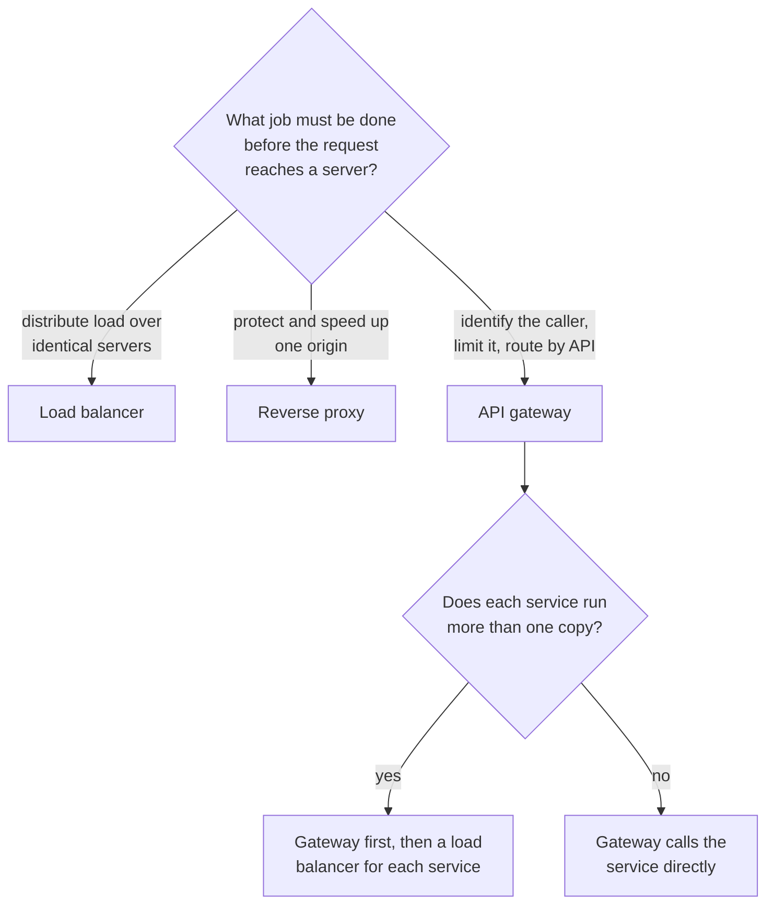

# API gateway vs load balancer vs reverse proxy

> Three parts that receive a request before your servers do: choose by the job each one performs, not by the product name.

All three accept a client's request and pass it to a server, which is why they are often confused. The short answer is that a load balancer distributes requests across identical copies of one service. A reverse proxy protects and speeds up one origin, which is the server that holds the real content. An API gateway manages a public API that many services implement: it identifies the caller, limits the caller, and routes each call. The deciding question is this: what job must be done before the request reaches a server? (The [load balancing](../patterns/load-balancing.md), [proxies](../patterns/proxies.md) and [API gateway](../patterns/api-gateway.md) pattern pages explain how each one works.)

## Quick comparison

| Dimension | Load balancer | Reverse proxy | API gateway |
|-----------|---------------|---------------|-------------|
| Main job | Distribute requests over identical servers | Stand between clients and one origin | Manage one public API over many services |
| Works at | Layer 4 (TCP, UDP) or layer 7 (HTTP) | Usually layer 7 | Layer 7 |
| Knows about | Server health and load | URLs, headers, stored responses | Callers, API keys, routes, quotas |
| Typical features | Health checks, balancing algorithms, failover | TLS termination, caching, compression | Authentication, rate limiting, routing, request rewriting |
| Servers behind it | Many copies of one service | One origin, or a few | Many different services |
| Work per request | Least, when it works at layer 4 | More: it reads each HTTP request | Most: several checks on every call |
| Main risk | Sends traffic to a server that only looks healthy | Serves a stale stored response | Collects business logic that belongs in services |

## How to choose

Start from the job, and expect to pick more than one part:

1. **You run several copies of the same server.** Use a load balancer. It checks which copies are healthy and sends each request to one of them. The [L4 vs L7 sheet](l4-vs-l7-load-balancing.md) covers which kind to pick.
2. **You have one origin to protect.** Use a reverse proxy. It ends TLS (the encryption between client and server), stores common responses, compresses them, and hides the origin's address.
3. **You publish an API that many services implement.** Use an API gateway. It verifies the caller's token once, applies [rate limits](../patterns/rate-limiting.md) for each caller, and routes `/orders` and `/users` to different services.
4. **You need two or three of these jobs.** Combine the parts. A common design puts a load balancer first, several gateway copies behind it, and one more load balancer for each service.

## Why the three overlap

The three names describe jobs, not three different kinds of software. A reverse proxy is any server that accepts requests on behalf of other servers. A layer 7 load balancer is a reverse proxy that chooses among copies. An API gateway is a reverse proxy that also applies API rules. For this reason, one product such as NGINX, HAProxy or Envoy can perform all three jobs, depending on its configuration.

The jobs still differ in what they must know, and that knowledge sets the cost. A layer 4 load balancer reads only an address and a port, so it adds almost no delay. A reverse proxy reads the HTTP request, so it must first decrypt any request that arrives over TLS. A gateway reads the request, verifies a token, looks up a quota, and selects a route. Each check adds a little time, usually a few milliseconds in total when no check needs a slow remote call.

The gateway also becomes a shared dependency. Every API call passes through it, so one failed gateway stops every service at once. The fix is standard: run at least two stateless gateway copies behind a load balancer. Stateless means a copy keeps no data between requests, so any copy can handle any call. Counters for rate limiting then live in a shared store such as [Redis](redis-vs-memcached.md).

## What interviewers probe

- **Is the gateway a single point of failure?** A single point of failure is a part whose loss stops the whole system. The gateway is not one if several stateless copies run in at least two zones behind a load balancer that is itself redundant.
- **Where does TLS end?** It usually ends at the first layer 7 part, because that part must read the request. Traffic to the services is then encrypted again when the internal network is not trusted.
- **Why not put authentication in every service?** Each team would repeat the same code and make different mistakes. The gateway verifies the token once and passes the caller's identity along. Each service still checks whether that caller may access the specific record.
- **What does not belong in the gateway?** Business logic. A gateway that joins data or applies pricing rules must change with every feature, and every team then waits for one deployment.
- **Do calls between internal services use the gateway?** Usually not. Internal calls go directly to the target service's load balancer, which avoids one extra network step and keeps public rules separate from internal ones.

## How to talk about it in an interview

A weak answer is "I will add a load balancer and an API gateway." It names two products and gives no job to either. A strong answer assigns the jobs: "Clients reach a layer 4 load balancer, which distributes connections over three gateway copies. The gateway ends TLS, verifies the token, applies 100 requests per minute for each API key, and routes by path. Each service has its own layer 7 load balancer, because each service runs several copies. Static files skip the gateway and come from a [CDN](../patterns/cdn.md)."

## Go deeper

- Related pages: [API gateway](../patterns/api-gateway.md), [load balancing](../patterns/load-balancing.md), [proxies](../patterns/proxies.md), [L4 vs L7 load balancing](l4-vs-l7-load-balancing.md), [design an API gateway](../questions/design-api-gateway.md), [design a rate limiter](../questions/design-rate-limiter.md)
- The same comparison as a free lesson: [Load Balancer vs. API Gateway](https://www.designgurus.io/course-play/grokking-the-system-design-interview/doc/load-balancer-vs-api-gateway?utm_source=github&utm_medium=repo&utm_campaign=grokking-system-design&utm_content=cheat-sheets-api-gateway-vs-load-balancer-vs-reverse-proxy) in [Grokking the System Design Interview](https://www.designgurus.io/course/grokking-the-system-design-interview?utm_source=github&utm_medium=repo&utm_campaign=grokking-system-design&utm_content=cheat-sheets-api-gateway-vs-load-balancer-vs-reverse-proxy).
- Practice questions on gateways and service discovery: [Microservices Interview Questions](https://github.com/design-gurus/microservices-interview-questions/blob/main/questions/api-gateway-and-service-discovery.md), a free companion guide
