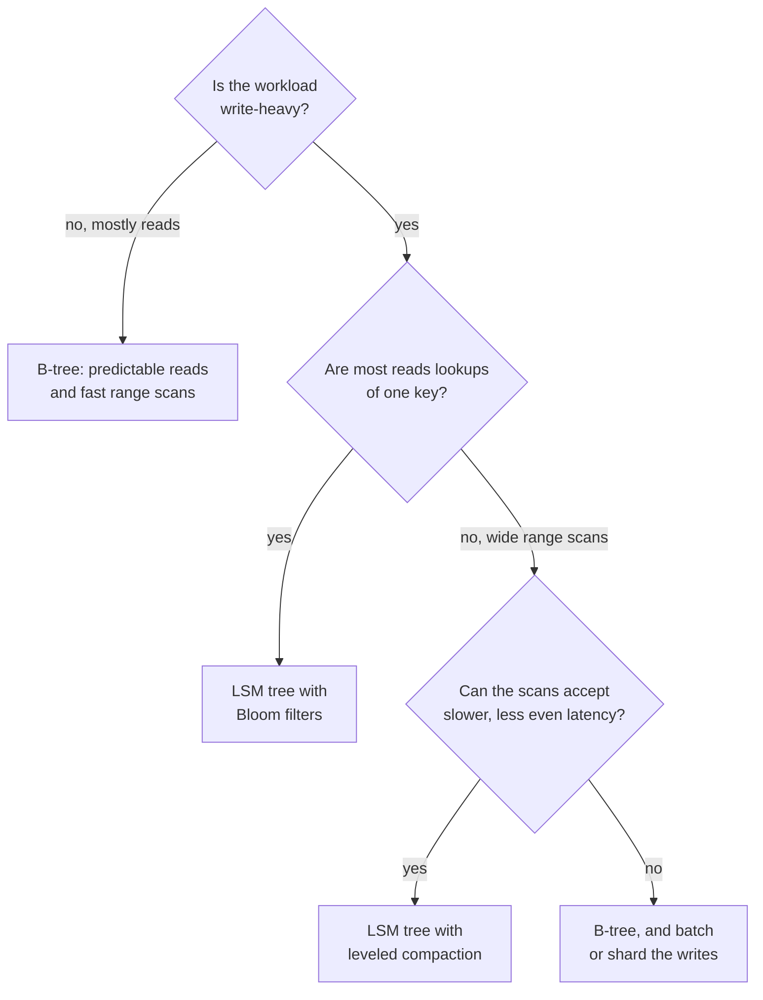

# B-tree vs LSM tree

> The two storage engine designs behind most databases: decide by whether the workload mostly reads or mostly writes.

A storage engine is the part of a database that writes data to disk and finds it again. Most engines use one of two designs. A B-tree keeps data in a sorted tree of fixed-size pages and changes those pages in place. An LSM tree (log-structured merge tree) collects writes in memory, saves them as sorted files that never change, and merges those files later. The short answer is that a B-tree favors reads and an LSM tree favors writes. The deciding question is whether the workload is read-heavy or write-heavy.

## Quick comparison

| Dimension | B-tree | LSM tree |
|-----------|--------|----------|
| Write path | Change a page in place, at a random disk position | Add to memory and to a log, in sequential order |
| Read path | One lookup down the tree, about 3 or 4 pages | Memory first, then several files |
| Write throughput | Lower | Higher |
| Read of one key | Fast and predictable | Slower: may check several files |
| Range scan | Fast: neighboring keys share pages | Must merge results from several files |
| Disk space | Pages are partly empty | Compresses well, but old versions wait for cleanup |
| Background work | Little | Compaction uses disk and CPU |
| Delete | Remove or mark the entry in its page | Write a marker, remove the data later |
| Used by | PostgreSQL, MySQL (InnoDB), SQLite, SQL Server | Cassandra, HBase, Bigtable, RocksDB, LevelDB |

## How to choose

Start from the write rate, then check what the reads look like:

1. **Mostly reads, or many range scans and transactions.** Choose a B-tree engine, because each key lives in exactly one place and a lookup costs the same small number of page reads every time. This is the default for relational databases and their [indexes](../patterns/database-indexing.md).
2. **Mostly writes, with reads by key.** Choose an LSM engine. Logs, metrics, and events fit this pattern.
3. **Heavy writes and heavy scans together.** Measure before choosing. An LSM tree with leveled compaction (explained below) limits the read cost. A B-tree with batched or [sharded](../patterns/sharding-partitioning.md) writes can also meet the target.

## The three amplifications, and compaction

Engines are compared by three ratios. Each is called an amplification because it measures the extra work or space that one operation causes.

**Write amplification** is the bytes written to disk divided by the bytes the application wrote. A B-tree that changes a 100-byte row must later write the whole page, commonly 4 KB to 16 KB, and it also records the change in a [write-ahead log](../patterns/write-ahead-log.md). Each page sits at a different disk position, so the page writes are random. An LSM tree first adds the write to a log and to a sorted table in memory called the memtable. When the memtable is full, the engine saves it as a sorted file called an SSTable. All of that I/O is sequential, which is why the write rate is high.

**Compaction** is the deferred cost of the LSM tree. It is a background job that merges SSTables, keeps the newest version of each key, and discards the rest. Each record is therefore rewritten several times during its life, often 10 times or more with leveled compaction. Two strategies exist. Size-tiered compaction merges files of similar size, which writes less but leaves more files to read. Leveled compaction keeps files in levels with no overlapping keys inside a level, which writes more but limits each read to about one file for each level.

**Read amplification** is the number of disk reads for one query. A B-tree needs one page for each tree level. An LSM tree may need to check every file that could hold the key. A [Bloom filter](../patterns/bloom-filters.md) removes most of this cost for lookups of one key. It is a small bit array for each file that answers "certainly not here" or "possibly here". With about 10 bits for each key, it gives a false "possibly here" about 1 percent of the time, so most files are skipped without a disk read.

**Space amplification** is the disk size divided by the size of the live data. B-tree pages are often about two thirds full after many inserts in random key order. An LSM tree holds old versions and delete markers until compaction removes them. Size-tiered compaction can need up to twice the data size while a large merge runs.

## What interviewers probe

- **What does a Bloom filter not help with?** Range scans. The filter answers a question about one exact key, so a scan across many keys must still open every file that overlaps the range.
- **How does an LSM tree delete a row?** It writes a marker called a tombstone, and because older files still hold the row, the space returns only after compaction.
- **What happens when writes arrive faster than compaction can merge?** Files accumulate, each read checks more of them, and disk use rises. The engine then slows or pauses new writes, which is called a write stall.
- **Why do both designs keep a write-ahead log?** Both hold recent changes in memory first. The log is a sequential file written before the change is confirmed, so a crash loses no confirmed write.

## How to talk about it in an interview

A weak answer is "I will use Cassandra because it is fast for writes." It names a product and not the reason. A strong answer names the engine and its cost: "This service takes 50,000 sensor writes per second and reads by device id. That is write-heavy with reads by key, so I want an LSM engine. Bloom filters keep those reads fast. I will plan disk and CPU for compaction, and I will watch for write stalls at peak."

## Go deeper

- Related pages: [database indexing](../patterns/database-indexing.md), [Bloom filters](../patterns/bloom-filters.md), [write-ahead log](../patterns/write-ahead-log.md), [Cassandra deep dive](../deep-dives/cassandra-wide-column-db.md), [Bigtable deep dive](../deep-dives/bigtable-wide-column-store.md), [Postgres vs DynamoDB vs Cassandra](postgres-vs-dynamodb-vs-cassandra.md)
- This comparison is the lesson "B-Tree vs. LSM Tree" in [Grokking System Design Fundamentals](https://www.designgurus.io/course/grokking-system-design-fundamentals?utm_source=github&utm_medium=repo&utm_campaign=grokking-system-design&utm_content=cheat-sheets-b-tree-vs-lsm-tree).
- Full course: [Grokking the System Design Interview](https://www.designgurus.io/course/grokking-the-system-design-interview?utm_source=github&utm_medium=repo&utm_campaign=grokking-system-design&utm_content=cheat-sheets-b-tree-vs-lsm-tree)
