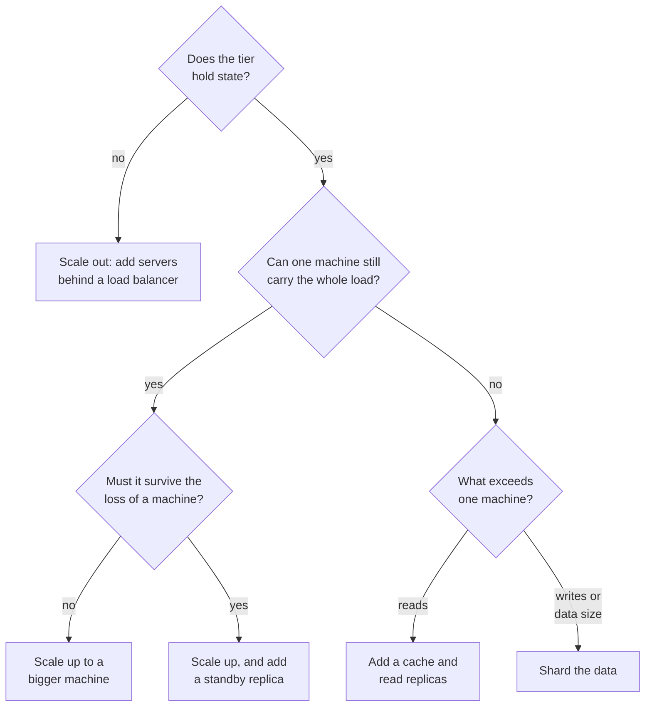

# Horizontal vs vertical scaling

> A bigger machine or more machines: decide by whether the tier holds state and by how much downtime the product allows.

Vertical scaling, also called scaling up, replaces a machine with a larger one that has more CPU, memory, or disk. Horizontal scaling, also called scaling out, adds more machines and divides the work among them. The short answer is to scale out any tier that holds no state, and to scale up a database until one machine is no longer enough. A tier is a group of servers that do the same job, such as the web tier or the database tier. Two questions decide the choice: does this tier hold state, and what availability target must it meet?

## Quick comparison

| Dimension | Vertical (scale up) | Horizontal (scale out) |
|-----------|---------------------|------------------------|
| What changes | One machine gets more CPU, memory, or disk | The tier gets more machines |
| Code changes | Usually none | Servers must be stateless, or the data must be divided |
| Upper limit | The largest machine you can rent | Very high for stateless tiers |
| Availability | One machine is a single point of failure | The tier survives the loss of a machine |
| Cost | Rises faster than capacity for the largest machines | Close to linear, plus coordination work |
| Resizing | Usually a restart and a short outage | Add or remove machines while serving traffic |
| Added parts | None | Load balancer, replication, later sharding |
| Best fit | Databases early, and small systems | Web and application tiers, and very large data |

## How to choose

Start from state, because state is what makes adding machines hard:

1. **Stateless tier.** Scale out. A stateless server keeps no user data between requests, so any server can answer any request. Put the servers behind a [load balancer](../patterns/load-balancing.md) and run at least two.
2. **Stateful tier that one machine can still hold.** Scale up first, because a single database keeps transactions and joins simple. Add a standby replica, which is a copy that takes over when the primary fails, if the tier must survive the loss of a machine.
3. **Too many reads.** Add a [cache](../patterns/caching.md), then read replicas. A read replica is a copy of the database that answers queries but accepts no writes.
4. **Too many writes, or too much data.** Shard. Sharding divides the rows across several databases by a key, so each database holds one part of the data.

## The order a sensible design scales in

Each step below costs more engineering work than the one before it, so take them in order and stop when the numbers are met.

**Step 1: scale up.** Moving from 8 CPU cores to 32 takes minutes and changes no code. The largest machines cost more for each unit of capacity, and one machine is still a single point of failure, which is a part whose loss stops the whole system.

**Step 2: make the application tier stateless, then scale it out.** Move sessions out of server memory into a shared store such as [Redis](redis-vs-memcached.md). After that, capacity is a count: if one server handles 1,000 requests per second, six servers handle close to 6,000 while the database keeps up. This step also removes the single point of failure in this tier. A target of 99.99 percent allows about 53 minutes of downtime in a year, and one long hardware repair can use all of it.

**Step 3: reduce and distribute the reads.** Most products read far more than they write. A cache answers repeated reads from memory, and read replicas take the remaining queries. The cost is [replication](../patterns/replication.md) lag, which is the delay before a replica receives a new write.

**Step 4: shard the writes.** Replicas do not help writes, because every write still goes to the one primary database. When the primary is already the largest machine available, sharding is the only step here that adds write capacity, and it is also the most expensive one. A query that needs rows from several shards becomes slow, a transaction across shards needs a coordination protocol, and moving data to a new shard is slow and needs careful planning. The [sharding pattern](../patterns/sharding-partitioning.md) and the [sharding strategies sheet](sharding-strategies.md) cover the choice of key.

## What interviewers probe

- **What makes a server stateless?** It stores nothing that the next request needs. Sessions, uploaded files, and counters live in a shared store, so the load balancer can send a request to any server.
- **How do you handle replication lag?** Read from the primary for a few seconds after a user's own write. Other users can read from replicas, because a short delay does not affect them.
- **Why not shard from the start?** Sharding commits you to one key before you know the access pattern. One large database with replicas serves many products for years, and it keeps joins and transactions.
- **Does capacity double when you double the servers?** Not fully. The servers still share a database, a cache, and a network. The shared part becomes the limit.
- **What triggers autoscaling?** Autoscaling adds and removes servers by a rule. Use a measured signal such as CPU above 60 percent or queue length. A new server takes a minute or more to start, so keep spare capacity for sudden load.

## How to talk about it in an interview

A weak answer is "We will scale horizontally to handle the load." It does not say which tier, or what happens to the data. A strong answer goes tier by tier: "The API servers are stateless, so I run six behind a load balancer and add more by CPU. The database starts as one large primary with a standby for failover. Reads are 100 times the writes, so I add a cache and two read replicas. I shard by user id only if writes pass what one primary can take."

## Go deeper

- Related pages: [load balancing](../patterns/load-balancing.md), [replication](../patterns/replication.md), [sharding and partitioning](../patterns/sharding-partitioning.md), [consistent hashing](../patterns/consistent-hashing.md), [sharding strategies](sharding-strategies.md), [SQL vs NoSQL](sql-vs-nosql.md)
- The same trade-off as a free lesson: [Horizontal vs Vertical Scaling](https://www.designgurus.io/course-play/grokking-the-system-design-interview/doc/horizontal-vs-vertical-scaling?utm_source=github&utm_medium=repo&utm_campaign=grokking-system-design&utm_content=cheat-sheets-horizontal-vs-vertical-scaling) in [Grokking the System Design Interview](https://www.designgurus.io/course/grokking-the-system-design-interview?utm_source=github&utm_medium=repo&utm_campaign=grokking-system-design&utm_content=cheat-sheets-horizontal-vs-vertical-scaling).
