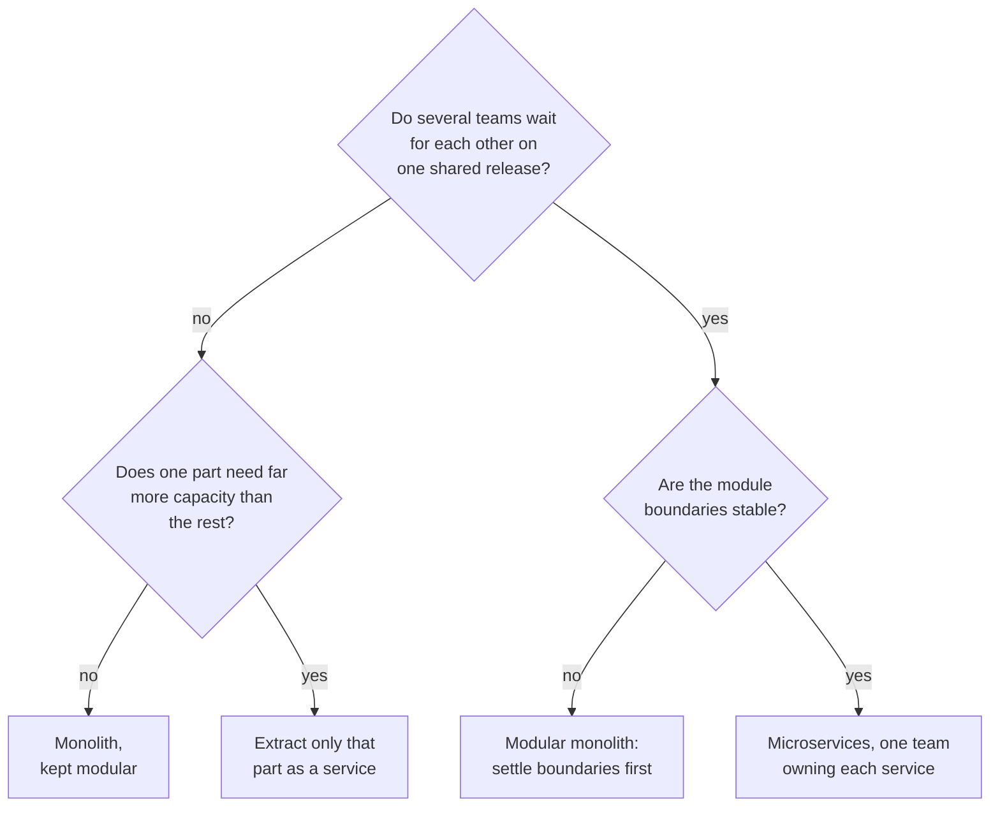

# Monolith vs microservices

> One deployable program or many small ones: decide by how many teams you have and whether any part must scale or deploy alone.

A monolith is one program that contains every feature and is deployed as one unit. Microservices are many small programs, each owning one business capability and its own data, that call each other over the network. The short answer is to start with a monolith and keep its modules cleanly separated. Move a part into its own service only when a specific need appears. The deciding question has two halves: how many teams change this code, and does any part need to scale or deploy independently of the rest?

## Quick comparison

| Dimension | Monolith | Modular monolith | Microservices |
|-----------|----------|------------------|---------------|
| Deployable units | One | One | Many, one for each service |
| Module boundaries | Kept by habit | Enforced in the code | Enforced by the network |
| Calls between parts | Function call in one process | Function call through a public interface | Network call (HTTP, gRPC, or a queue) |
| Data | One shared database | One database, tables owned by one module each | One database for each service |
| Transactions | One local transaction | One local transaction | Saga or outbox, with eventual consistency |
| Scaling | Run more copies of the whole program | Run more copies of the whole program | Scale each service alone |
| Releases | All teams share one | All teams share one | Each team releases alone |
| Operations | One pipeline, one log | One pipeline, one log | Service discovery, tracing, many pipelines |
| Fits | One to a few teams | Several teams, one product | Many teams, or parts with very different load |

## How to choose

Start from the teams, then look at load:

1. **One team, or a few, and even load.** Use a monolith. It gives you one codebase, one deployment, and one database transaction for each request.
2. **Several teams, and boundaries that still change.** Use a modular monolith, which is a monolith whose modules can call each other only through declared interfaces. Moving a boundary is then a code change and not a data migration between services.
3. **One part with a very different load.** Extract that part only. A video encoder that needs 50 machines should not force 50 copies of the checkout code.
4. **Many teams with stable boundaries.** Use microservices. Each team can then release many times a day without waiting for the others.

## What a network call costs

The table says "network call", and most of the cost of microservices comes from those two words.

**Speed and failure.** A function call inside one process takes nanoseconds and cannot be lost on the way. A call between two services in one data center takes about half a millisecond before any work starts, and it can fail or time out. Every such call therefore needs a timeout, a retry, and an [idempotent](../patterns/idempotency.md) receiver, which is one that gives the same result when a request arrives twice. It also needs a [circuit breaker](../patterns/circuit-breaker.md), which is a guard that stops calls to a service that keeps failing.

**Availability.** A request that needs five services in a row, each available 99.9 percent of the time, succeeds only about 99.5 percent of the time. A monolith has one program to keep available, although one bad release then affects every feature.

**Transactions.** In a monolith, one database transaction can charge a card and create an order together, or do neither. With one database for each service, that guarantee is gone. The usual replacement is a saga: a sequence of local transactions in which each step has an undo action, called a compensation. The data is then eventually consistent, which means the services agree after a short delay and not at every instant. The [distributed transactions](../patterns/distributed-transactions.md) and [outbox](../patterns/outbox-pattern.md) pages cover the details.

**Operations.** Twenty services mean twenty build pipelines, twenty dashboards, and logs in twenty places. You need service discovery, which is a registry that tells one service where another is running. You also need distributed tracing, which gives each request one id that every service records.

## What interviewers probe

- **How do you keep data consistent across services?** Use a saga with a compensation for each step, publish events through an outbox table, and make every consumer idempotent.
- **How do you find the service boundaries?** Split by business capability and by data ownership. A typical feature change should modify one service, and if it usually modifies three, the boundary is wrong.
- **What is a distributed monolith?** It is a set of services that must be deployed together or that share one database. It has the costs of both designs and the independence of neither.
- **How do you move from a monolith to services?** Extract one module at a time. An [API gateway](../patterns/api-gateway.md) routes the extracted paths to the new service, and the remaining paths still reach the monolith.
- **How do services talk to each other?** Use a direct call when the caller needs the answer now. Use a [message queue](../patterns/message-queues.md) when the work can finish later, so a slow consumer does not delay the caller.

## How to talk about it in an interview

A weak answer is "I will use microservices because they scale." It ignores the cost and gives no reason tied to this system. A strong answer names the need and the cost: "I will start with one modular service, because the order and payment steps share a transaction. The notification sender has ten times the traffic and can fail without losing an order, so I extract it behind a queue. If the team grows to several groups, the module interfaces are where I would split next."

## Go deeper

- Related pages: [distributed transactions](../patterns/distributed-transactions.md), [outbox pattern](../patterns/outbox-pattern.md), [circuit breaker](../patterns/circuit-breaker.md), [message queues](../patterns/message-queues.md), [REST vs gRPC vs GraphQL](rest-vs-grpc-vs-graphql.md), [design a payment system](../questions/design-payment-system.md)
- Full course: [Grokking the System Design Interview](https://www.designgurus.io/course/grokking-the-system-design-interview?utm_source=github&utm_medium=repo&utm_campaign=grokking-system-design&utm_content=cheat-sheets-monolith-vs-microservices)
- The patterns microservices depend on: [System Design Patterns](https://www.designgurus.io/course/system-design-patterns?utm_source=github&utm_medium=repo&utm_campaign=grokking-system-design&utm_content=cheat-sheets-monolith-vs-microservices)
- Practice questions with model answers: [Microservices Interview Questions](https://github.com/design-gurus/microservices-interview-questions), a free companion guide
