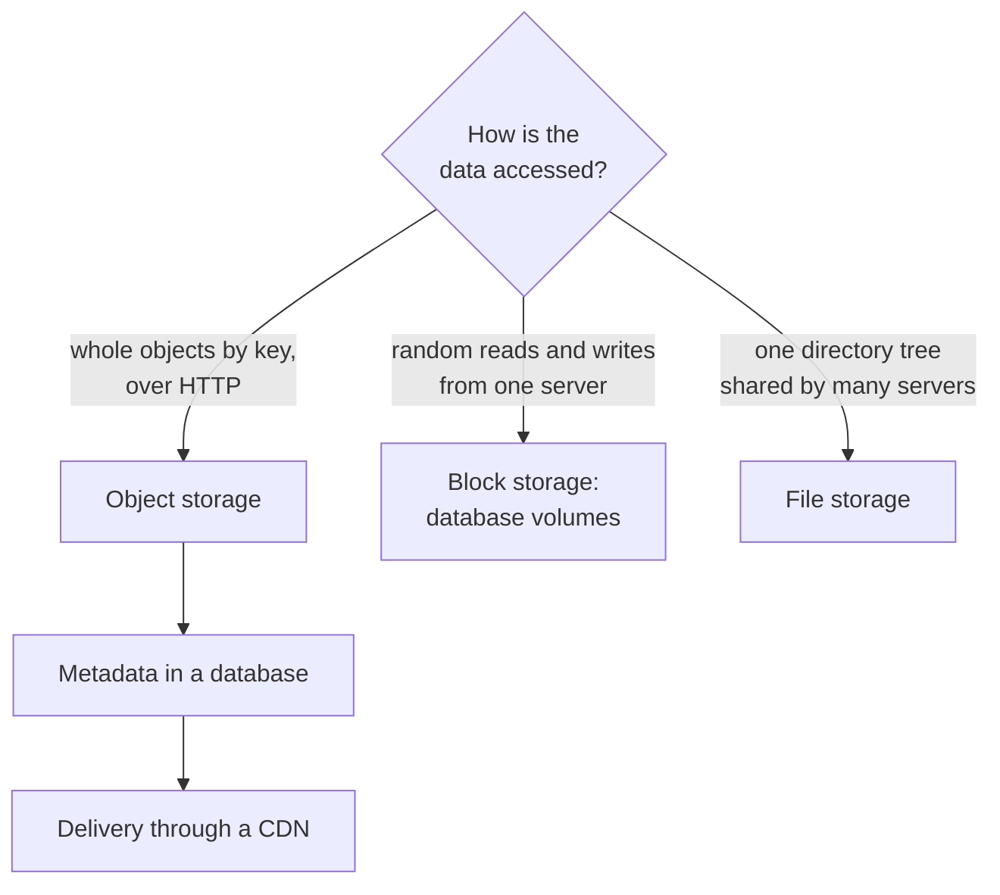

# Object vs block vs file storage

> Three storage models: decide by how the data is accessed, as whole objects over HTTP, as a raw volume for a database, or as a shared directory tree.

A design that stores photos, videos or documents must name where the bytes are kept. Object storage keeps each item as a whole object under a key and serves it over HTTP. Block storage gives one server a raw volume, which behaves like a local disk. File storage gives many servers one shared directory tree. The short answer for user content is object storage, and block storage is the answer for the disk under a database. The deciding question is how the data is accessed.

## Quick comparison

| Dimension | Object | Block | File |
|-----------|--------|-------|------|
| Unit | A whole object under a key | Fixed-size blocks on a volume | Files in directories |
| Access | HTTP API: PUT, GET, DELETE | Attached to one server as a disk | Mounted by many servers, for example over NFS |
| Change part of the data | No: replace the whole object | Yes: any block | Yes: any byte range |
| Time to first byte | Tens of milliseconds | About 1 ms or less | A few milliseconds |
| Metadata | Your own key-value pairs per object | None: the file system above adds it | Name, size, owner, permissions |
| Relative cost per GB | Lowest | Several times object storage | Usually the highest |
| Typical use | Images, video, backups, logs | Database files, boot disks | Shared files for older applications |

## How to choose

Start from the access pattern, not from a product name:

1. Photos, videos, attachments, backups and logs: use object storage. Each item is written once and read whole.
2. A database or any software that changes small parts of large files: use block storage. A database rewrites single pages of about 8 KB, and a busy one does so thousands of times per second.
3. Several servers that must see the same directory through ordinary file calls: use file storage.
4. A system design answer for user content usually combines three parts. The blobs go in object storage, the metadata goes in a database, and a [CDN](../patterns/cdn.md) delivers the bytes. A blob is a large piece of binary data, such as an image or a video file.

## How object storage stays durable and cheap

Object storage is the cheapest of the three because it accepts two limits. An object cannot be changed in place, and every request has the overhead of an HTTP call. Because of those limits, the service can spread data across thousands of ordinary machines and protect it in one of two ways.

**[Replication](../patterns/replication.md)** stores full copies, usually 3, on machines in different locations. It uses 3 GB of disk for every 1 GB of data and survives the loss of any 2 copies.

**Erasure coding** splits an object into data fragments and adds computed parity fragments. A common layout is 6 data fragments plus 3 parity fragments, and any 6 of the 9 can rebuild the object. This layout uses 1.5 GB of disk per 1 GB of data and survives the loss of any 3 fragments. The cost is extra CPU work and slower repair, so small or frequently read objects are often replicated instead.

Both methods depend on [checksums](../patterns/checksums.md). A background process reads every fragment, compares its checksum, and rebuilds any fragment that has become corrupt.

An object store also separates metadata from data, as [design Amazon S3](../questions/design-amazon-s3.md) explains. A metadata service maps each key to the machines that hold its fragments, and this mapping is often the hardest part to scale. The namespace is flat, so a "folder" is only a shared key prefix. Renaming a folder of 1 million objects therefore means copying 1 million objects.

## What interviewers probe

- **Why not store the images in the database?** Large values increase the size of backups and replication traffic, and they occupy memory that the database needs for rows and indexes. Store the object key, size and owner in the database, and store the bytes in object storage.
- **How does a client upload a 5 GB video?** The server issues pre-signed URLs, one for each part of the file. A pre-signed URL carries a signature and an expiry time, and it permits one specific request. The client sends the parts directly to object storage, and retries only the parts that failed. See [design Dropbox](../questions/design-dropbox.md) and [design YouTube](../questions/design-youtube.md).
- **Why can a transactional database not run directly on object storage?** It cannot change 8 KB inside an object, so every small write would replace a whole object.
- **Is durability the same as availability?** No. Durability is the probability that stored data is not lost. Availability is the fraction of time that a request succeeds.
- **How do you reduce the cost of old data?** Move objects that nobody has read for 30 days or more to a colder storage class. The price per GB is lower, and each read costs more or takes longer.

## How to talk about it in an interview

A weak answer is "I will store the videos in the database, or in S3." It gives no reason. A strong answer is "Videos are written once and read whole, so they go in object storage. The client uploads in parts through pre-signed URLs, so my application servers never handle the file. A metadata table holds the object key, owner, size and status. A CDN serves playback from a location near each viewer. The database itself runs on block storage, because it rewrites small pages many times per second."

## Go deeper

- Related pages: [design Amazon S3](../questions/design-amazon-s3.md), [design Dropbox](../questions/design-dropbox.md), the [CDN pattern](../patterns/cdn.md), and the [GFS](../deep-dives/gfs-distributed-file-system.md) and [HDFS](../deep-dives/hdfs-file-storage.md) deep dives
- Full course: [Grokking the System Design Interview](https://www.designgurus.io/course/grokking-the-system-design-interview?utm_source=github&utm_medium=repo&utm_campaign=grokking-system-design&utm_content=cheat-sheets-object-vs-block-vs-file-storage)
- A two-week version with a "Design Amazon S3" lesson: [System Design Interview Crash Course](https://www.designgurus.io/course/system-design-interview-crash-course?utm_source=github&utm_medium=repo&utm_campaign=grokking-system-design&utm_content=cheat-sheets-object-vs-block-vs-file-storage)
