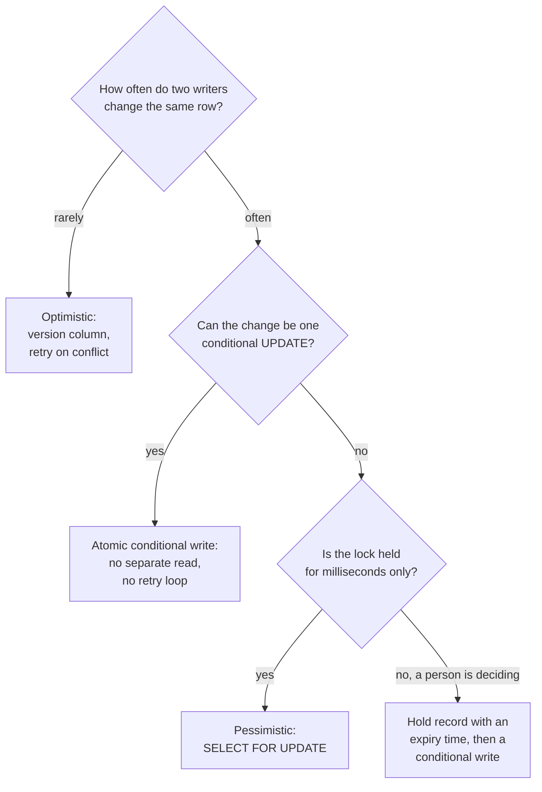

# Optimistic vs pessimistic locking

> Two ways to stop concurrent writers from overwriting each other: decide by how often two writers change the same row at the same time.

Two requests read the same row, both compute a new value, and both write it. The second write replaces the first without any error, which is called a lost update. Pessimistic locking prevents this by locking the row when it reads it, so the second writer waits. Optimistic locking takes no lock: each writer checks at write time that the row has not changed, and retries if it has. The deciding question is how often two writers change the same row at the same time. Optimistic locking suits rare conflicts, and pessimistic locking suits common ones.

## Quick comparison

| Dimension | Optimistic | Pessimistic |
|-----------|------------|-------------|
| When a conflict is found | At write time | At read time: the second writer waits |
| Mechanism | Version column plus compare-and-set | `SELECT ... FOR UPDATE` row lock |
| Cost with no conflict | One extra condition in the `UPDATE` | A lock held for the whole transaction |
| Cost with a conflict | The rejected writer repeats all its work | The second writer waits, then works once |
| Deadlocks | Rare: a lock is held only while the write runs | Possible when transactions lock rows in different orders |
| A person is deciding between read and write | Works | Does not work: a lock cannot wait for a person |
| Typical fit | Profile edits, documents, shopping carts | Account balances, seat assignment, the last unit of stock |

## How to choose

Start from the conflict rate, then check how long the lock would be held:



1. Conflicts are rare, for example two edits of one user profile: use optimistic locking.
2. Conflicts are common, and the change fits in one statement: use an atomic conditional write. `UPDATE stock SET qty = qty - 1 WHERE id = 7 AND qty >= 1` either changes one row or changes none.
3. Conflicts are common, and the transaction must read several rows before it writes: use pessimistic locking, and keep the transaction short.
4. A person takes minutes between choosing and paying: write a hold record with an expiry time. A database lock must never stay open while a person fills in a form.

## What a conflict costs

Optimistic locking adds a version column, which is a number that increases by 1 on every write. The writer reads the row and its version, then writes with a compare-and-set. A compare-and-set is a write that succeeds only if a value still equals what the writer read earlier.

```sql
UPDATE seats SET status = 'BOOKED', version = version + 1
WHERE id = 42 AND version = 5;
-- 0 rows changed means another writer was first.
```

When the statement changes 0 rows, the application reads the row again and repeats its work. Suppose 100 requests increment the same counter at the same time. If every request reads before any request writes, only one write succeeds per round. The worst case is 100 + 99 + 98 and so on, or about 5,000 attempts for 100 successes.

Pessimistic locking replaces repeated work with waiting.

```sql
BEGIN;
SELECT balance FROM accounts WHERE id = 42 FOR UPDATE;
UPDATE accounts SET balance = balance - 30 WHERE id = 42;
COMMIT;
```

The row stays locked from the `SELECT` until the `COMMIT`. Each of the 100 writers does its work once, but they run one after another. A lock held for 5 ms therefore limits that one row to about 200 writes per second.

Row locks also make deadlocks possible. A deadlock occurs when transaction 1 holds row A and waits for row B, while transaction 2 holds row B and waits for row A. The database detects the cycle and aborts one transaction, which the application must then retry. Three habits prevent most deadlocks: lock rows in one fixed order (for example, ascending ID), keep transactions short, and set a lock timeout.

## What interviewers probe

- **How do you stop two users from booking one seat?** Use a hold record with an expiry time of about 10 minutes, written with a conditional write so that only one user succeeds. See [design Ticketmaster](../questions/design-ticketmaster.md) and [design a hotel reservation system](../questions/design-hotel-reservation.md).
- **How do you avoid selling more stock than you have?** Decrement with one conditional `UPDATE` that includes `qty >= 1`. For a sale with thousands of buyers per second, see [design a flash sale system](../questions/design-flash-sale-system.md).
- **How do you move money between two accounts?** Lock both account rows in ascending ID order inside one transaction. Add an [idempotency](../patterns/idempotency.md) key, so that a retried request does not move the money twice. See [design a payment system](../questions/design-payment-system.md).
- **What if an optimistic retry keeps failing?** Limit the writer to about 3 attempts with a short random delay between them, then return an error.
- **What if the data is in two databases?** A row lock cannot cover both. Use a [distributed transaction](../patterns/distributed-transactions.md), or a [distributed lock](../patterns/distributed-locking.md) that both writers must acquire first, and compare [two-phase commit with sagas](two-phase-commit-vs-saga.md).

## How to talk about it in an interview

A weak answer is "I will add a lock so that two users cannot book the same seat." It names no mechanism. A strong answer is "Many users compete for the same seat, so I expect frequent conflicts. Selecting a seat writes a hold row with a 10 minute expiry, using a conditional write that only one user can complete. Payment then confirms the hold in one short transaction. Profile edits are different: conflicts are rare there, so a version column with one retry is enough."

## Go deeper

- Related pages: [distributed locking](../patterns/distributed-locking.md), [idempotency](../patterns/idempotency.md), and [strong vs eventual consistency](strong-vs-eventual-consistency.md)
- Full course: [Grokking the System Design Interview](https://www.designgurus.io/course/grokking-the-system-design-interview?utm_source=github&utm_medium=repo&utm_campaign=grokking-system-design&utm_content=cheat-sheets-optimistic-vs-pessimistic-locking)
- Consistency patterns in depth: [System Design Patterns](https://www.designgurus.io/course/system-design-patterns?utm_source=github&utm_medium=repo&utm_campaign=grokking-system-design&utm_content=cheat-sheets-optimistic-vs-pessimistic-locking)
