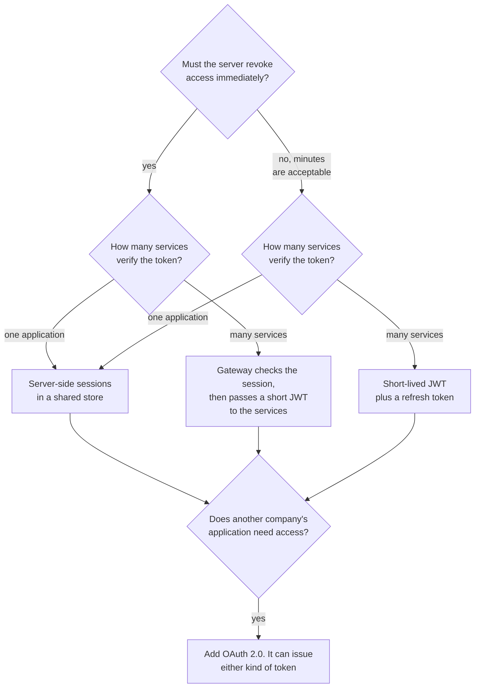

# Sessions vs JWT vs OAuth

> Sessions and JWTs are two ways to carry a logged-in identity, and OAuth is a protocol that can issue either: decide by how fast access must be revoked and by how many services verify the token.

These three are not alternatives of the same kind. A server-side session stores the login on the server and gives the browser a random ID. A JSON Web Token (JWT) is a signed token that contains the user ID and an expiry time, so a service can verify it without a lookup. OAuth 2.0 is a protocol for delegated access: a user lets one application reach their data in another, without sharing a password. OAuth issues access tokens, and those tokens can be random IDs or JWTs. The real choice is therefore between sessions and JWTs. Two questions decide it: must the server revoke access immediately, and how many services verify the token?

## Quick comparison

| Dimension | Server-side session | JWT | OAuth 2.0 |
|-----------|---------------------|-----|-----------|
| Server state | A session store, such as [Redis](redis-vs-memcached.md) | None, only the signing keys | Grants and refresh tokens |
| Verification | One lookup per request | A signature check, no network call | Depends on the token type issued |
| Revocation | Immediate: delete the record | At expiry, unless you add a deny list | Revoke the grant and its refresh token |
| Typical lifetime | Hours to weeks | 5 to 15 minutes | Short access token, long refresh token |
| Browser storage | `HttpOnly` cookie | `HttpOnly` cookie or memory | Decided by the client application |
| Typical fit | One web application | Many services, one identity | Access by another company's application |

## How to choose

Start from revocation, then count the services that verify the token:

1. One web application with its own users: use server-side sessions in both cases. Logout and account suspension take effect on the next request.
2. Many services that must each confirm the caller, and a delay of minutes before revocation is acceptable: use JWTs with a lifetime of 5 to 15 minutes.
3. Many services and immediate revocation: check a session at the [API gateway](../patterns/api-gateway.md), and pass a short-lived JWT to the internal services.
4. A third-party application needs limited access, or users sign in with an external account: add OAuth 2.0. OpenID Connect is a layer on OAuth that adds login, because OAuth alone covers only authorization.

## Why a JWT is hard to revoke

A service verifies a JWT by checking its signature and its expiry time. It contacts no other system, which is called stateless verification. The cost follows directly: after the token is signed, the server has no record to delete. A stolen token, or the token of a suspended user, remains valid until it expires.

Three techniques reduce that period:

- **Short lifetimes with refresh tokens.** The access token lasts about 15 minutes. A refresh token is a long-lived credential that the client exchanges for a new access token. The server stores refresh tokens, so it can revoke one, and access then ends within 15 minutes.
- **Refresh token rotation.** Every exchange returns a new refresh token and invalidates the old one. If an invalidated token is presented again, the server treats it as stolen and revokes every token from that login.
- **A deny list.** The server stores the IDs of revoked tokens until they expire, and every service checks the list. This restores a lookup per request, although the list is far smaller than a session store.

Storage in the browser has its own trade-off. Any script on the page can read `localStorage`, so one cross-site scripting (XSS) flaw exposes the token. XSS is an attack in which a hostile script runs inside your page. A cookie marked `HttpOnly` cannot be read by scripts, but the browser attaches it to every request automatically. That behavior permits cross-site request forgery (CSRF), in which another site causes the browser to send a request with the user's cookie. The `SameSite` cookie attribute and a CSRF token together prevent most of these requests.

## What interviewers probe

- **A user selects "log out of all devices". How fast does it take effect?** With sessions, delete the user's records, and the next request fails. With JWTs, revoke the refresh tokens and wait up to one access token lifetime, or check a deny list.
- **Does the session store limit scale?** Rarely. A lookup in an in-memory store takes under 1 ms, and 10 million sessions of 1 KB each need about 10 GB.
- **How do many services verify one token safely?** Sign with a private key that only the login service holds, and publish the public key. Services can then verify tokens, but they cannot create them.
- **What belongs inside a JWT?** A user ID, an expiry time, and a few roles. The payload is signed but not encrypted, so anyone who holds the token can read it.

## How to talk about it in an interview

A weak answer is "I will use JWT for authentication because it is stateless and scales better." It ignores revocation, and it treats one store lookup as a scaling problem. A strong answer is "The web application uses a session cookie that is `HttpOnly`, with the session in a replicated in-memory store, because support staff must suspend an account immediately. The gateway checks the session and passes a 5 minute JWT to the 12 internal services, so they verify the caller without a lookup. Partner applications get access through OAuth 2.0 with limited scopes."

## Go deeper

- Related pages: [design an API gateway](../questions/design-api-gateway.md), the [API gateway pattern](../patterns/api-gateway.md), and [Redis vs Memcached](redis-vs-memcached.md)
- This comparison is close to the lesson "OAuth vs. JWT for Authentication" in [Grokking System Design Fundamentals](https://www.designgurus.io/course/grokking-system-design-fundamentals?utm_source=github&utm_medium=repo&utm_campaign=grokking-system-design&utm_content=cheat-sheets-sessions-vs-jwt-vs-oauth).
- Full course: [Grokking the System Design Interview](https://www.designgurus.io/course/grokking-the-system-design-interview?utm_source=github&utm_medium=repo&utm_campaign=grokking-system-design&utm_content=cheat-sheets-sessions-vs-jwt-vs-oauth)
