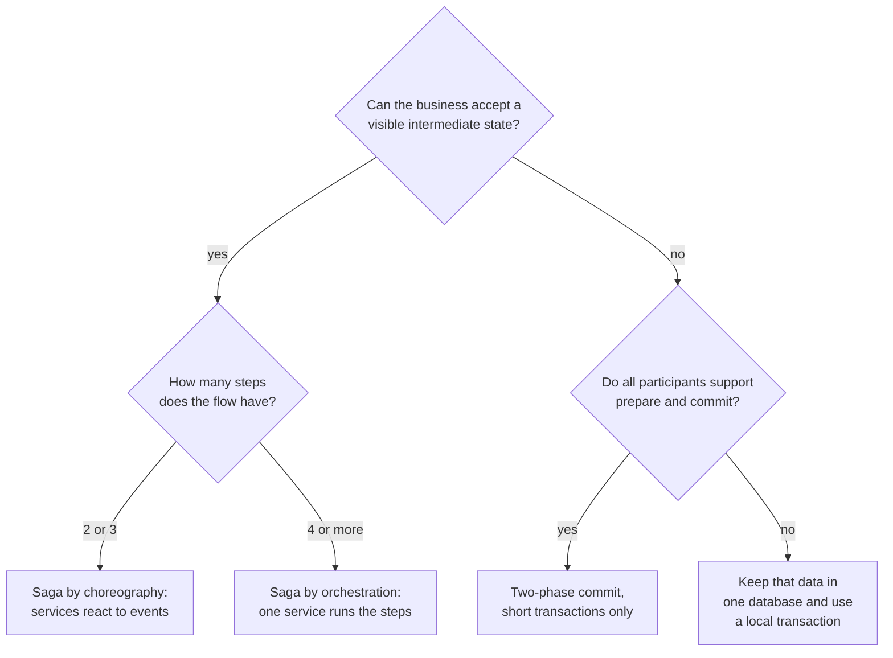

# Two-phase commit vs saga

> Two ways to change data in several services as one operation: decide by whether the business can accept a visible intermediate state.

Placing an order requires three changes in three services: reserve the stock, charge the card, and create the shipment. Each service owns its database, so one local transaction cannot cover all three. Two-phase commit (2PC) makes every participant commit or abort together, so no participant keeps half of the order. A saga runs one local transaction per service, in sequence, and reverses the earlier steps if a later step fails. The short answer is a saga for most flows between services, and 2PC only where a half-finished state is unacceptable. The deciding question is whether the business can accept a state that other users can see while the operation is partly complete.

## Quick comparison

| Dimension | Two-phase commit | Saga |
|-----------|------------------|------|
| Guarantee | All participants commit, or none do | All steps complete, or the completed steps are reversed |
| Intermediate state | Hidden: changed rows stay locked until the decision | Visible until the last step or the last reversal |
| Locks | Held in every participant across both phases | Held only inside each local transaction |
| Coordinator crash | Participants that voted yes block and keep their locks | An orchestrator resumes from its saved state, and no locks are held |
| Undo | Automatic rollback | Compensating actions that you write |
| What participants need | Support for prepare and commit | A local transaction and an API or an event |
| Typical fit | Shards of one distributed database | Orders, bookings and payments across services |

## How to choose

Start from the intermediate state, then count the steps:

1. An order may show as "pending" for a few seconds: use a saga.
2. The flow has 2 or 3 steps: choreography is enough. In choreography, each service publishes an event when it finishes, and the next service reacts to that event.
3. The flow has 4 or more steps, or steps with branches: use orchestration. In orchestration, one service calls each step in order and records the progress.
4. No reader may ever see a partial result, and every participant supports the protocol: use 2PC, and keep each transaction to milliseconds.

## Coordinator blocking and compensating actions

Two-phase commit uses a coordinator, which is the process that asks the participants to vote and then announces the decision. In phase 1, each participant writes its changes to disk, keeps its locks, and votes yes or no. In phase 2, the coordinator records the decision and tells every participant to commit or abort.

The weakness is the time between the two phases. A participant that voted yes can no longer commit or abort by itself. If the coordinator crashes at that moment, every participant keeps its locks until the coordinator recovers, and every request for those rows waits. Availability also drops, because all participants must be reachable at the same time. Three services at 99.9 percent each give about 99.7 percent for the whole operation.

A saga holds no locks between steps, and it needs compensating actions instead. A compensating action is a new transaction that reverses the business effect of a step that has already committed. A refund compensates a charge, and releasing stock compensates a reservation. The earlier step still happened, so the customer may see both the charge and the refund. Some steps cannot be reversed, such as sending an email or shipping a package, so those steps are placed after every step that can fail.

Two supporting patterns make a saga reliable:

- **[Idempotency](../patterns/idempotency.md).** Messages between services can arrive more than once. Every step and every compensating action must therefore be idempotent, which means that running it twice has the same effect as running it once.
- **[The outbox pattern](../patterns/outbox-pattern.md).** A service must update its database and publish an event. A crash between those two writes loses the event. The outbox pattern writes the event to a table in the same local transaction, and a separate process publishes the rows from that table.

## What interviewers probe

- **What if a compensating action fails?** Retry it until it succeeds, which is safe because it is idempotent. After a fixed number of attempts, such as 10, alert a person. A compensating action must never be rejected for a business reason.
- **How do you stop users from acting on a half-finished order?** Store a status such as `PENDING` on the record. Other operations refuse to ship or cancel an order until the saga sets it to `CONFIRMED` or `FAILED`.
- **Orchestration or choreography?** Choreography has no central service, but the flow is spread across many event handlers. Orchestration keeps the whole flow in one place, and adds one service that must stay available.
- **Is 2PC ever the right answer?** Yes, inside distributed databases such as [Spanner](../deep-dives/spanner-global-sql.md) that commit across shards. Each participant there, including the coordinator, is a group of replicas that agree through a consensus protocol such as Paxos or [Raft](../deep-dives/raft-consensus.md). One failed machine therefore does not block the others.

## How to talk about it in an interview

A weak answer is "I will use a distributed transaction across the order, payment and inventory services." It does not say which kind, or what happens when a step fails. A strong answer is "These three services own separate databases, and an order can stay pending for a few seconds, so I will use a saga with an orchestrator. The steps are reserve stock, charge the card, and create the shipment. If the charge fails, the orchestrator releases the stock. Every step takes an idempotency key, and each service publishes its events through an outbox table."

## Go deeper

- Related pages: [distributed transactions](../patterns/distributed-transactions.md), [the outbox pattern](../patterns/outbox-pattern.md), and [design a payment system](../questions/design-payment-system.md)
- Distributed consistency in depth: [System Design Patterns](https://www.designgurus.io/course/system-design-patterns?utm_source=github&utm_medium=repo&utm_campaign=grokking-system-design&utm_content=cheat-sheets-two-phase-commit-vs-saga)
- Full course: [Grokking the System Design Interview](https://www.designgurus.io/course/grokking-the-system-design-interview?utm_source=github&utm_medium=repo&utm_campaign=grokking-system-design&utm_content=cheat-sheets-two-phase-commit-vs-saga)
