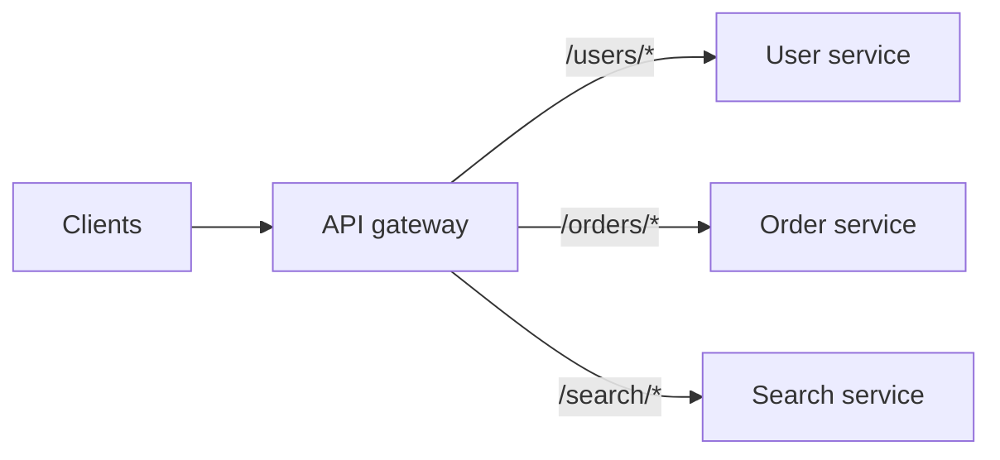
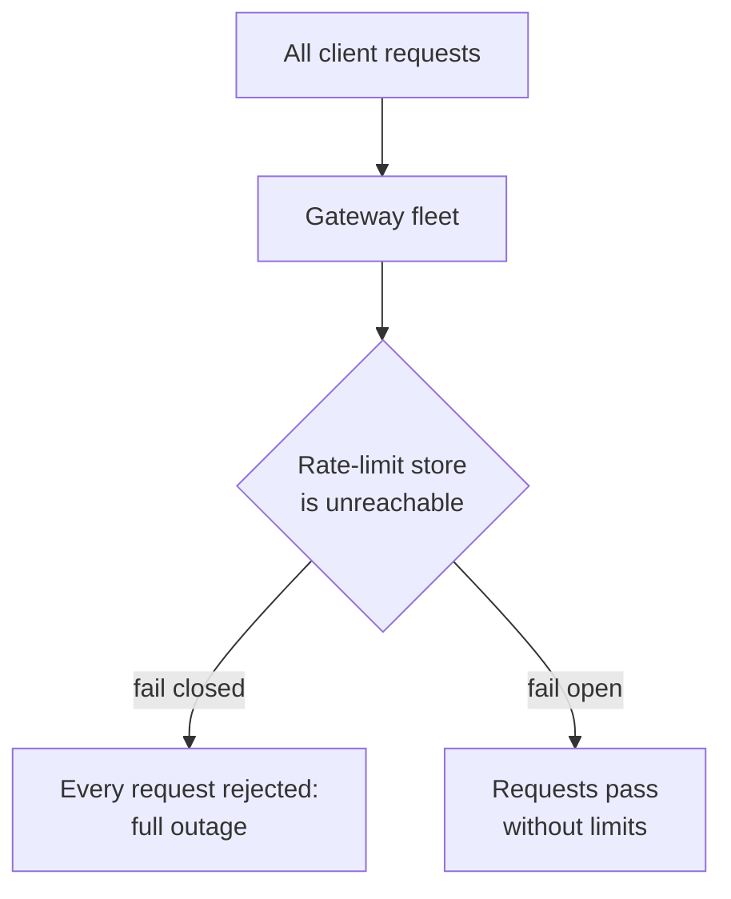

# API gateway

> A single entry point in front of your services that handles auth, rate limiting, routing, and other cross-cutting concerns once.

## What it is

An API gateway is a specialized reverse proxy (see [proxies](proxies.md)) that all client traffic passes through before reaching backend services. Instead of every microservice re-implementing authentication, rate limiting, and logging, the gateway does it once at the edge and forwards clean, authorized requests inward.

A concern is called cross-cutting when every service needs it but none of them is about it. Authentication, rate limiting, logging, and TLS are the usual examples. The gateway exists to hold those, and only those.

## When to use it

- A microservices system where clients would otherwise call many services directly.
- Public APIs that need keys, quotas, and versioning.
- Several client types, such as web and mobile, that need different shapes of the same data.
- When you want one place to see and control all incoming traffic.

A system with one or two services rarely needs a gateway. A load balancer and a shared auth library cover it, with one less component to run. The gateway earns its place when the number of services, client types, or API consumers grows.

## What it handles

- **Authentication and authorization**: validate tokens, reject bad requests before they touch a service.
- **Rate limiting and quotas**: per user, key, or IP (see [rate limiting](rate-limiting.md)).
- **Routing**: map paths and versions to services; canary and blue-green traffic splits.
- **Protocol translation**: HTTP/JSON outside, gRPC inside; WebSocket termination.
- **Aggregation**: fan out one client call to several services and merge the responses (backend-for-frontend).
- **Observability**: one shared point for logging, metrics, and tracing headers.

## Gateway vs load balancer

A load balancer distributes identical traffic across copies of one service and works at L4/L7 with little application knowledge. A gateway is application-aware: it routes by path and identity, enforces API policy, and transforms requests. Many deployments use both: DNS to load balancer, load balancer to gateway fleet, gateway to services.

## The gateway is on every request's path

This is the idea that separates a strong answer. Whatever the gateway costs, every request pays it, and whatever the gateway depends on, every request depends on.

**Availability multiplies.** Two components in series are only as available as the product of their availabilities. A gateway at 99.9% in front of a service at 99.9% gives about 99.8% end to end. The gateway's own target must therefore be higher than any service behind it.

**Every call it makes is multiplied by total traffic.** Work the authentication choice out loud. Assume 20,000 requests per second.

| Approach | Extra work per second | Cost |
|----------|-----------------------|------|
| Ask an auth service about each token | 20,000 network calls | About a round trip per request, and the auth service becomes critical |
| Verify a signed token locally | 0 network calls | A revoked token stays valid until it expires |

A signed token, such as a JWT, carries its own claims and a signature. The gateway checks the signature with a public key it has cached, so no call is needed. The price is revocation. If a token lives 15 minutes, a user you block can keep access for up to 15 minutes. That is the gateway's equivalent of a staleness budget: state it. Short-lived tokens with refresh tokens, or a small revocation list pushed to every gateway node, shorten it.

**Fan-out raises tail latency.** Suppose an aggregation call queries five services, and each one is independently slower than 100 milliseconds on 1% of calls. The client call is slow whenever any of the five is slow. That happens on 1 - 0.99^5, or about 4.9%, of client calls. Aggregation is convenient, but it turns each service's rare slow call into a common one.

## The failure mode to name: a gateway dependency fails

The gateway itself is usually a stateless fleet that scales well. The danger is what it calls. A rate-limit store or an auth service that goes down can take every API down with it:

Decide this per dependency, before it happens. A common answer is to fail open for rate limiting, because a few minutes without limits is cheaper than an outage. Authentication fails closed, because letting unverified requests through is a security failure. Put a short timeout on every gateway dependency, so a slow store does not hold every request.

## Trade-offs

| Pro | Con |
|-----|-----|
| Cross-cutting concerns implemented once | Extra hop of latency on every request |
| Services stay small and focused | Every request passes through it, so it must be replicated and scaled itself |
| Clients see one stable surface while services evolve | Easy to overload with logic until it becomes a monolith at the edge |

## The hard parts

- **Keeping it thin.** Business rules in the gateway, such as "orders over a limit need approval", couple every team to one shared deploy. Policy belongs in the gateway. Business logic belongs in services.
- **Ownership.** Many teams need routing changes, so the gateway needs self-service configuration and gradual rollout, or it becomes a queue of requests to one team.
- **Versioning.** The gateway is a natural place to route `/v1` and `/v2` to different services. It cannot remove the work of keeping old clients working, so keep the number of live versions small.
- **Long-lived connections.** If the gateway terminates WebSockets, each node holds many open connections, and a deploy disconnects them. Plan for draining.

## What to say in an interview

A complete answer names five things, in this order:

1. **Where it sits.** Behind a load balancer, in front of the services.
2. **What it owns.** Two or three concrete concerns, such as auth, rate limiting, and routing.
3. **How auth works.** Local token checks or a remote call, and how long a revoked token lasts.
4. **How it scales.** A stateless fleet across zones, behind a load balancer.
5. **What happens when it or a dependency fails.** Which dependencies fail open and which fail closed.

Point 5 is the one interviewers push on. If the gateway is down, nothing works, so its availability story must be stronger than any service behind it.

## Related pages

- The full question, end to end: [design an API gateway](../questions/design-api-gateway.md).
- The policy it most often enforces: [rate limiting](rate-limiting.md).
- Protecting the gateway from slow services: [circuit breaker](circuit-breaker.md).
- The same idea for model traffic: [design an LLM gateway](../questions/design-llm-gateway.md).

## Go deeper

- Full question walkthrough: [Design an API gateway](../questions/design-api-gateway.md)
- Every pattern, in depth: [System Design Patterns](https://www.designgurus.io/course/system-design-patterns?utm_source=github&utm_medium=repo&utm_campaign=grokking-system-design&utm_content=patterns-api-gateway)
- Full course: [Grokking the System Design Interview](https://www.designgurus.io/course/grokking-the-system-design-interview?utm_source=github&utm_medium=repo&utm_campaign=grokking-system-design&utm_content=patterns-api-gateway)
