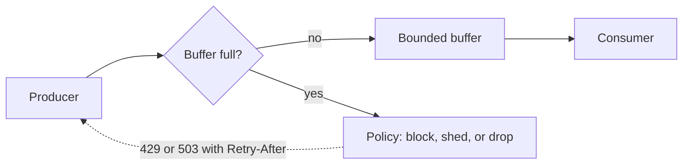
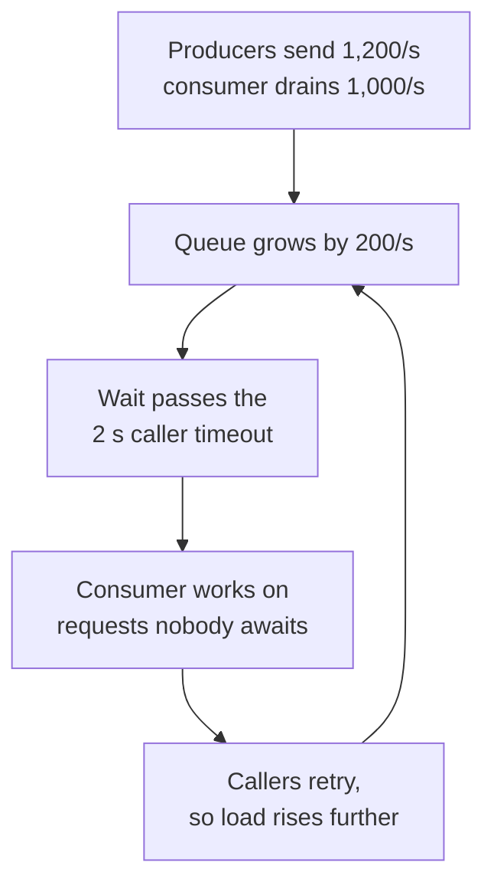

# Backpressure

> When a system cannot keep up, it must push back on its callers instead of buffering until it dies.

## What it is

Overload starts when producers send work faster than a consumer can process it. Without a plan, the excess piles up in queues and memory. Latency grows, then the process runs out of memory and dies, and the failure spreads to everything upstream. Backpressure is the set of mechanisms that surface a "slow down" signal to the source of the work.

The core rule: every buffer must be bounded, and every bounded buffer needs a policy for what happens when it fills. An unbounded queue does not remove overload. It hides overload until it is fatal.

## When to use it

- Any queue or buffer that sits between a producer and a consumer.
- Services that accept requests faster than a downstream dependency can serve them.
- Ingest pipelines for logs, metrics, and events, where bursts are normal.
- Any system whose traffic peaks can exceed its capacity, which is most systems.

## Think in waiting time, not queue length

This is the idea that separates a strong answer from a weak one. A queue length means nothing alone. What matters is how long a new item waits, and that is the queue length divided by the rate at which the consumer drains it.

Work it out loud. A consumer processes 1,000 items per second. Producers send 1,200 items per second. The extra 200 items per second pile up:

| Time overloaded | Items waiting | Wait for a new item |
|-----------------|---------------|---------------------|
| 1 minute | 12,000 | 12 seconds |
| 10 minutes | 120,000 | 2 minutes |
| 1 hour | 720,000 | 12 minutes |

Now assume each caller gives up after 2 seconds. The wait reaches 2 seconds once 2,000 items are queued, which takes only 10 seconds of overload. From that point on, every item the consumer processes belongs to a caller who already left. The consumer runs at full speed and does no useful work. Useful completed work is often called goodput, and here it has fallen to zero while throughput looks normal.

This gives the sizing rule. Derive the bound from the latency budget, not from available memory. If items may wait at most 500 milliseconds and the consumer drains 1,000 per second, the queue should hold about 500 items. A queue that holds more only stores work that will arrive too late to matter.

## When the buffer fills

- **Block the producer.** The producer waits until space opens. This is the natural behavior in pull systems, where the consumer takes work only when it is ready.
- **Shed load.** Reject new work with an explicit error: HTTP 429 (too many requests) or 503 (service unavailable), plus a Retry-After header so callers know when to retry. [Rate limiting](rate-limiting.md) is the preemptive form of this: it sheds load before any buffer fills.
- **Drop data.** Discard some items. This is fine for telemetry and metrics, where fresh data is worth more than complete data. Say which drop policy you use: drop the oldest items or drop the newest.

## How it works

Pull beats push. In pull-based consumption, like a consumer reading from a [message queue](message-queues.md), backpressure is automatic: the consumer takes only what it can handle, and the backlog (consumer lag) grows where you can see it. In push-based chains, where one service calls another directly, you need explicit signals: a timeout on every call, bounded connection pools, and a [circuit breaker](circuit-breaker.md) for when a dependency stops keeping up.

TCP already does this for a single connection. The receiver advertises how much buffer space it has left, and the sender stops when that window reaches zero. Backpressure in a system design applies the same idea across services.

## The failure mode to name: overload that does not end

The dangerous case is not the spike itself. It is the loop that keeps the system overloaded after the spike ends:

Retries add new load on top of the original traffic, so the queue can keep growing even after the original traffic returns to normal. The system can then stay overloaded until load is shed by hand. The fixes break the loop at different points:

- **Bound and shed early**, so the wait never passes the caller's timeout.
- **Drop expired work.** Record when each item arrived, and skip any item older than the caller's timeout instead of processing it.
- **Limit retries** with backoff, jitter, and a retry budget, such as retries no greater than 10% of normal requests.
- **Serve the newest first under overload.** Some systems switch the queue to last-in, first-out when it is long, so recent requests still finish inside their timeout.

## Trade-offs

| Pro | Con |
|-----|-----|
| Bounded buffer plus shedding gives predictable latency and memory | Some work is rejected under load, and callers must handle that |
| Overload becomes visible early, as lag and rejection counts | Picking bounds and policies takes real capacity thinking |
| Expired work is never processed, so capacity goes to live requests | Callers need retry logic that respects Retry-After |

## The hard parts

- **Where to shed.** Reject at the edge, before any work is done. Rejecting at the last service in a chain wastes all the work done upstream.
- **What to shed.** Shed the lowest priority first. A background sync can wait; a checkout request should not.
- **Propagation.** In a chain A to B to C, the signal from C must reach A. If B buffers instead, B becomes the next unbounded queue.
- **Autoscale on the right signal.** Scale consumers on queue depth or consumer lag, not CPU. Consumers blocked on a slow downstream dependency look idle on CPU while the queue keeps growing. Adding consumers often takes minutes, so it cannot replace shedding during a sudden spike.
- **Watch three numbers.** Queue depth, consumer lag, and time-in-queue. Alert on the trend (lag rising for ten minutes), not only on a fixed threshold.

## What to say in an interview

"What happens when the consumer falls behind?" is a common follow-up question. A complete answer names five things, in this order:

1. **The bound.** The queue holds at most N items, where N is the drain rate times the wait budget.
2. **The policy when full.** Block, shed with 429 and Retry-After, or drop the oldest telemetry.
3. **Where and what you shed.** At the edge, lowest priority first.
4. **Deadlines.** Items older than the caller's timeout are dropped unprocessed.
5. **The metric.** Alert on the lag trend, and scale consumers on lag.

Many candidates say only "we add a queue" and stop. The number of items, and the reason for that number, is what shows you understand the queue.

## Related pages

- Shedding load before any buffer fills: [rate limiting](rate-limiting.md).
- Failing fast when a dependency is slow: [circuit breaker](circuit-breaker.md).
- Building the queue yourself: [Design a Distributed Message Queue](../questions/design-distributed-message-queue.md).
- How much backpressure each queue gives you for free: [Kafka vs RabbitMQ vs SQS](../cheat-sheets/kafka-vs-rabbitmq-vs-sqs.md).

## Go deeper

- Every pattern, in depth: [System Design Patterns](https://www.designgurus.io/course/system-design-patterns?utm_source=github&utm_medium=repo&utm_campaign=grokking-system-design&utm_content=patterns-backpressure)
- Full course: [Grokking the System Design Interview](https://www.designgurus.io/course/grokking-the-system-design-interview?utm_source=github&utm_medium=repo&utm_campaign=grokking-system-design&utm_content=patterns-backpressure)
