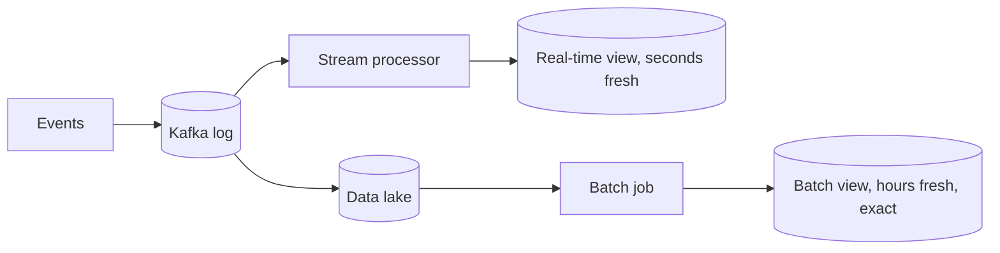
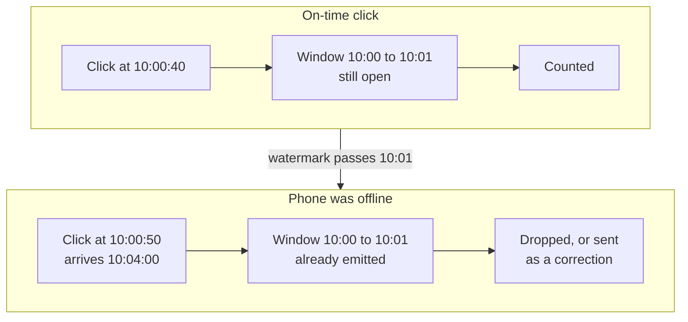

# Batch vs stream processing

> Two ways to compute over large data: process accumulated data on a schedule, or process each event as it arrives.

## What it is

- **Batch processing** runs a job over a large, bounded dataset on a schedule: nightly reports, model training, rebuilding a search index. High throughput, results delayed by hours. Tools: Spark, MapReduce, SQL warehouses.
- **Stream processing** consumes an unbounded flow of events and updates results within seconds: live dashboards, fraud detection, trending topics. Tools: Flink, Spark Streaming, Kafka Streams, usually fed by a [message queue](message-queues.md) or log like [Kafka](../deep-dives/kafka-distributed-messaging.md).

A bounded dataset has a known end, so a batch job can read all of it before it answers. An unbounded stream never ends, so a stream job must decide when it has seen "enough" to emit a result. That one difference explains almost every hard part of streaming.

## When to use it

Use batch when results can be hours old and must be exact: billing, payroll, financial reports, training data, and rebuilding derived tables after a bug. Use streaming when the value of the answer falls quickly with time: blocking a fraudulent card before the purchase completes, alerting on errors, or showing what is trending now. When a question needs both, build both paths, as in the diagram above.

## How to choose

| Question | Batch | Stream |
|----------|-------|--------|
| How fresh must results be? | Hours are fine | Seconds to minutes |
| Accuracy requirements | Exact, easy to recompute | Approximations often acceptable |
| Complexity budget | Lower: reruns are cheap, bugs are re-runnable | Higher: state, ordering, late events, exactly-once |
| Typical examples | Billing, reports, ML training, reindexing | Fraud checks, live metrics, notifications, trending |

Many real systems combine both, as in the diagram above: a streaming path for freshness and a batch path that periodically recomputes the exact answer and corrects any streaming drift. This is the lambda architecture. The kappa architecture keeps only the stream and replays the log when logic changes.

## The mechanism, with numbers

Take an ad click counter that receives 100,000 clicks per second, about 200 bytes each.

**The batch view.** One day is 86,400 seconds, so the nightly job reads 8.64 billion events, about 1.7 TB. That sounds large, but it is a normal job for a cluster that reads in parallel. Its strength is that it sees every event, including ones that arrived late, and a rerun gives the same answer. Its weakness is that today's numbers do not exist until tomorrow.

**The stream view.** The stream job keeps a running count per ad for each one-minute window. A window is a slice of time that groups events for one aggregate. At 100,000 clicks per second, each window covers 6 million events, but the job stores only the counts, not the events. State stays small, and results appear seconds after the minute ends.

The hard question is when "the minute ends". There are two clocks:

- **Event time** is when the click happened, stamped on the device.
- **Processing time** is when the stream job receives it.

They differ because phones lose signal, clients batch their uploads, and brokers fall behind. Correct counts are grouped by event time. But a job that waits for every possible late click would never close a window.

## The failure mode to name: late events and the watermark

A watermark is the stream job's estimate that "all events up to time T have now arrived". When the watermark passes the end of a window, the job emits that window's result. Any click that arrives after that moment is late:

The watermark is a dial between speed and completeness. Set it to wait 10 seconds, and results are fast, but every click that is more than 10 seconds late arrives after its window has closed. Set it to wait 5 minutes, and more clicks are counted, but every dashboard is 5 minutes behind.

There are three honest answers, and a strong candidate picks one deliberately:

- **Drop late events** and accept a small undercount. Fine for a trending list.
- **Allow lateness** for a fixed period, and emit an updated result for the window when a late event arrives. Downstream systems must accept updates, not only inserts.
- **Reconcile with batch.** The stream gives the fast, approximate number. The nightly batch recomputes the exact number from the full log and replaces it. This is the right choice when money depends on the count, as in ad billing.

## Trade-offs

| Pro | Con |
|-----|-----|
| Batch: exact, simple, and cheap to rerun | Batch: results are hours old |
| Batch: high throughput on bulk reads | Batch: a failed job delays the whole result |
| Stream: results within seconds | Stream: late events force a speed-versus-completeness choice |
| Stream: small state for simple aggregates | Stream: state, checkpoints, and replays to operate |
| Both paths: fast and exact | Both paths: the same logic written twice and kept consistent |

## The hard parts to mention in an interview

- **Event time vs processing time.** Group by event time, and say how late events are handled.
- **Windowing.** Tumbling windows are fixed and do not overlap. Sliding windows overlap, such as "the last 5 minutes, updated every minute". Session windows close after a gap in a user's activity.
- **Exactly-once results.** Delivery is still at least once. Correct results come from checkpointed state plus [idempotent](idempotency.md) sinks. A sink is the store that receives the output, and an idempotent sink gives the same result when a write is repeated. Flink takes consistent snapshots of all operator state, and after a failure it restores the last snapshot and rereads the log from the matching offsets.
- **Reprocessing.** When the logic changes, how is history recomputed? Batch reruns the job. Kappa replays the log, so the log must keep enough history.

## What to say in an interview

A complete answer names five things, in this order:

1. **The freshness requirement.** "Trending needs minutes, billing can wait until tomorrow."
2. **The accuracy requirement.** Whether an approximate number is acceptable, and for how long.
3. **The path or paths.** Batch, stream, or both, and which one is the source of truth.
4. **Windows and lateness.** The window type, the watermark, and what happens to late events.
5. **Recovery.** How the job restarts without double counting, and how history is recomputed.

Point 4 is the one interviewers push on. Saying "we use Flink" is not an answer. Saying "one-minute tumbling windows by event time, 30 seconds of allowed lateness, and nightly batch replaces the numbers used for billing" is.

## Related pages

- The stream engine, in depth: [Flink](../deep-dives/flink-stream-processing.md).
- The original batch model: [MapReduce](../deep-dives/mapreduce-batch-processing.md).
- A full question built on both paths: [design an ad click aggregator](../questions/design-ad-click-aggregator.md).
- Making repeated writes safe in the sink: [idempotency](idempotency.md).

## Go deeper

- Full question walkthroughs: [Design an ad click aggregator](../questions/design-ad-click-aggregator.md), [Design a metrics and monitoring system](../questions/design-metrics-monitoring.md)
- Every pattern, in depth: [System Design Patterns](https://www.designgurus.io/course/system-design-patterns?utm_source=github&utm_medium=repo&utm_campaign=grokking-system-design&utm_content=patterns-batch-vs-stream-processing)
- Full course: [Grokking the System Design Interview](https://www.designgurus.io/course/grokking-the-system-design-interview?utm_source=github&utm_medium=repo&utm_campaign=grokking-system-design&utm_content=patterns-batch-vs-stream-processing)
