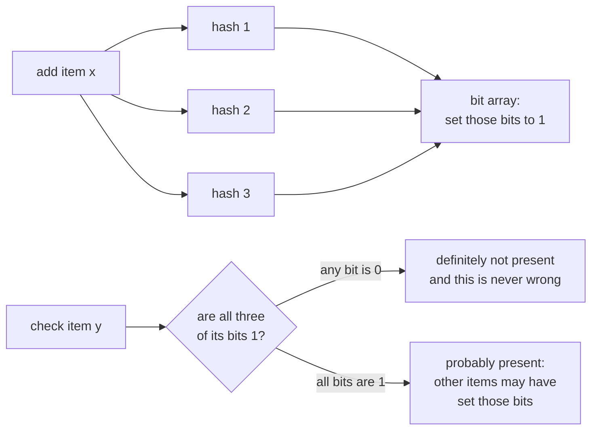
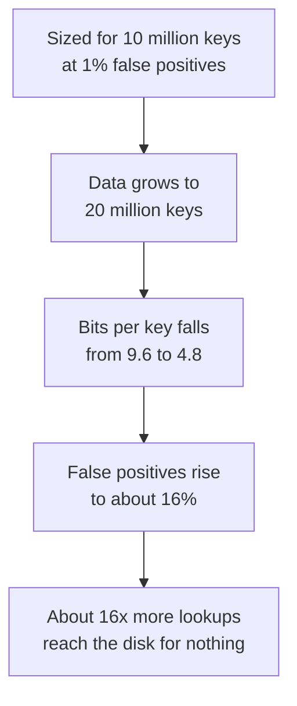

# Bloom filters

> A small, fast structure that tells you an item is "definitely not present" or "possibly present", using very little memory.

## What it is

A Bloom filter is a probabilistic set membership test. Probabilistic here means that one of its two answers is only likely, not certain. It can return false positives (it may say "possibly present" for something that is not there) but never false negatives (if it says "not present", that is certain). In exchange, it uses far less memory than storing the actual set.

The filter never replaces the real store. It sits in front of the store and answers one question cheaply: is this lookup certainly a waste of time?

## When to use it

- Most lookups are for keys that do not exist, and each of those lookups costs a disk read or a network call.
- The set is too large to keep in memory exactly.
- A small rate of wasted lookups is acceptable, because every "possibly present" answer is checked against the real store.
- Not when you need an exact answer with no second check, or when items are deleted often.

## How it works

The asymmetry is the whole point. One answer is certain, the other is a probability:

A bit array plus several hash functions. To add an item, hash it with each function and set those bits to 1. To check an item, hash it the same way. If any of those bits is 0, the item is definitely not in the set. If all are 1, it is probably in the set (those bits could have been set by other items).

## Sizing: think in bits per key

This is the idea that separates a strong answer from a weak one. The memory a Bloom filter needs depends only on how many keys it holds and the false positive rate you accept. It does not depend on how large each key is. A 100-byte URL and an 8-byte ID cost the same.

The standard formulas: for a false positive rate p, the filter needs about 1.44 x log2(1/p) bits per key, and the best number of hash functions is about 0.69 times the bits per key.

| False positive rate | Bits per key | Hash functions |
|---------------------|--------------|----------------|
| 10% | 4.8 | 3 |
| 1% | 9.6 | 7 |
| 0.1% | 14.4 | 10 |
| 0.01% | 19.2 | 13 |

The pattern to remember: each extra 4.8 bits per key cuts the false positive rate by a factor of ten.

Work it out loud. A store holds 100 million keys, and you want a 1% false positive rate. That is 100 million x 9.6 = 960 million bits, or about 120 MB. Storing the same keys as 40-byte strings would take 4 GB before any index overhead. The filter is more than 30 times smaller and fits easily in memory.

## Think in lookups saved

The second question is whether the filter pays for itself. Its value depends on how many lookups are for keys that are absent.

Assume a store receives 10,000 lookups per second for keys it does not hold, and each one would cost a disk read. Without a filter, all 10,000 reach the disk and find nothing. With a 1% filter, about 100 do. If, instead, nearly every lookup is for a key that exists, the filter saves almost nothing. It still costs memory and several hash computations per lookup.

LSM-tree databases are the classic case. An LSM tree, or log-structured merge tree, stores data in many sorted, immutable files. A read for one key may need to check several of those files. Cassandra keeps a Bloom filter for each of its data files, called SSTables, so a read skips every file that cannot contain the key.

## The failure mode to name: the overfilled filter

A Bloom filter is sized for an expected number of keys. When more keys arrive than planned, the false positive rate rises quickly, and nothing reports an error:

The filter cannot grow in place, because the position of each bit depends on the size of the array. There are two standard fixes. Rebuild the filter from the source keys with a larger array, or add a second filter for new keys and check both. Either way, plan the expected count with room to grow, and track how many items have been inserted.

## Deleting items

A basic Bloom filter cannot delete an item, because one bit may be shared by many items. Clearing it could create a false negative, which breaks the one guarantee the filter offers. Three options exist:

- **Counting Bloom filter.** Each bit becomes a small counter, often 4 bits, so deletes are possible. It uses about four times the memory.
- **Cuckoo filter.** A different structure that supports deletes, with similar or lower memory use at low false positive rates. Delete only items that were really inserted.
- **Rebuild.** In an LSM tree each file is immutable, so its filter never needs deletes. It is rebuilt when files are merged.

## Where it is used

- Skip an expensive lookup: check the Bloom filter before hitting disk or a remote store, to avoid work for keys that do not exist (databases like Cassandra use this to avoid disk reads).
- Cache filtering: avoid caching one-hit items.
- Deduplication and "have I seen this before" checks at scale (for example a web crawler avoiding re-crawling URLs).

## Trade-offs

| Pro | Con |
|-----|-----|
| Tiny memory footprint | False positives (tunable, never false negatives) |
| Very fast inserts and lookups | Cannot delete from a basic Bloom filter |
| Great as a pre-check before expensive work | Not a replacement for the real store |

## What to say in an interview

A complete answer names five things, in this order:

1. **The question it answers.** "Is this key certainly absent?", asked before an expensive lookup.
2. **The size.** Expected keys, target false positive rate, bits per key, and total memory.
3. **What a false positive costs.** One wasted lookup, never a wrong answer, because the real store is still checked.
4. **Growth.** What happens when the key count passes the design size, and how the filter is rebuilt.
5. **Deletes.** A counting filter, a cuckoo filter, or a rebuild.

Point 2 is the one that shows real understanding. "About 10 bits per key for 1%" is a short sentence, and it turns the filter into a number you can put in a capacity estimate.

## Related pages

- Avoiding misses for keys that do not exist: [caching](caching.md).
- Filters on every data file in an LSM store: [Cassandra](../deep-dives/cassandra-wide-column-db.md).
- Where Cassandra's storage design comes from: [Bigtable](../deep-dives/bigtable-wide-column-store.md).
- "Have I seen this URL before?" at scale: [Design a web crawler](../questions/design-web-crawler.md).

## Go deeper

- Every pattern, in depth: [System Design Patterns](https://www.designgurus.io/course/system-design-patterns?utm_source=github&utm_medium=repo&utm_campaign=grokking-system-design&utm_content=patterns-bloom-filters)
- For harder, distributed-systems depth: [Advanced System Design Interview, Volume II](https://www.designgurus.io/course/grokking-system-design-interview-ii?utm_source=github&utm_medium=repo&utm_campaign=grokking-system-design&utm_content=patterns-bloom-filters)
- Full course: [Grokking the System Design Interview](https://www.designgurus.io/course/grokking-the-system-design-interview?utm_source=github&utm_medium=repo&utm_campaign=grokking-system-design&utm_content=patterns-bloom-filters)
