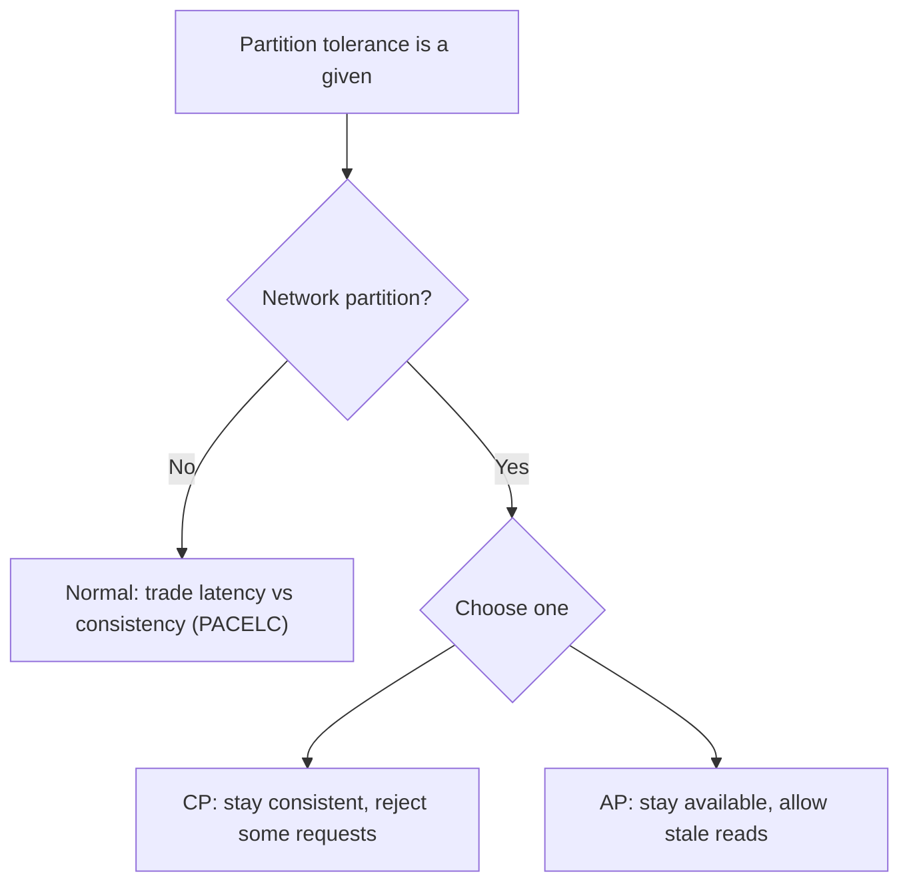
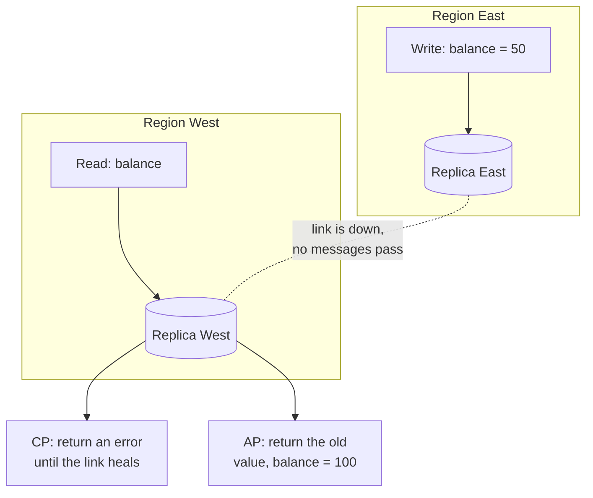

# CAP theorem

> In a distributed system, when a network partition happens, you can keep either consistency or availability, not both.

## What it is

The CAP theorem says a distributed data store can provide at most two of three guarantees. Consistency means every read sees the latest write. Availability means every request gets a non-error response. Partition tolerance means the system keeps working despite dropped messages between nodes. Because network partitions are unavoidable in practice, partition tolerance is a given, so the real choice during a partition is between consistency and availability.

In the theorem, these words are narrower than in everyday use. The consistency it means is the strictest kind: the system behaves as if there were only one copy of the data (this is called linearizability). The availability it means is that every request reaching a working node gets a real answer, not an error. A network partition is a failure where nodes are still running but cannot reach each other.

## When to use it

CAP is not a component you add to a design. It is a way to reason about one decision: what each operation does when replicas cannot reach each other. Reach for it when:

- Data is replicated across machines or regions, and a write must reach more than one copy.
- You choose a database and must explain how it behaves during a failure.
- Some data is costly to get wrong: balances, inventory, seat bookings, unique usernames.
- The design spans several regions, where links between regions can fail.

## The real choice: one write during a partition

Make it concrete. A balance is stored in two regions, and the link between them fails. A user in East changes the balance from 100 to 50. A moment later, another request in West reads the balance.

The West replica has exactly two honest options:

- **Refuse (CP):** return an error, or wait, until it can confirm the latest value. Users in West see failures, but the two copies never disagree.
- **Answer (AP):** return the value it has. Users see success, but the answer is stale. If West also accepts writes, the two sides diverge, and something must merge them later.

There is no third option. A "CA" system is one that never sees a partition, which in practice means a single machine. Once data lives on two machines, the network between them can fail, and the system must do one of the two things above.

## PACELC: the cost you pay every day

CAP only describes behavior during a partition. PACELC extends it: if there is a Partition, choose between Availability and Consistency; Else (normal operation), choose between Latency and Consistency. Most real systems trade some consistency for lower latency even when there is no partition.

This is the half that strong candidates talk about, because it applies to every request. Work it out with the [latency numbers](../cheat-sheets/latency-numbers.md). A write that must be confirmed by a replica on another continent waits at least one cross-continent round trip, about 150 ms. A write to a replica in the same data center waits about 0.5 ms. If one user action makes four sequential writes, that is about 600 ms against about 2 ms.

Partitions are occasional events. That latency cost appears on every write, all day. So the normal-operation choice usually shapes the design more than the partition choice does.

| System | During a partition | Normal operation |
|--------|--------------------|------------------|
| [Dynamo](../deep-dives/dynamo-key-value-store.md), [Cassandra](../deep-dives/cassandra-wide-column-db.md) with default settings | Available | Low latency |
| [Spanner](../deep-dives/spanner-global-sql.md) | Consistent | Consistent, pays the latency |

## Choose per operation, not per database

The idea that separates a strong answer is that one system can make both choices. In a ticketing system, the final seat booking is CP: two users must never buy the same seat, so a replica that cannot confirm the booking refuses it. The event page, the seat map and the reviews are AP: a seat map that is a few seconds old is harmless, because the booking step checks again.

Many stores support this directly. Within one region, DynamoDB lets each read ask for a strongly consistent result or an eventually consistent one. Cassandra lets each query set its own consistency level. So the useful sentence is not "we use a CP database". It is "this operation refuses during a partition, and that one answers with stale data, for these reasons".

## Trade-offs

| | CP | AP |
|---|----|----|
| During a partition | Some requests fail or wait | Every working node answers, some answers are stale |
| After the partition | Nothing to repair | Conflicting writes must be merged |
| Normal-operation latency | Higher: writes wait for other replicas | Lower: write to one nearby replica |
| Good fit | Balances, inventory, bookings, locks | Feeds, carts, counters, presence |

## The hard parts to mention in an interview

- **CP does not mean the whole system is down.** A five-node cluster that uses [majority quorums](quorum.md) and splits into groups of three and two keeps serving on the side of three. Only the minority side refuses.
- **A slow node looks like a partition.** A long garbage collection pause or an overloaded node is indistinguishable from a broken link. Partitions are therefore more common than cut cables suggest.
- **AP needs a merge story.** Last-writer-wins by timestamp silently drops writes. Vector clocks, one kind of [logical clock](logical-clocks.md), detect real conflicts so the system can merge them.

## What to say in an interview

Do not recite "pick two." Instead say which guarantee the system favors during a partition and why, tied to the product. For example: "this is a feed, so I favor availability and accept eventual consistency." A complete answer names five things, in this order:

1. **What is replicated, and where.** The data and the regions.
2. **The partition choice for each piece of data.** Refuse or answer, tied to the cost of a wrong answer.
3. **For the CP parts, which side keeps serving.** Usually the majority, and say what minority users see.
4. **For the AP parts, how the sides reconcile.** Last-writer-wins, a merge rule, or vector clocks.
5. **The normal-operation cost.** The PACELC latency, with a number.

Point 5 is the strong senior signal, because it is the cost the system pays even when nothing is broken.

## Related pages

- Picking the model for each piece of data: [strong vs eventual consistency](../cheat-sheets/strong-vs-eventual-consistency.md).
- The models between the two extremes: [consistency models](consistency-models.md).
- How majority voting lets the larger side keep serving: [quorum](quorum.md).
- A booking system where the CP choice is the core of the design: [design Ticketmaster](../questions/design-ticketmaster.md).

## Go deeper

- Read more (free): [CAP Theorem vs PACELC](https://www.designgurus.io/blog/system-design-interview-basics-cap-vs-pacelc?utm_source=github&utm_medium=repo&utm_campaign=grokking-system-design&utm_content=patterns-cap-theorem)
- Every pattern, in depth: [System Design Patterns](https://www.designgurus.io/course/system-design-patterns?utm_source=github&utm_medium=repo&utm_campaign=grokking-system-design&utm_content=patterns-cap-theorem)
- Full course: [Grokking the System Design Interview](https://www.designgurus.io/course/grokking-the-system-design-interview?utm_source=github&utm_medium=repo&utm_campaign=grokking-system-design&utm_content=patterns-cap-theorem)