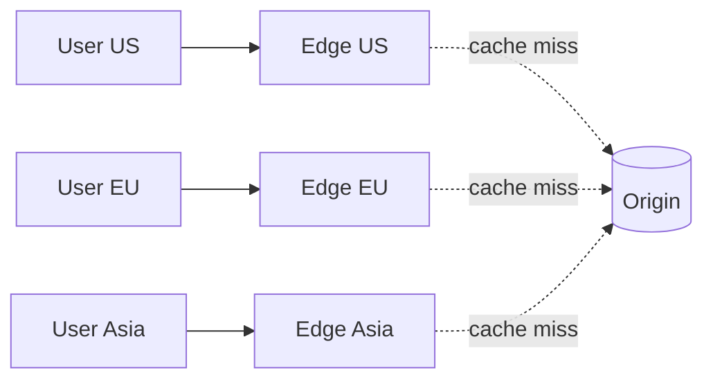
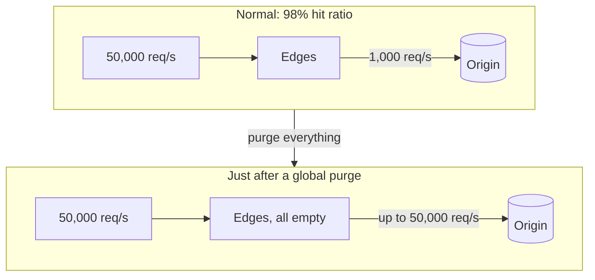

# CDN (content delivery network)

> A network of edge servers that cache content close to users, cutting latency and offloading your origin.

## What it is

A CDN is a globally distributed set of caching servers. The servers are grouped into edge locations, often called points of presence or PoPs. When a user requests content, a nearby edge serves it instead of your origin server far away. This reduces latency, absorbs traffic spikes, and lowers load and bandwidth costs on the origin.

A CDN edge is a caching reverse proxy (see [proxies](proxies.md)), so everything on the [caching](caching.md) page applies here. The differences are scale and distance: thousands of servers you do not run, spread across the world.

## When to use it

- Users are spread across regions, far from your origin.
- Large or popular static files: images, video, CSS, JavaScript, fonts, downloads.
- Traffic that spikes, such as a launch or a viral page, where the origin cannot grow fast enough.
- Some protection against attacks, because the edge absorbs traffic before it reaches you.

## What to put on a CDN

- Static assets, including video split into small segment files, which cache like any other file.
- Cacheable API responses and HTML where appropriate.
- Increasingly, dynamic content via edge compute, though that is more advanced.

## Why it is faster: count round trips

Most candidates say "the edge is closer". The stronger answer counts round trips, because latency is mostly round trips.

A new HTTPS connection needs one round trip for the TCP handshake and at least one for TLS. The request itself then takes one more. That is three round trips before the first byte arrives. Assume a user in Europe and an origin in the United States, with a cross-continent round trip of about 150 milliseconds. Assume a nearby edge at about 20 milliseconds.

| Path | Round trips | Time to first byte |
|------|-------------|--------------------|
| User to distant origin | 3 x 150 ms | about 450 ms |
| User to nearby edge, cache hit | 3 x 20 ms | about 60 ms |
| Edge miss, warm connection to origin | 3 x 20 ms + 1 x 150 ms | about 210 ms |

The last row matters. Even a miss is faster through the edge, because the edge keeps connections to the origin open. The handshakes happen over the short path, and only the request crosses the ocean. See [latency numbers](../cheat-sheets/latency-numbers.md) for the ladder behind these figures.

## How content gets there

- Pull (origin pull): the CDN fetches from your origin on the first request for a path, then caches it. Simple to operate.
- Push: you upload content to the CDN ahead of time. More control, more work, good for large or predictable assets.

## Sizing the origin: think in offload

The origin only sees the misses, so the origin is sized for the miss rate. Assume 50,000 requests per second for assets:

| Edge hit ratio | Requests reaching the origin |
|----------------|------------------------------|
| 90% | 5,000 per second |
| 98% | 1,000 per second |
| 99.5% | 250 per second |

There is a catch. Each edge location misses on its own. When a new file is published, every edge that receives a request for it fetches it from the origin separately. With 200 edges, one new file can cause 200 origin fetches. A **shield tier**, also called tiered caching, puts one regional cache layer between the edges and the origin. The edges miss to the shield, and only the shield misses to the origin.

## Cache control

You control freshness with HTTP headers (Cache-Control, ETag, TTLs). For updates, use cache invalidation or content versioning (for example a hash in the filename) so users get the new version without serving stale content.

Versioned URLs are the better default. A file named `app.3f9a1c.js` never changes, so it can carry a TTL of a year. A new release simply uses a new name, and nothing needs to be purged. Invalidation is for the files whose names cannot change, such as the HTML page that points to the versioned assets. Keep that page on a short TTL.

## The failure mode to name: the purge that floods the origin

A global purge, or a misconfigured cache rule, can empty the edges at once:

The origin was built for 1,000 requests per second and now receives up to fifty times that. The fixes: purge by specific path or tag, never everything; use a shield tier so the edges refill from the shield; and let the CDN coalesce identical misses into one origin fetch. The `stale-while-revalidate` and `stale-if-error` directives let the edge keep serving an old copy while it refreshes, or while the origin is down.

## Trade-offs

| Pro | Con |
|-----|-----|
| Lower latency for global users | Cache invalidation and staleness to manage |
| Offloads traffic from the origin | Added cost and another system to configure |
| Absorbs spikes and some attacks | Not a fit for highly personalized, uncacheable content |

## The hard parts

- **The cache key.** If the key includes every query string or cookie, each user gets a separate copy and the hit ratio collapses. Strip what does not change the response.
- **Personal data.** A response that contains one user's data must be marked `Cache-Control: private`, or the edge may serve it to the next user.
- **Purge speed.** An invalidation takes time to reach every edge. It is not instant, so do not rely on it for correctness.

## What to say in an interview

A complete answer names five things, in this order:

1. **What goes on the CDN.** Static assets, video segments, and any cacheable responses.
2. **How content arrives.** Pull for most content, push for large planned releases.
3. **How updates reach users.** Versioned URLs for assets, a short TTL for the page that names them.
4. **The origin load.** The hit ratio, the misses per second, and whether a shield tier protects the origin.
5. **The failure mode.** What the origin sees after a purge, or when the CDN is unreachable.

Pair it with [caching](caching.md) as the client-and-edge layer of your caching story.

## Related pages

- The same ideas inside your data center: [caching](caching.md).
- The round-trip figures behind the speedup: [latency numbers](../cheat-sheets/latency-numbers.md).
- A CDN as the core of a video product: [design Netflix](../questions/design-netflix.md).
- Uploads and playback at scale: [design YouTube](../questions/design-youtube.md).

## Go deeper

- Read more (free): [Content Delivery Networks (CDN) in System Design](https://www.designgurus.io/blog/content-delivery-network-cdn-system-design-basics?utm_source=github&utm_medium=repo&utm_campaign=grokking-system-design&utm_content=patterns-cdn)
- Every pattern, in depth: [System Design Patterns](https://www.designgurus.io/course/system-design-patterns?utm_source=github&utm_medium=repo&utm_campaign=grokking-system-design&utm_content=patterns-cdn)
- Full course: [Grokking the System Design Interview](https://www.designgurus.io/course/grokking-the-system-design-interview?utm_source=github&utm_medium=repo&utm_campaign=grokking-system-design&utm_content=patterns-cdn)
