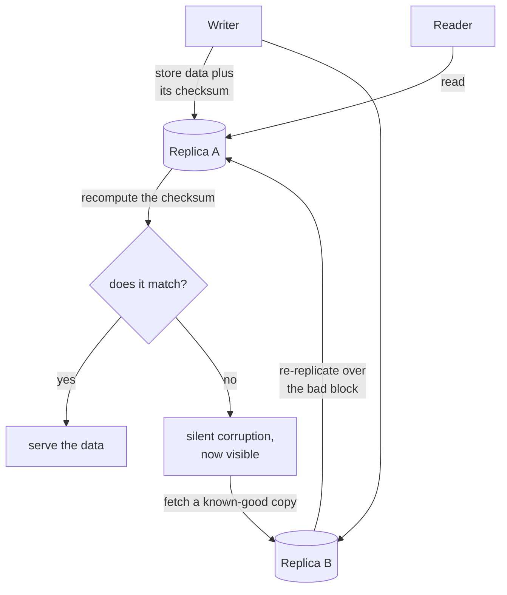
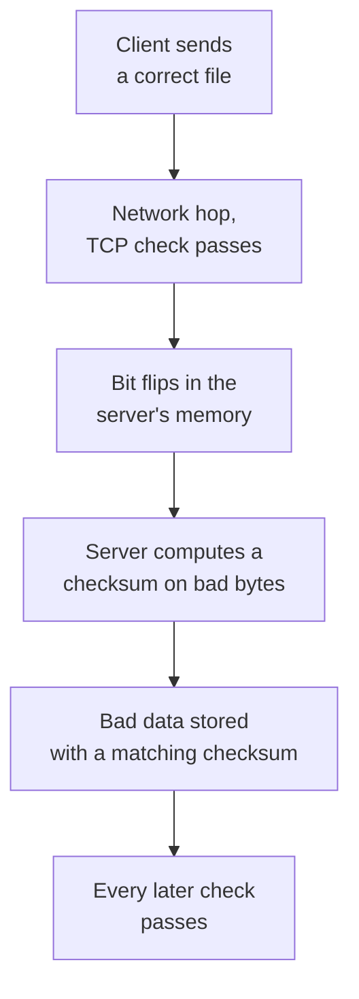

# Checksums

> A small fingerprint computed from data, checked after transfer or storage to detect corruption.

## What it is

Disks silently flip bits, networks drop and mangle packets, and memory fails. A checksum is a compact value (CRC32, MD5, SHA-256) computed from a block of data. Recompute it later: if it does not match, the data changed. It converts silent corruption, the worst kind of failure, into a detectable and therefore fixable one.

The value of a checksum is not detection on its own. It is that detection turns a silent failure into a repairable one:

## When to use it

- Any system that stores data for a long time: file stores, object stores, backups.
- Any transfer where the data passes through several systems, such as uploads and data pipelines.
- Replicas that must be compared, to find which parts differ.
- Content that should be stored once even when uploaded many times.

At scale, corruption is not a rare event to ignore. A store with many thousands of disks will see some bad blocks, so the design must expect them.

## How it works

The writer computes the checksum and stores or sends it with the data. The reader recomputes it from the data it received. If the two values match, the reader uses the data. If not, it discards the data and fetches it again, from another replica or by asking the sender to resend.

The crucial pairing: detection plus **redundancy** equals repair. A checksum alone tells you the data is bad; a replica or an erasure-coded copy lets you fix it. Distributed file systems such as GFS and HDFS checksum every block on write and verify on every read. They also run background **scrubbing**, which re-reads and re-verifies data nobody has read recently, so corruption is found while healthy copies still exist.

## Choosing the checksum: match it to the threat

Checksums come in two families, and they defend against different things.

| Kind | Examples | Size | Protects against |
|------|----------|------|------------------|
| Error-detecting code | CRC32, CRC32C | 4 bytes | Random bit flips and short bursts |
| Cryptographic hash | SHA-256 | 32 bytes | Deliberate tampering, as well as random errors |
| Broken cryptographic hash | MD5, SHA-1 | 16 and 20 bytes | Random errors only; collisions can be forced |

The numbers show why the choice matters. A 32-bit CRC detects every burst of errors up to 32 bits long, which is a proven property of CRCs of that degree. For random corruption beyond that, it misses about 1 in 2^32, or 1 in 4.3 billion. TCP's checksum is only 16 bits, so it misses roughly 1 in 65,536 random errors. That is why applications add their own checksum on top of TCP.

A CRC is fast and fine against accidents. It is useless against an attacker, who can change the data and recompute a matching CRC. When the threat is tampering, or when the checksum is also the data's identity, use SHA-256.

The overhead is small. HDFS by default stores a 4-byte CRC32C for every 512 bytes of data. That is 4 / 512, or about 0.8% extra storage.

## The checksum covers only what lies between its two ends

This is the idea that separates a strong answer. A checksum proves the data did not change between the place it was computed and the place it was checked. It says nothing about anything before or after. So the question is: where is it computed, and where is it verified?

## The failure mode to name: checksumming data that is already corrupt

Each hop checked its own piece, and the corruption happened between two of them. The stored checksum now protects the corrupt data perfectly. The fix is an **end-to-end checksum**: the original writer computes it before the data leaves, and it travels with the data to the final reader. Object stores such as S3 support this by accepting a checksum with an upload and rejecting the upload if the received bytes do not match.

## Scrubbing: find it while a good copy exists

Verification on read protects only data that is read. Cold data can sit unread for months while copies go bad one by one. Scrubbing finds this early, and the numbers show why it runs all the time. Assume a 10 TB disk scrubbed at 50 MB per second in the background. One full pass takes 10,000,000 MB / 50 = 200,000 seconds, which is about 2.3 days. So each block is checked every few days, not every few months.

## Where it is used

- Storage: per-block checksums in HDFS, GFS, ZFS; verify on read, repair from a healthy replica.
- Network transfer: verifying file uploads and downloads end to end (TCP's checksum is weak; applications add their own).
- Content addressing: when the checksum of the content is also its identifier (Git objects, Docker image layers), the same hash gives both integrity checking and deduplication.
- Replica comparison: Merkle trees (trees of checksums) let two replicas find which ranges differ without shipping the data, used in Cassandra and Dynamo anti-entropy.

A **Merkle tree** stores a hash for each data range, then a hash of each pair of hashes, up to one root. Two replicas compare roots first. If the roots match, they are in sync. If not, they compare children and go down only into the halves that differ. With about one million ranges, the tree is about 20 levels deep. One differing range is found by comparing a few hashes per level instead of shipping all the data.

## Trade-offs

| Pro | Con |
|-----|-----|
| Turns silent corruption into detected errors | CPU cost on every read and write path |
| Cheap: a few bytes per block | Detects but cannot repair without redundancy |
| Enables dedup and content addressing | Weak checksums (CRC) can collide; pick strength for the threat |

## The hard parts

- **Where to compute it:** at the original writer, or the end-to-end guarantee is lost.
- **Which checksum:** a CRC for accidents, a cryptographic hash for tampering or identity.
- **What to do on a mismatch:** read another replica, repair the bad copy, and alert if no good copy remains.

## What to say in an interview

A complete answer names five things, in this order:

1. **Where the checksum is computed.** At the original writer, before the data leaves.
2. **Where it is verified.** On every read, and at each important hop.
3. **The algorithm and why.** CRC32C for speed, SHA-256 when tampering or identity matters.
4. **The repair path.** Which copy replaces the bad one.
5. **Scrubbing.** How often cold data is re-verified.

Point 1 is the one interviewers push on. A checksum computed after the data was already damaged only protects the damage.

## Related pages

- Storage built on per-block checksums: [GFS](../deep-dives/gfs-distributed-file-system.md) and [HDFS](../deep-dives/hdfs-file-storage.md).
- Checksums on uploads, at scale: [design Amazon S3](../questions/design-amazon-s3.md).
- Merkle trees for replica repair: [Dynamo](../deep-dives/dynamo-key-value-store.md).
- Detecting a torn final log record: [write-ahead log](write-ahead-log.md).

## Go deeper

- Related deep dives: [GFS](../deep-dives/gfs-distributed-file-system.md), [HDFS](../deep-dives/hdfs-file-storage.md)
- Every pattern, in depth: [System Design Patterns](https://www.designgurus.io/course/system-design-patterns?utm_source=github&utm_medium=repo&utm_campaign=grokking-system-design&utm_content=patterns-checksums)
- Full course: [Grokking the System Design Interview](https://www.designgurus.io/course/grokking-the-system-design-interview?utm_source=github&utm_medium=repo&utm_campaign=grokking-system-design&utm_content=patterns-checksums)
