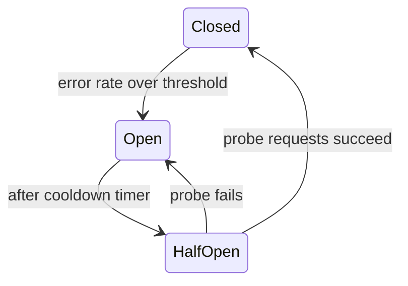
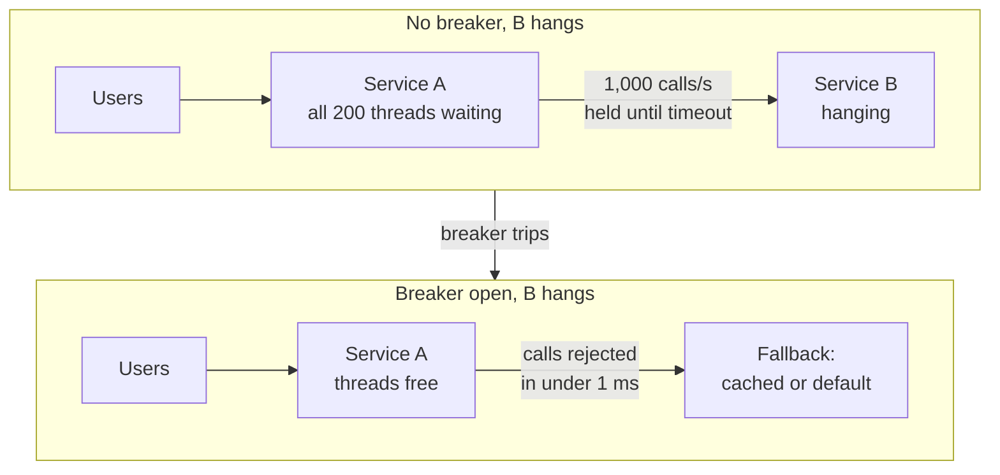

# Circuit breaker

> When a downstream dependency starts failing, stop calling it for a while and fail fast, so one sick service does not take down the whole system.

## What it is

A circuit breaker is a small piece of state that sits in the client, in front of every call to one dependency. It counts recent failures. While failures stay low, calls pass through. When the failure rate crosses a threshold, the breaker "opens" and rejects calls at once, without sending them. After a cooldown, it lets a few test calls through to see whether the dependency has recovered.

The problem it solves is the cascading failure. When service B slows down, callers of B hold threads and connections while they wait. Those callers slow down, and then their own callers slow down. The slowness of one service spreads upstream, one hop at a time. A breaker stops that spread at the first hop. It also stops sending load to B while B tries to recover.

## When to use it

- Any synchronous call over the network to another service, a database, or a third-party API.
- Dependencies that are optional for the user, where a fallback exists (recommendations, reviews, avatars).
- Calls that share a limited pool of threads or connections with other work.
- Clients that retry, because a breaker puts an upper limit on retry traffic during an outage.

## How it works

The breaker has three states. The names come from the electrical breaker: a closed circuit lets current flow, and an open one stops it.

- **Closed** (normal): calls pass through; failures are counted in a rolling window.
- **Open**: calls fail instantly with an error or a fallback; no load reaches the dependency.
- **Half-open**: after a cooldown, let a few probe requests through; success closes the circuit, failure reopens it.

The threshold usually has two parts: a failure rate and a minimum number of calls. Without the minimum, two failures out of three calls would open the breaker during a period of low traffic. Hystrix, a Netflix library that helped make the pattern widely known, documented defaults of 20 calls within a 10-second window, a 50% error rate, and a 5-second cooldown. Treat those as a starting point to tune, not as correct values.

A timeout counts as a failure. This matters more than it sounds, as the next section shows.

## Why slow is worse than dead: count the threads

This is the idea that separates a strong answer from a weak one. A dependency that refuses connections fails in about a millisecond and costs the caller almost nothing. A dependency that hangs costs the caller one thread for the full timeout. The number of threads you hold is the call rate multiplied by how long each call waits. This relation is called Little's law.

Work it out loud. Service A has 200 worker threads and calls service B 1,000 times per second. B normally answers in 50 milliseconds:

| B's behavior | Wait per call | Threads held in A |
|--------------|---------------|-------------------|
| Healthy | 50 ms | 50 |
| Hanging, 30-second timeout | 30 s | 30,000 (the pool of 200 is gone in 0.2 s) |
| Hanging, 1-second timeout | 1 s | 1,000 (still more than 200) |
| Breaker open | under 1 ms | close to 0 |

Two things follow. First, a timeout alone does not save A. Even a 1-second timeout holds more threads than A has, so A stops serving every request, including the ones that never touch B. Second, the breaker is what turns a slow failure into a fast one. It does not make B healthy. It makes B's failure cheap for A.

## The failure mode to name: the cascade

In the first picture, users of A get errors even for pages that never need B, because A has no threads left. In the second picture, A keeps serving everything else, and only the part of the page that depends on B is degraded.

## What to do when the circuit is open

The breaker forces the real design question: what is the degraded experience?

- Return a cached or stale value (fine for a recommendations widget).
- Return a default (empty list, generic response).
- Queue the work for later ([message queue](message-queues.md)) if it does not need to be synchronous.
- Fail visibly, only for truly critical dependencies like payments.

## Timeouts, retries, and bulkheads

Circuit breakers travel with three other patterns, and each one covers a weakness the breaker leaves open:

- **Timeouts** on every call, so no wait is unbounded.
- **Bounded retries with exponential backoff and jitter.** Retries multiply. If each of three layers makes up to 3 attempts, one user request can become 3 x 3 x 3 = 27 calls at the bottom layer during an outage. Retry at one layer only, and see [idempotency](idempotency.md) for making retries safe.
- **Bulkheads**: a separate thread or connection pool per dependency, so one bad dependency cannot use up resources the others need. In the table above, B needs 50 threads when healthy. A bulkhead of 75 threads for B gives it some margin and still leaves 125 threads for everything else.

## Trade-offs

| Pro | Con |
|-----|-----|
| Stops cascading failures; callers stay responsive | Thresholds need tuning; too sensitive means flapping |
| Sheds load from a struggling dependency so it can recover | Adds state and complexity to every client |
| Forces explicit fallback design | A misconfigured breaker can reject traffic to a healthy service |

## The hard parts

- **Tuning the threshold.** If it is too sensitive, the breaker opens on normal noise, closes, and opens again. This is called flapping. If it is too loose, it opens only after the threads are already gone.
- **Granularity.** One breaker per dependency is the default. If B runs on 20 hosts and only one is bad, a single breaker for all of B may reject traffic meant for 19 healthy hosts. Health per host belongs to the [load balancer](load-balancing.md).
- **Half-open probes.** Let a few requests through, not all of them. If every client sends full traffic the moment the cooldown ends, B receives the same overload that broke it.
- **Each client decides alone.** With 100 instances of A, there are 100 breakers, each seeing its own sample of errors. They open at slightly different times. That is usually fine, and it avoids adding a central component.

## What to say in an interview

A complete answer names five things, in this order:

1. **The timeout on every call.** A concrete value, chosen from the dependency's normal latency, such as a little above its 99th percentile.
2. **The retry policy.** How many attempts, with backoff and jitter, and at which single layer.
3. **The breaker threshold.** A failure rate over a window, a minimum call count, and a cooldown.
4. **The fallback.** What the user sees while the circuit is open.
5. **The bulkhead.** Which resources are isolated, so one dependency cannot drain the rest.

Bring this up when you are asked "what if this service goes down?" Point 4 is the one interviewers ask about most. Saying what the user sees while the circuit is open is what separates a memorized term from an understood one. "We return an error" can be a valid fallback, but choose it on purpose and say why this dependency cannot degrade more gently.

## Related pages

- Making retries safe to repeat: [idempotency](idempotency.md).
- Pushing back on callers when you are the overloaded one: [backpressure](backpressure.md).
- Moving work off the synchronous path: [message queues](message-queues.md).
- A design where every dependency needs a fallback: [Design an API gateway](../questions/design-api-gateway.md).

## Go deeper

- Every pattern, in depth: [System Design Patterns](https://www.designgurus.io/course/system-design-patterns?utm_source=github&utm_medium=repo&utm_campaign=grokking-system-design&utm_content=patterns-circuit-breaker)
- Full course: [Grokking the System Design Interview](https://www.designgurus.io/course/grokking-the-system-design-interview?utm_source=github&utm_medium=repo&utm_campaign=grokking-system-design&utm_content=patterns-circuit-breaker)
- Practice live: [Mock interviews](https://www.designgurus.io/mock-interviews?utm_source=github&utm_medium=repo&utm_campaign=grokking-system-design&utm_content=patterns-circuit-breaker)
