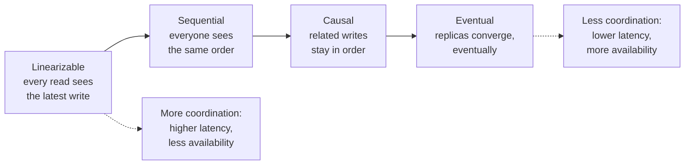
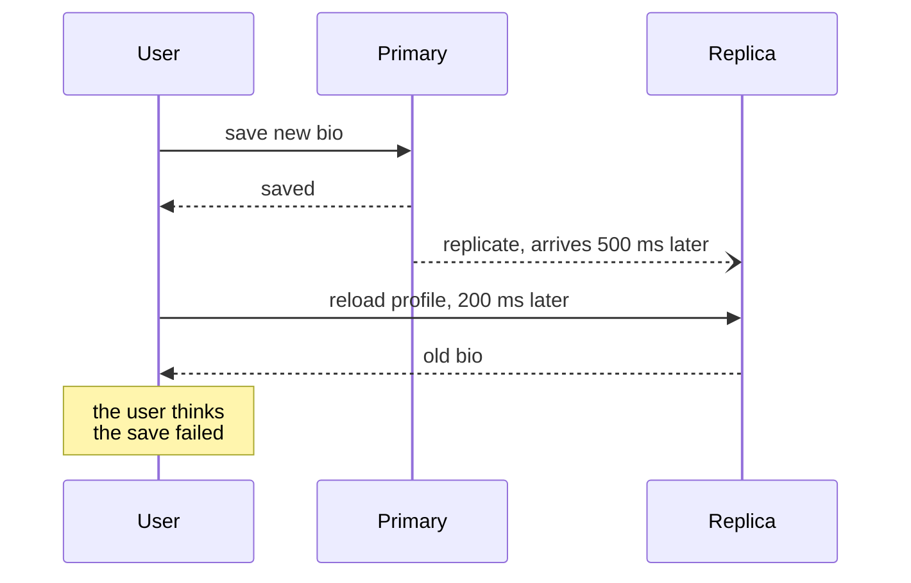

# Consistency models

> The contract for what a read is allowed to return when data is replicated and being written concurrently.

## What it is

A consistency model defines how up to date and ordered reads are across replicas. A replica is one copy of the data on one machine. Stronger models are easier to reason about but cost latency and availability. Weaker models are faster and more available but can return stale or out-of-order data.

Every model answers the same question: once a write has happened, which later reads must reflect it, and in what order?

## When to use it

- Any time data is copied to more than one machine: read replicas, multi-region databases, or caches.
- When a user reads data they have just written, such as a profile edit or a new post.
- When you decide whether a read goes to the primary or to any replica.
- When the question says users must "always" or "never" see something.

## The spectrum (strong to weak)

The models form one line, and moving along it is always the same trade:

| Model | What it guarantees |
|-------|--------------------|
| Linearizable (strong) | Every read sees the most recent write, as if there were one copy |
| Sequential | All clients see operations in the same order, and each client's own operations keep their order, but a read may not see the latest write |
| Causal | Operations that are causally related are seen in order; unrelated ones may differ |
| Read your writes | A client always sees its own writes |
| Eventual | Replicas converge over time; a read may be stale until they do |

## Think in anomalies, not in model names

Weak answers start from a model name. Strong answers start from the wrong thing a user could see, and then pick the weakest model that prevents it. An anomaly is a result that would be impossible if there were only one copy of the data.

| Anomaly the user sees | Example | Weakest model that prevents it |
|-----------------------|---------|-------------------------------|
| Own write disappears | Edit a bio, refresh, see the old bio | Read your writes |
| Time goes backward | Comment count shows 12, then 10 | Monotonic reads |
| Effect before cause | A reply appears before its question | Causal |
| Two buyers win one item | The last ticket is sold twice | Linearizable, on that one write |

This turns a vague choice into a short list. Most of a product can be eventual, a few surfaces need a session guarantee, and usually only one or two writes need linearizability.

## The failure mode to name: replication lag

Many databases, including MySQL and PostgreSQL, replicate asynchronously by default: the primary confirms the write first, then ships it to the replicas. The delay before a replica applies it is called replication lag. When the system is healthy, lag is often well under a second. Under a write burst, or while a replica recovers, it can grow to seconds or minutes.

Work it out. Assume lag is 500 ms and the page reloads 200 ms after the save. Every such reload served by a replica shows the old bio, so the user tries again. If lag grows to 5 seconds during a backlog, even a user who waits a few seconds sees old data. The fix must not depend on lag being small:

- **Read from the primary after a write.** For example, route the writer's reads to the primary for a short window, which is simple but adds load to the primary.
- **Use a version token.** The client remembers the log position of its last write. A replica serves the read only after it has applied that position, and otherwise the read waits or goes to the primary.
- **Keep a session on one replica.** This gives monotonic reads, but the guarantee breaks when that replica fails.

## Common session guarantees

These make eventual consistency usable in practice:

- Read your writes: you always see your own updates.
- Monotonic reads: you never see time go backward across reads.
- Monotonic writes: your writes apply in order.

## How to choose

Pick the weakest model the product can tolerate, because weaker is faster and more available. A bank balance wants linearizable. A like counter is fine with eventual. Then state how old a read may be before a user would notice or be harmed. That limit is the staleness budget, and you should give it as a number.

## Trade-offs

| | Stronger models | Weaker models |
|---|-----------------|---------------|
| Reasoning | Behaves like one copy | Every reader must handle stale or reordered data |
| Latency | Writes or reads wait for coordination | Read or write any nearby replica |
| During a partition | The minority side stops serving | Every side keeps serving |
| Cost | More round trips, often a single leader | Conflict handling and merge logic |

## The hard parts to mention in an interview

- **A cache is a replica too.** A cache with a 60-second TTL makes that read path eventual, whatever the database promises.
- **"Eventual" has no time limit.** It only promises that replicas agree once writes stop. If the product needs a bound, state it and monitor the lag.
- **Reads cost coordination too.** A linearizable read cannot simply go to a follower that may lag behind, so it must go to the leader or confirm with a majority. Even the leader must first confirm that it is still the leader, with a lease or a round of heartbeats, because a deposed leader can serve stale data.

## What to say in an interview

Name the model per piece of data, not for the whole system. Tie it to [replication](replication.md) and the [CAP theorem](cap-theorem.md): the model you can offer depends on how you replicate and what you do during a partition. A complete answer names five things, in this order:

1. **The data and how it is replicated.** Single leader, multi-leader or leaderless, and how many regions.
2. **The anomaly that would hurt.** For each surface, the wrong result a user must never see.
3. **The weakest model that prevents it.** Usually eventual, with a session guarantee for the writer.
4. **How the model is enforced.** Primary reads, version tokens, quorums, or a single leader for that key.
5. **The staleness budget for everything else.** How stale, and what you monitor.

Point 4 is where interviewers push. Saying "read your writes" is easy, but saying how a replica knows it is current enough is the real answer.

## Related pages

- A one-page decision guide for each kind of data: [strong vs eventual consistency](../cheat-sheets/strong-vs-eventual-consistency.md).
- Where lag comes from in the first place: [replication](replication.md).
- How overlapping reads and writes give stronger reads: [quorum](quorum.md).
- How systems track which writes caused which: [logical clocks](logical-clocks.md).

## Go deeper

- Every pattern, in depth: [System Design Patterns](https://www.designgurus.io/course/system-design-patterns?utm_source=github&utm_medium=repo&utm_campaign=grokking-system-design&utm_content=patterns-consistency-models)
- For harder, distributed-systems depth: [Advanced System Design Interview, Volume II](https://www.designgurus.io/course/grokking-system-design-interview-ii?utm_source=github&utm_medium=repo&utm_campaign=grokking-system-design&utm_content=patterns-consistency-models)
- Full course: [Grokking the System Design Interview](https://www.designgurus.io/course/grokking-the-system-design-interview?utm_source=github&utm_medium=repo&utm_campaign=grokking-system-design&utm_content=patterns-consistency-models)