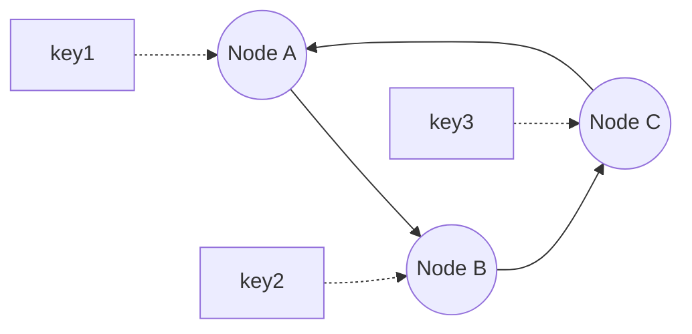
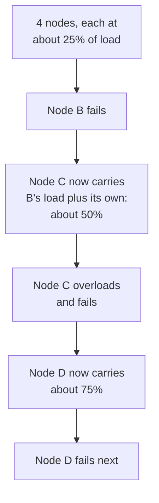

# Consistent hashing

> Distribute keys across nodes so that adding or removing a node moves as little data as possible.

## What it is

Consistent hashing is a way to assign keys to nodes so that a change in the node count moves only a small share of the keys. It is used wherever a set of servers shares a key space and that set changes over time: cache clusters, partitioned databases, and load balancers.

### The problem it solves

Naive sharding with `hash(key) % N` breaks when N changes: adding or removing one node remaps almost every key, causing a storm of data movement and cache misses. Consistent hashing fixes this so that a change affects only a small slice of keys.

## When to use it

- A distributed cache, where every moved key becomes a cache miss.
- A partitioned data store, where every moved key means data copied across the network.
- Any cluster that grows, shrinks, or loses nodes without warning.
- Sticky routing, where the same user or session should keep reaching the same server.

If the node count never changes, plain modulo hashing is simpler and just as even. Consistent hashing pays off only when nodes come and go.

## How it works

Map both nodes and keys onto a ring (a hash space treated as a circle). A key belongs to the first node found by moving clockwise from the key's position. When a node is added or removed, only the keys between it and the previous node on the ring move. Every other key stays where it is.

The nodes form a ring (A to B to C and back to A). Each key is owned by the first node found moving clockwise from the key's position.

In code, the ring is a sorted array of node positions. To find a key's owner, hash the key and binary search for the first position at or after it, wrapping to the start if needed. With V positions on the ring, a lookup costs O(log V), which is a few microseconds at most.

## Think in keys moved

This is the idea that separates a strong answer. The question to ask of any placement scheme is: when the node count changes, what fraction of keys move?

Work it out loud. Assume 100 million keys on 10 nodes, and add an 11th node.

| Scheme | Fraction of keys that move | Keys moved |
|--------|----------------------------|------------|
| `hash(key) % N`, N from 10 to 11 | about 10 in 11 | about 91 million |
| Consistent hashing | about 1 in 11 | about 9 million |
| The minimum possible | 1 in 11, only the new node's share | about 9 million |

With modulo, a key stays put only when `hash % 10` and `hash % 11` happen to agree, which is about 1 time in 11. So almost everything moves. Consistent hashing moves only the keys the new node takes over, which is the minimum any scheme could achieve.

In a cache, this is the difference between losing 9% of the hot set and losing 91% of it. The second case sends almost the full read load to the database at once. That is the [cache stampede](caching.md) on a cluster-wide scale.

## Virtual nodes

A plain ring can distribute load unevenly, and removing a node moves all its keys onto one neighbor. The fix is virtual nodes: each physical node is placed at many points on the ring. This smooths the distribution and spreads a departed node's keys across many others.

The unevenness is large without them. With 10 nodes placed at one random point each, the expected largest gap on the ring is about 2.9 times the fair share. That node gets almost three times the keys of an average node. Giving each node many positions, commonly tens to a few hundred, averages those gaps out.

Virtual nodes also handle machines of different sizes. A server with twice the memory gets twice the virtual nodes, and so about twice the keys.

## The failure mode to name: the cascade without virtual nodes

When one node owns a single arc of the ring, its failure moves its entire load to the next node clockwise:

Each failure doubles or triples the load on one neighbor, so the failures move around the ring one node at a time. With virtual nodes, B's many small arcs are owned next by many different nodes. Each survivor takes a small share, about a third more load in this four-node example instead of double.

## Replication on the ring

To store each key on more than one node, walk clockwise from the key and take the first R distinct physical nodes. [Dynamo](../deep-dives/dynamo-key-value-store.md) calls this list the preference list. The word "distinct" matters. With virtual nodes, two consecutive positions may belong to the same machine, and two copies on one machine are not real redundancy.

## Where it is used

Distributed caches (for example Memcached clients), partitioned data stores (Cassandra and other Dynamo-style stores), and load balancers that need sticky, even distribution.

Two alternatives are worth knowing by name. **Rendezvous hashing** scores every node for each key and picks the highest score, with no ring at all. **Jump consistent hash** needs no stored ring and is very fast, but it assumes nodes are numbered and removed only from the end.

## Trade-offs

| Pro | Con |
|-----|-----|
| Minimal data movement when nodes change | More complex than modulo hashing |
| Even load with virtual nodes | Still needs care for hot keys |
| Adding capacity is a local change | Every client must agree on the same ring |

## The hard parts

- **Hot keys:** consistent hashing spreads keys, not traffic. One very popular key still lands on one node. See [sharding and partitioning](sharding-partitioning.md) for salting.
- **Ring membership:** every client and server must agree on which nodes are in the ring. Systems spread that view with [gossip](gossip-protocol.md) or keep it in a coordination service.
- **Moving the data:** the ring says which keys move. Copying them while they are still being written is a separate job.

## What to say in an interview

A complete answer names five things, in this order:

1. **Why modulo fails.** Changing N moves almost every key.
2. **The ring.** Keys belong to the next node clockwise.
3. **The number.** Adding one node to N moves about 1 in N+1 keys.
4. **Virtual nodes.** For even load and for spreading a failed node's keys.
5. **What it does not solve.** Hot keys, and agreeing on membership.

Point 4 is the one interviewers push on. Without virtual nodes, the ring is uneven and one failure can overload the next node.

## Related pages

- Where the ring is applied: [sharding and partitioning](sharding-partitioning.md).
- The ring in a real store, with replicas: [Dynamo](../deep-dives/dynamo-key-value-store.md).
- A full design that depends on it: [design a distributed cache](../questions/design-distributed-cache.md).
- How nodes learn who is in the ring: [gossip protocol](gossip-protocol.md).

## Go deeper

- Every pattern, in depth: [System Design Patterns](https://www.designgurus.io/course/system-design-patterns?utm_source=github&utm_medium=repo&utm_campaign=grokking-system-design&utm_content=patterns-consistent-hashing)
- Full course: [Grokking the System Design Interview](https://www.designgurus.io/course/grokking-the-system-design-interview?utm_source=github&utm_medium=repo&utm_campaign=grokking-system-design&utm_content=patterns-consistent-hashing)
- Read more (free): [Consistent Hashing vs Traditional Hashing](https://www.designgurus.io/blog/consistent-hashing-vs-traditional-hashing?utm_source=github&utm_medium=repo&utm_campaign=grokking-system-design&utm_content=patterns-consistent-hashing)
