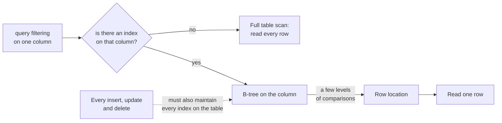
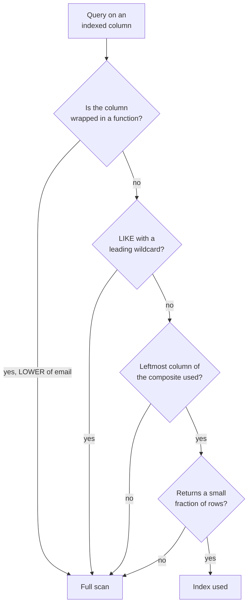

# Database indexing

> A data structure that lets the database find rows by a key without scanning the whole table.

## What it is

An index is a separate, sorted (or hashed) structure that maps column values to row locations. It turns a full table scan into a fast lookup. The cost is extra storage and slower writes, because every insert, update, or delete must also maintain the index.

An index buys reads and charges writes. Both halves belong in the answer:

## When to use it

- A query filters, joins, or sorts on a column, and it runs often.
- The query returns a small fraction of the table.
- Reads matter more than write speed for this table.
- A uniqueness rule must be enforced, such as one account per email. A unique index does this.

Index a column because a named query needs it, not because the column exists.

## Why a B-tree lookup is fast: the numbers

A **B-tree** is a balanced tree whose nodes are disk pages. Each page holds many sorted keys, each with a pointer to the next level down. Page sizes are documented defaults: 8 KB in PostgreSQL and 16 KB in MySQL InnoDB. A page that size holds a few hundred keys, so each level multiplies the reach by a few hundred. That multiplier is the **fan-out**.

Work it out with a fan-out of 500:

| Levels | Rows reachable |
|--------|----------------|
| 1 | 500 |
| 2 | 250,000 |
| 3 | 125 million |
| 4 | 62.5 billion |

So a table of one billion rows needs only four levels, and the top levels are small enough to stay in memory. A lookup therefore usually costs one or two disk reads.

Compare the full scan. Assume one billion rows of 100 bytes each, which is 100 GB. At a sequential read speed of about 1 GB per second, scanning it takes around 100 seconds. The index answers the same single-row question in about a millisecond or less.

## Common index types

| Type | Good for | Notes |
|------|----------|-------|
| B-tree | Range queries and sorting, equality | The default for most relational databases |
| Hash | Exact-match lookups | Very fast equality, no range queries |
| Bitmap | Low-cardinality columns (few distinct values) | Common in analytics |
| Inverted | Full-text search | Maps terms to the documents that contain them |

## Selectivity: an index helps only when it filters

This is the idea that separates a strong answer. **Selectivity** is the fraction of rows a query returns. An index is fast because it lets the database read a small fraction of the table. When the query returns a large fraction, the index stops helping.

The reason is the kind of read: a scan reads pages in order, which disks do well. An index lookup jumps to each matching row separately, which is a random read. Assume a table of one billion rows:

| Query returns | Index plan | Better plan |
|---------------|------------|-------------|
| 1,000 rows | A few page reads, then 1,000 row fetches | Index |
| 1 million rows | 1 million random row fetches | Usually index |
| 300 million rows | 300 million random row fetches | Full scan |

The crossover point depends on the storage and the data layout, so the database's query planner estimates it from statistics. This is why an index on a column like `status`, with three evenly spread values, is often ignored, since each value matches a third of the table.

## Composite indexes: design from the query

A **composite index** covers several columns in a fixed order, such as `(country, created_at)`. It is sorted by the first column, then by the second within each value of the first. A query can use it only from the left: country alone works, country plus date works, but date alone cannot use it efficiently.

The rule for column order:

1. Columns compared with equality come first, because each one narrows the search to a single sorted block.
2. Then the one column used for a range or a sort, which reads that block in order.
3. Then, optionally, extra columns so that the index covers the query.

A **covering index** contains every column a query needs, so the database answers from the index alone and never reads the table.

## The failure mode to name: the index the query cannot use

An index can exist and still be ignored, so a query that looks indexed scans the whole table:

A function on the column hides the sorted values from the planner, so the fix is an index on the expression itself. A leading wildcard, such as `LIKE '%smith'`, has no starting point in the sort order. It needs an index built for substring search, such as PostgreSQL's trigram index, which indexes every three-letter fragment of the text. These failures are easy to miss in development, where tables are small and every plan is fast. Read the query plan, for example with `EXPLAIN`, before you trust an index.

## Trade-offs

| Pro | Con |
|-----|-----|
| Lookups in a few page reads instead of a scan | Every write must update every index |
| Fast sorting and range queries | Extra storage, often a large share of the table |
| Can enforce uniqueness | Unused indexes cost writes and help nothing |

The write cost adds up quickly. A table with five indexes does six structure updates for each insert: one for the row and one per index. In a write-heavy system, that is why you keep only the indexes your queries actually use.

## The hard parts

- **Write amplification:** more indexes means slower writes, which matters for write-heavy systems.
- **Indexes in sharded systems:** an index local to each shard makes a lookup by that column query every shard. A global index avoids that, but every write updates two places. See [sharding and partitioning](sharding-partitioning.md).
- **B-trees vs LSM trees:** stores built for heavy writes, such as Cassandra and RocksDB, use LSM trees. Writes go to a [write-ahead log](write-ahead-log.md) and memory first, and reads may check several files.

## What to say in an interview

A complete answer names five things, in this order:

1. **The query.** Write it out, with its filter, its sort, and how often it runs.
2. **The index that serves it.** Columns in order: equality, then range or sort.
3. **The selectivity.** Why this query returns a small fraction of rows.
4. **The write cost.** How many indexes the table carries, and whether writes can afford one more.
5. **Whether it covers the query.** If so, the table is never read.

Point 4 is the one interviewers push on, because in a write-heavy design every index you propose needs a reason.

## Related pages

- Choosing the kind of store before its indexes: [SQL vs NoSQL](../cheat-sheets/sql-vs-nosql.md).
- The inverted index at scale: [Elasticsearch and Lucene](../deep-dives/elasticsearch-lucene.md).
- Indexes once the data is split: [sharding and partitioning](sharding-partitioning.md).
- Why random reads cost more than sequential ones: [latency numbers](../cheat-sheets/latency-numbers.md).

## Go deeper

- Read more (free): [Database Indexing Explained](https://www.designgurus.io/blog/database-indexing?utm_source=github&utm_medium=repo&utm_campaign=grokking-system-design&utm_content=patterns-database-indexing)
- Every pattern, in depth: [System Design Patterns](https://www.designgurus.io/course/system-design-patterns?utm_source=github&utm_medium=repo&utm_campaign=grokking-system-design&utm_content=patterns-database-indexing)
- Full course: [Grokking the System Design Interview](https://www.designgurus.io/course/grokking-the-system-design-interview?utm_source=github&utm_medium=repo&utm_campaign=grokking-system-design&utm_content=patterns-database-indexing)
