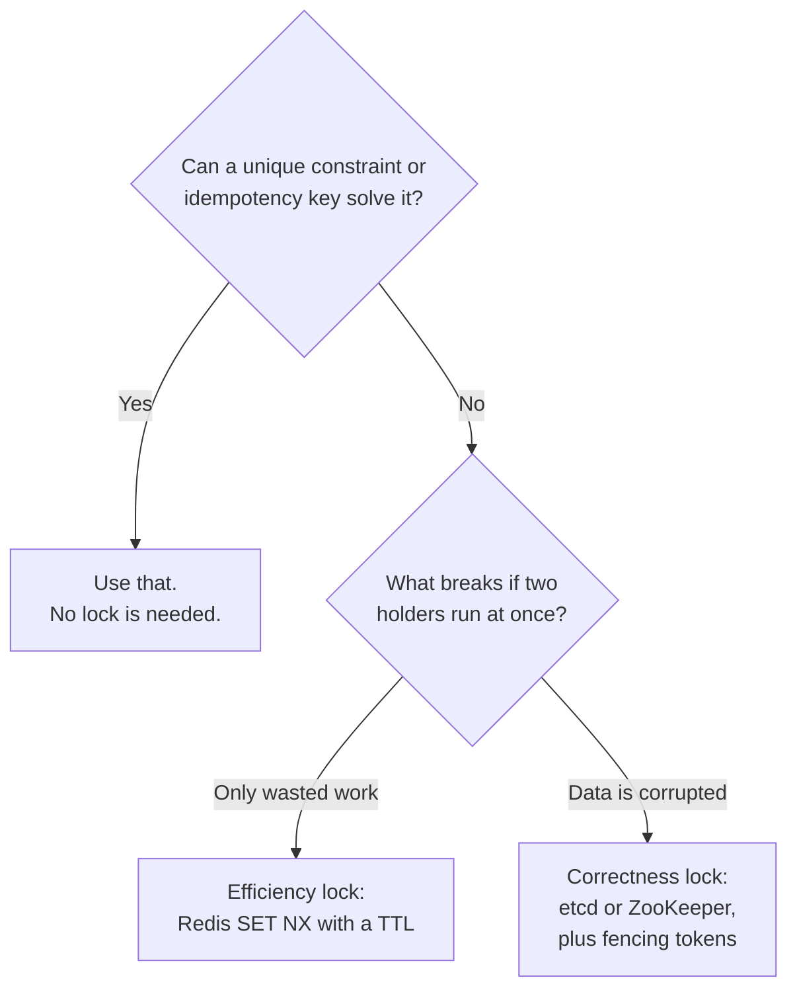
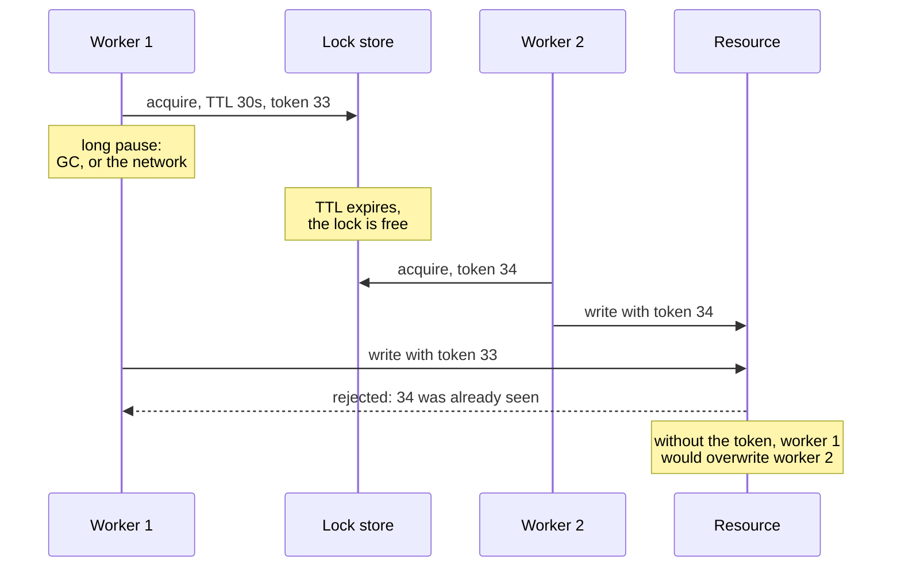

# Distributed locking

> Mutual exclusion across machines: make sure at most one process in the whole system does a thing at a time.

## What it is

A mutex protects a resource within one process; a distributed lock protects it across a fleet. Typical uses: stop two workers from processing the same job, prevent double-booking of a seat or a room, guard a migration so it runs once. The lock lives in a shared store that all contenders can see.

Most distributed locks are really leases. A lease is a lock that expires on its own after a fixed time unless the holder renews it.

## When to use it

- Expensive work that should not run twice, such as rebuilding a report or a search index.
- A resource that two writers must never change at the same moment, such as a seat or a file.
- One-time operations across a fleet: a migration, a cleanup job, a cache warm-up.
- Only after simpler tools fail. Ask first whether a unique constraint or [idempotency](idempotency.md) removes the need.

## How it works

Acquire by atomically creating a record that expires:

```
SET lock:room-42 owner=worker-7 NX PX 30000   -- only if not exists, TTL 30s
  OK      -> you hold the lock, do the work, then DEL (only if still owner)
  nil     -> someone else holds it, back off and retry
```

The TTL is the crucial part: without it, a crashed holder keeps the lock forever and nobody else can take it. With it, you get the opposite hazard: the lock can expire while a slow holder is still working. Long jobs renew the lease while they work. A common choice is to renew at about a third of the TTL, so one missed renewal is not fatal.

## Efficiency or correctness: the first question

The idea that separates a strong answer is to ask what the lock is for. There are only two answers, and they lead to different designs:

- **Efficiency.** The lock saves work. If two holders run at once, the cost is wasted effort, such as a report computed twice.
- **Correctness.** The lock protects data. If two holders run at once, data is corrupted, such as one seat sold to two people.



For efficiency, a single Redis node is enough. If it fails now and then, a job runs twice, and that is acceptable. For correctness, no lease alone is enough, for the reason below.

## Sizing the TTL, worked out loud

Assume a job takes 5 seconds at the 99th percentile and the TTL is 30 seconds. That looks like 25 seconds of margin. The margin is consumed by anything that stops the holder without its knowledge: a long garbage collection pause, a virtual machine paused by its host, or a network delay between the holder and the resource.

The TTL pulls in two directions:

| TTL | If the holder crashes | If the holder pauses |
|-----|----------------------|----------------------|
| 10 seconds | Work waits up to 10 seconds | A pause over 10 seconds creates two holders |
| 30 seconds | Work waits up to 30 seconds | Two holders only after a 30-second pause |
| 10 minutes | Work waits up to 10 minutes | Two holders are rare, but still possible |

No TTL value makes both columns safe. Checking the remaining time before each write does not help either, because the pause can happen between the check and the write.

## The safety problem

A lock with a timeout can be held by two workers at once. The fencing token is what makes that survivable:



If the holder pauses (garbage collection, slow I/O) past the TTL, the lock expires and a second worker acquires it: now two workers believe they hold the lock. Defenses, in increasing strength:

- **Check ownership on release** so you never delete someone else's lock.
- **Consensus-backed locks** (ZooKeeper, etcd, Chubby): the lock is replicated via a [quorum](quorum.md), with sessions kept alive by [heartbeats](heartbeats.md), so losing one lock server does not lose the lock. The session still expires after a pause, so this alone does not stop two holders.
- **Fencing tokens**: the lock service issues an increasing number with each grant; the protected resource rejects operations with a stale token. This is the only defense that actually prevents corruption.

Fencing has one requirement that is easy to miss. The resource itself must store the highest token it has seen and compare it on every write. If the resource cannot do that, the lock cannot be made fully safe.

## Choosing an implementation

| Option | Character |
|--------|-----------|
| Redis `SET NX` + TTL | Simple and fast; fine when the lock is an efficiency optimization, not a correctness guarantee |
| ZooKeeper / etcd ephemeral nodes | Stronger: quorum-replicated, session-based, ordered; use when correctness depends on the lock |
| Database row lock or unique constraint | Often the simplest correct answer if all contenders already share the database |

Redlock acquires the lock on a majority of independent Redis nodes. It removes the single Redis node as a point of failure. It still depends on timing assumptions, and whether it is safe for correctness locks is a known debate.
## Trade-offs

| Pro | Con |
|-----|-----|
| Simple model: one holder at a time | A lease can still have two holders after a pause |
| Prevents duplicate expensive work | The lock store is another dependency on the hot path |
| Works across services that share no database | A crashed holder blocks the work until the TTL expires |

## What to say in an interview

Give the Redis one-liner for the simple case, then immediately name its weakness (expiry during a pause means two holders) and the fix (fencing tokens, or a consensus-backed store when correctness is at stake). That progression, simple tool then its failure mode then the hardened version, is exactly the senior signal. A complete answer names five things, in this order:

1. **Whether a lock is needed at all.** A unique constraint, an idempotency key, or one writer per partition may remove it.
2. **What the lock is for.** Efficiency or correctness.
3. **The implementation and the TTL.** The store, the TTL, and the renewal interval.
4. **The failure mode.** A pause longer than the TTL creates two holders.
5. **The fencing token.** Issued by the lock service and checked by the resource on every write.

## Related pages

- Often the better tool, with no lock at all: [idempotency](idempotency.md).
- The same pause problem for a long-lived leader: [leader election](leader-election.md).
- A booking design where double-selling is the core risk: [design Ticketmaster](../questions/design-ticketmaster.md).
- How a consensus-backed lock service works inside: [ZooKeeper](../deep-dives/zookeeper-coordination.md).

## Go deeper

- Related deep dive: [Chubby, Google's distributed lock service](../deep-dives/chubby-distributed-locking.md)
- Every pattern, in depth: [System Design Patterns](https://www.designgurus.io/course/system-design-patterns?utm_source=github&utm_medium=repo&utm_campaign=grokking-system-design&utm_content=patterns-distributed-locking)
- For harder, distributed-systems depth: [Advanced System Design Interview, Volume II](https://www.designgurus.io/course/grokking-system-design-interview-ii?utm_source=github&utm_medium=repo&utm_campaign=grokking-system-design&utm_content=patterns-distributed-locking)