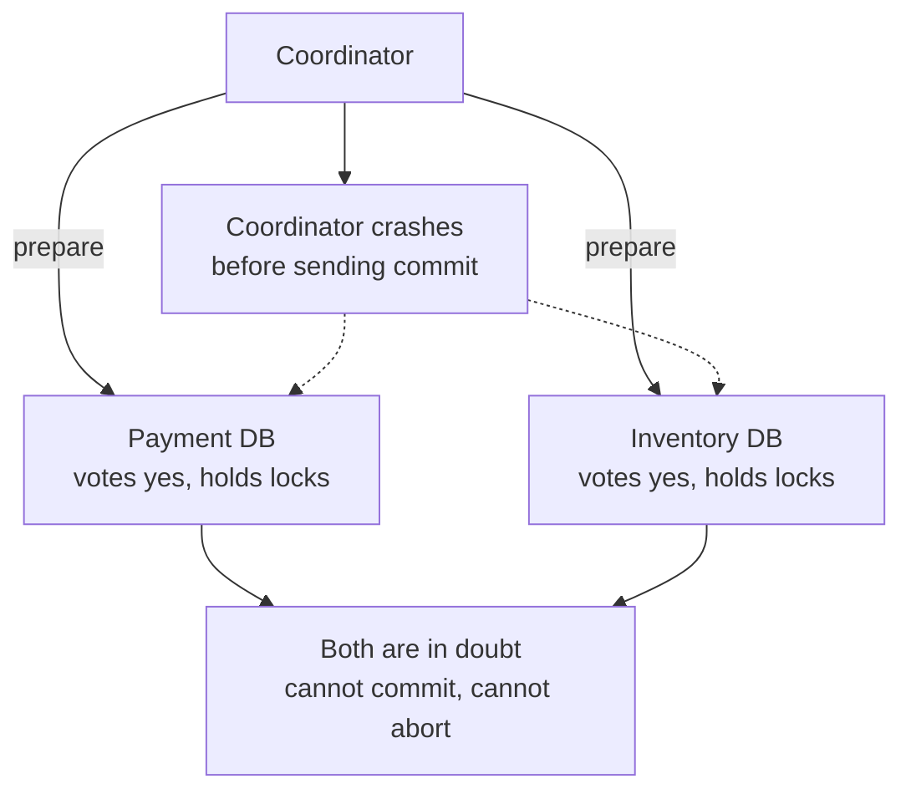
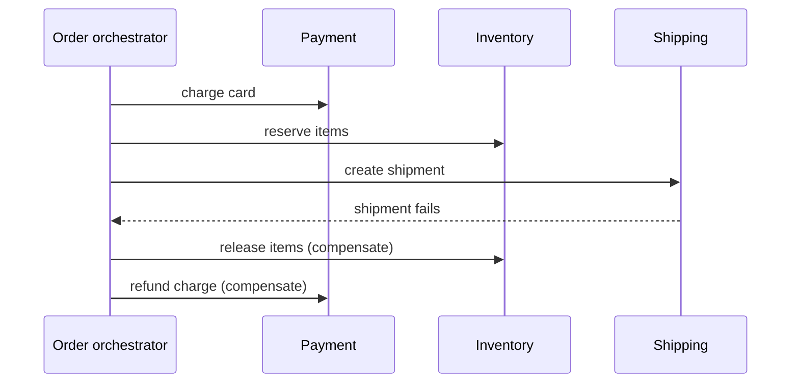

# Distributed transactions: 2PC vs sagas

> Keep one logical operation correct when it spans services that each own their own database.

## What it is

"Place an order" really means three writes: charge the payment, reserve the inventory, create the shipment. In a microservice system each write lives in a different service with its own database, so no single database transaction covers all three. There are two families of answers: make the operation atomic anyway (two-phase commit) or turn it into a sequence of steps you can undo (a saga).

## When to use it

- One business action must change data owned by two or more services.
- A partial result is harmful, such as a charge with no order, or a seat sold twice.
- The service boundaries cannot reasonably be redrawn to put the data in one place.

The last point comes first in a good answer. If the order and its inventory reservation can live in one service and one database, a local transaction solves the problem with none of the machinery below.

## Two-phase commit (2PC)

A coordinator asks every participant to **prepare**: keep its locks and promise the write will succeed. When every participant votes yes, the coordinator tells them all to **commit**. This gives true atomicity, but it blocks: participants hold their locks while waiting for the decision, and a dead coordinator leaves every participant frozen with locks held. That is why 2PC lives inside tightly controlled database systems like [Spanner](../deep-dives/spanner-global-sql.md), and almost never between microservices: one slow or crashed service would stall the payment database for everyone.

## The cost of 2PC: think in lock-hold time

This is the idea that separates strong answers. The problem with 2PC is not the message count. It is how long each participant holds its locks, because nothing else can change those rows meanwhile.

A participant takes its locks when it does its part of the work, and releases them only when the commit decision arrives. In between are at least two network round trips (the work request and the prepare vote), the commit message, and forced log writes so that a vote survives a crash. For one hot row, such as the stock count of a popular item, the hold time sets the maximum rate at which transactions can touch that row.

| Where the participants are | Round trip | Rough lock-hold time | Commits per second on one hot row |
|----------------------------|------------|---------------------|-----------------------------------|
| Same data center | 500 µs | about 5 ms, assuming a few ms of log writes | about 200 |
| Different continents | 150 ms | about 300 ms or more | about 3 |

The round trips come from the [latency numbers](../cheat-sheets/latency-numbers.md). The table assumes everything else is fast. In practice a participant that pauses for garbage collection or a slow disk extends the hold for every transaction queued behind it.

## The failure mode to name: the coordinator dies after prepare

The worse case is not a slow participant. It is a coordinator that crashes after every participant has voted yes:

A participant that voted yes has promised to commit if told to. So it may not abort on its own, and it does not know whether the decision was commit. It must wait, locks held, until the coordinator recovers. Systems like Spanner make this rare by running the coordinator itself as a replicated group with Paxos, so the decision survives the loss of one machine. Microservices rarely have that.

## Saga

A saga breaks the operation into a chain of local transactions, one per service, each committing immediately. If a later step fails, the earlier steps are undone by a **compensating action** (an explicit reverse operation): refund the charge, release the inventory. Between steps the system is visibly in a half-finished state (the charge exists, the shipment does not yet), so eventual consistency is the price.

## Order the steps by what can be undone

The second idea that separates strong answers is step order. Some actions have no clean reverse: an email cannot be unsent, and money paid out to a bank cannot be pulled back. So arrange the saga in three parts:

1. **Steps that can be compensated** go first, such as reserve inventory and place a hold on the card.
2. **The pivot step** goes next. It is the point after which the saga will not roll back, such as capturing the payment.
3. **Steps that can only be retried** go last, such as sending the confirmation email. They must eventually succeed, so they need retries, not reverses.

The diagram above charges the card first and refunds it on failure. That works, but a hold is cheaper to undo, and the customer never sees a charge followed by a refund.

Also say what other users see between steps. A saga has no isolation, which means other transactions can read its half-finished state. The usual answer is a status field, such as an order marked PENDING, which tells other code to treat it as not yet real.

## Choreography vs orchestration

There are two ways to drive the chain. In **choreography**, each service publishes an event to a [message queue](message-queues.md) and the next service reacts; there is no coordinator, but the flow is written down nowhere, so debugging means reading five codebases. In **orchestration**, one orchestrator service calls each step and decides what happens on failure: one place to read the flow, one component to keep alive and durable. Beyond three or four steps, orchestration is usually the clearer choice.

## What sagas require

Every step will eventually be retried after a timeout or a crash, so every step must be [idempotent](idempotency.md) (safe to run twice). And "commit the local transaction, then publish the event" must never lose the event, which is exactly the problem the [outbox pattern](outbox-pattern.md) solves. Systems that already record every change as an event ([event sourcing](event-sourcing-cqrs.md)) get the saga's audit trail with little extra work.

## Trade-offs

| | Two-phase commit | Saga |
|---|---|---|
| Consistency | Atomic: all steps or none | Eventual: half-finished states are visible |
| Availability | Blocking: locks held while waiting | Each step commits and moves on |
| Coupling | Tight: every participant joins one protocol | Loose: services connected by events or an orchestrator |
| Cost | Coordinator failure freezes participants | Compensation logic is real code you must write and test |
| Hard limit | Rarely viable across services | Some actions cannot be compensated: you cannot un-send an email |

## What to say in an interview

A complete answer names five things, in this order:

1. **Whether the problem can be removed.** Redraw the boundary so one service owns the data, if possible.
2. **The choice.** Saga with an orchestrator between services. 2PC only inside one database system.
3. **The steps and their compensations.** Name each reverse action.
4. **The step order.** Compensatable steps first, the pivot, then steps that only retry.
5. **What makes it reliable.** Idempotent steps, the outbox for events, and a status that hides half-finished state.

Point 1 is the senior signal. A distributed transaction is the fallback, not the default. A [payment system](../questions/design-payment-system.md) is the classic question where this trade-off decides the design.

## Related pages

- Publishing each saga step's event without losing it: [outbox pattern](outbox-pattern.md).
- Making retried steps safe: [idempotency](idempotency.md).
- How a replicated coordinator agrees on a decision: [Raft consensus](../deep-dives/raft-consensus.md).
- A full question built on this trade-off: [design a payment system](../questions/design-payment-system.md).

## Go deeper

- Related deep dive: [Spanner](../deep-dives/spanner-global-sql.md), the system that made 2PC work at global scale
- Every pattern, in depth: [System Design Patterns](https://www.designgurus.io/course/system-design-patterns?utm_source=github&utm_medium=repo&utm_campaign=grokking-system-design&utm_content=patterns-distributed-transactions)
- Full course: [Grokking the System Design Interview](https://www.designgurus.io/course/grokking-the-system-design-interview?utm_source=github&utm_medium=repo&utm_campaign=grokking-system-design&utm_content=patterns-distributed-transactions)
