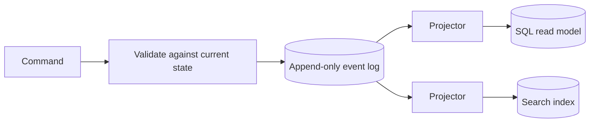
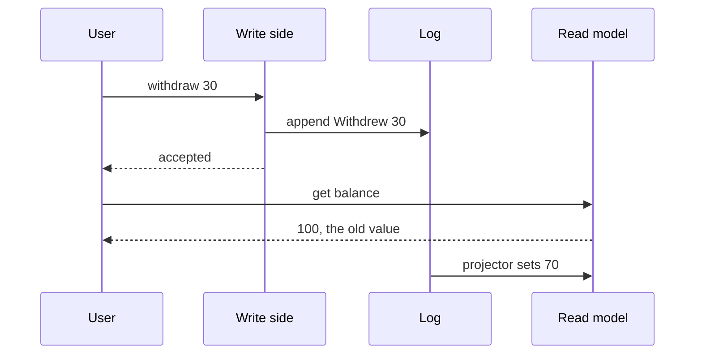

# Event sourcing and CQRS

> Store what happened as the source of truth, and build every view you need by replaying it.

## What it is

Most systems store current state: balance = 70. Event sourcing stores the facts instead: deposited 100, withdrew 30. The facts live in an append-only event log, and state is the result of folding the events (applying them in order, from the start). CQRS (command query responsibility segregation) is the natural partner: commands append events on the write side, and projectors (consumers that fold events into a view) maintain read models shaped for each query.

The two ideas are separate. Event sourcing is about what you store. CQRS is about using different models for writes and reads. You can use CQRS without event sourcing, and many systems do.

## How it works

A command arrives, say "withdraw 30". The write side validates it against current state, then appends one event. The write is a single append: fast and auditable, the same idea as a [write-ahead log](write-ahead-log.md) one level up, except here the log is the product, not an implementation detail. Projectors consume the stream, often through a [message queue](message-queues.md) or [Kafka](../deep-dives/kafka-distributed-messaging.md), and update read models: a SQL table, a cache, a search index. Each query gets exactly the shape it wants.

Validation has a detail that matters. Two commands for the same account can arrive together, and both can see a balance of 70. If both then append a withdrawal of 50, the account goes negative. The standard fix is optimistic concurrency. Each command says which version it read, such as "append as event 8, expecting the stream to be at version 7". The log accepts the first append and rejects the second, which reloads and validates again. The rule is checked per stream, so one account, order, or cart is the unit of consistency.

## When to use it

- Audit is a requirement. In a [payment system](../questions/design-payment-system.md), the ledger already is an event log; event sourcing just names the practice.
- Temporal questions. "What did the cart look like on Tuesday" is a replay up to that moment.
- Many differently shaped read views over the same writes.
- A stream is already the backbone of the system, so the log adds little new cost.

## When not to use it

Plain CRUD (create, read, update, delete) with one view. The costs are real:

- Read-after-write lag: projections update after the command, so a user may not see their own write immediately.
- Event schema evolution forever: old events never go away, so every replayer must understand every historical version.
- Replay time: folding millions of events is slow. Snapshots help when loading one entity: persist the folded state every N events, then replay only from the last snapshot. They do not help when rebuilding a whole read model, as the numbers below show.

## Replay cost, with numbers

Replay is cheap for one entity and expensive for a whole read model. The two cases need different answers.

**Loading one entity.** Assume applying one event, including reading and decoding it, takes about 10 microseconds. A busy account with 50,000 events then takes about half a second to load, on every command. With a snapshot every 1,000 events, a load reads one snapshot and at most 1,000 events, about 10 milliseconds. Snapshots fix the per-entity cost.

**Rebuilding a read model.** Assume 2 billion events in total and one projector that applies 50,000 events per second. A full rebuild then takes 40,000 seconds, about 11 hours. Snapshots do not help here, because the new projection needs every event. The fix is to run projectors in parallel, one per partition of the log, and to rebuild into a fresh table while the old one keeps serving reads.

## The failure mode to name: reading your own write too early

The read model is updated after the command succeeds, not during it. So a user can act, refresh, and see the old value:

Usually the gap is milliseconds to seconds. When a projector falls behind, it can be minutes, and users think the withdrawal failed and try it again. Three standard fixes:

- **Return the new state from the command.** The write side already folded the events, so the user's own screen can show 70 at once.
- **Wait for the version.** The command returns the event version. The read path waits until the projection has reached that version, with a short timeout.
- **Read from the write side for the user's own data.** Keep read models for searches and lists across many entities.

Alert on projection lag, measured as how far each projector's position is behind the end of the log, in events and in seconds. It is the event-sourced equivalent of queue age.

## Trade-offs

| Pro | Con |
|-----|-----|
| Complete audit trail built in; the log is the truth | Read models lag writes (eventual consistency) |
| Each query gets a read model shaped for it | Event schemas must be supported forever |
| Any view can be rebuilt by replaying the log | A full rebuild replays every event and can take hours |
| One append per write keeps the write path fast | Many more components to build and operate than CRUD |

## Common variations

- CQRS without event sourcing: a current-state store remains the truth, and change events feed separate read models. This is the most common production shape. The [outbox pattern](outbox-pattern.md) keeps the state write and the published event atomic.
- Snapshots: periodic saved state so recovery and replay start near the present.
- Rebuild as a deploy technique: to change a read model, run a new projector from event zero into a fresh table, then switch reads over.

## The hard parts to mention in an interview

- **Event design.** Name events as facts in the past tense, such as "ItemAdded", not as commands.
- **Schema evolution.** Add fields with defaults and never change the meaning of an old one. Upcasting is the usual tool: a function converts an old event version to the new one as it is read.
- **Deleting personal data.** An append-only log conflicts with a request to erase a user. One common answer stores personal fields encrypted with a per-user key, and deletes the key.
- **Concurrency.** Optimistic version checks per stream, as above.

## What to say in an interview

A complete answer names five things, in this order:

1. **Why the log is the truth here.** Audit, history, or many views. Without one of these, use CRUD.
2. **The stream and its events.** One stream per entity, with a few past-tense event types.
3. **How writes stay correct.** Validate against folded state, then append with an expected version.
4. **The read models.** Which projections exist, and the lag between write and read.
5. **Rebuild and evolution.** Snapshots for loading, parallel projectors for rebuilds, and how old event versions are read.

Point 4 is where interviewers push. Name the lag between command and projection before they do, and say which fix you use. Do not lead with this pattern for a CRUD app: proposing an event log for a simple admin panel reads as buzzword driven.

## Related pages

- Publishing events from a current-state store: [outbox pattern](outbox-pattern.md).
- The same append-only idea inside a database: [write-ahead log](write-ahead-log.md).
- What the read-side lag means for users: [strong vs eventual consistency](../cheat-sheets/strong-vs-eventual-consistency.md).
- A question where the ledger is the event log: [design a payment system](../questions/design-payment-system.md).

## Go deeper

- Related deep dive: [Kafka](../deep-dives/kafka-distributed-messaging.md)
- Every pattern, in depth: [System Design Patterns](https://www.designgurus.io/course/system-design-patterns?utm_source=github&utm_medium=repo&utm_campaign=grokking-system-design&utm_content=patterns-event-sourcing-cqrs)
- Full course: [Grokking the System Design Interview](https://www.designgurus.io/course/grokking-the-system-design-interview?utm_source=github&utm_medium=repo&utm_campaign=grokking-system-design&utm_content=patterns-event-sourcing-cqrs)
