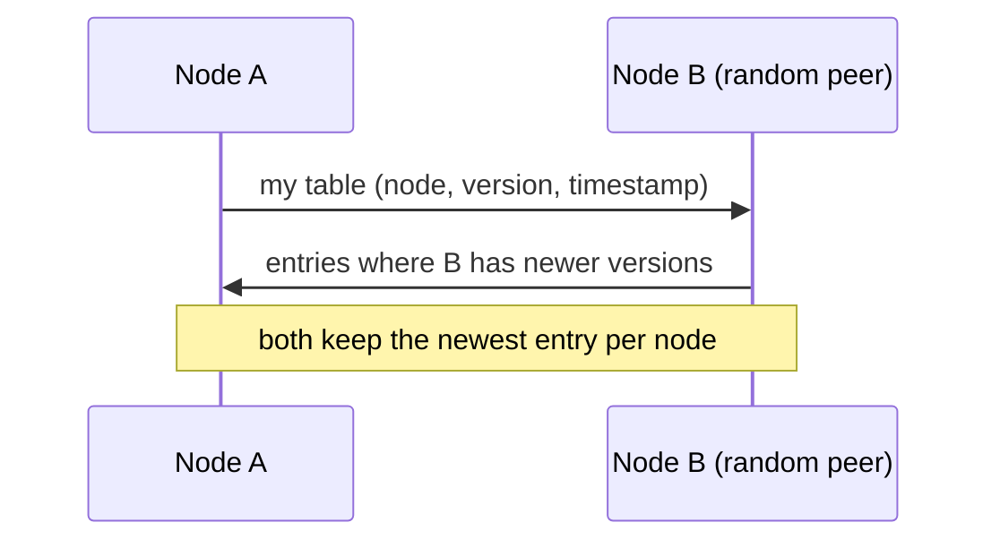
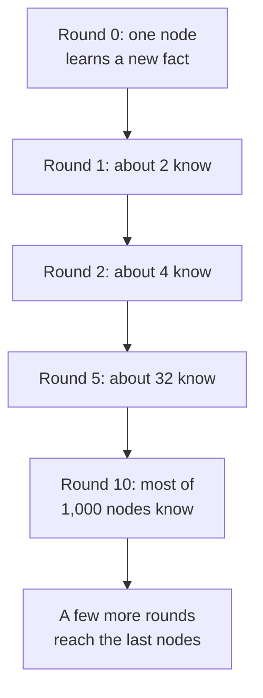
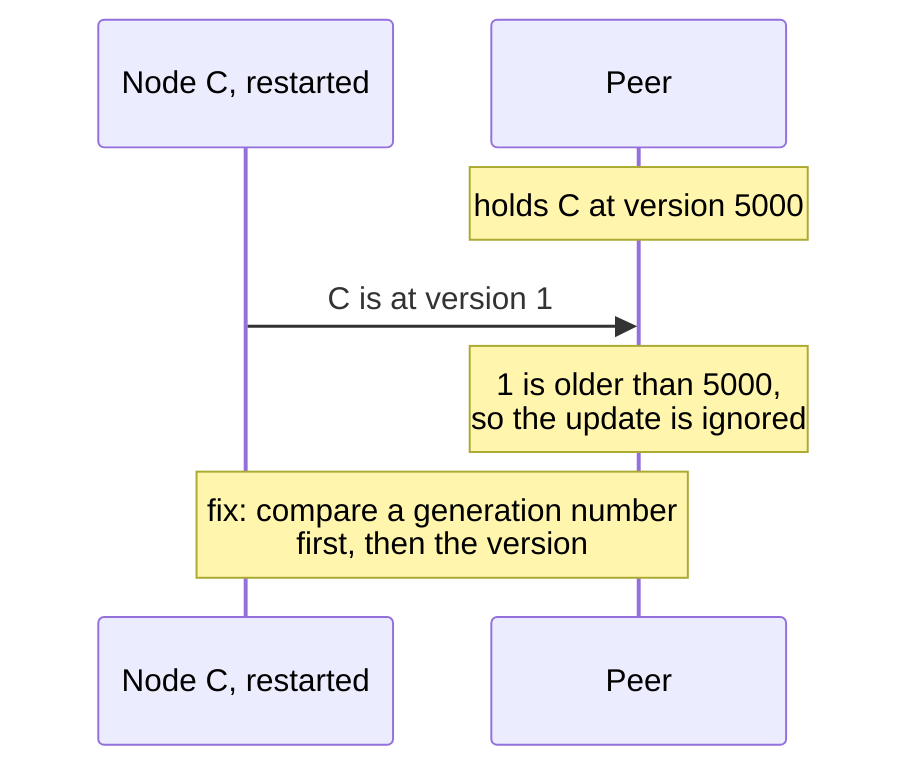

# Gossip protocol

> Nodes learn the state of a large cluster by periodically exchanging what they know with a few random peers.

## What it is

A gossip protocol spreads cluster state without a central registry and without broadcasting to everyone. On a timer (say once per second), each node picks a few random peers and exchanges what it knows: membership, health, versions. Information spreads the way a rumor does. After O(log N) rounds the whole cluster knows, and each node sends the same number of messages per round no matter how large the cluster grows.

The number of peers a node contacts in each round is called the fanout. Typical values are one to three.

## When to use it

- Clusters of hundreds to thousands of nodes that must share a view of who is a member and who is alive.
- State that can be a few seconds behind: membership, health, which node owns which key range, schema versions.
- Systems that must keep working when any single node fails, including a node that would otherwise be the coordinator.
- Not for decisions that need one agreed answer at one instant, such as who the leader is. Use consensus for that (see [Raft](../deep-dives/raft-consensus.md)).

## Why not the alternatives

A central membership service is a single point of failure and a hot spot: every node reports to it, and when it dies nobody knows who is alive. All-to-all [heartbeats](heartbeats.md) (every node pinging every other node) cost N-squared messages per round, which stops scaling at a few hundred nodes. Gossip is the decentralized middle: robust, cheap, and eventually consistent (every node converges to the same view, just not at the same instant).

## How it works

Each node keeps a table with one row per known node: (node id, heartbeat counter or version, last-updated timestamp). Every round, it merges tables with a random peer, keeping the newest entry per node.

Three exchange styles:

- **Push**: send your entries to the peer; simple, but slow to reach the last few uninformed nodes.
- **Pull**: ask the peer for its entries; fast at the end of a rumor's spread, slow at the start.
- **Push-pull**: exchange both ways in one round trip; this is what most real systems use.

## Convergence: rounds grow with log N, cost per node stays flat

This is the idea that separates a strong answer. Work it out loud with push and a fanout of one. At the start, the number of nodes that know a new fact roughly doubles each round, because every informed node tells one more node:

Since 1,000 is close to 2 to the power 10, about 10 rounds reach most of a 1,000-node cluster. The last few nodes take longer, because informed nodes often pick peers that already know. Pull and push-pull reach those last nodes faster. The table shows why gossip scales:

| Cluster size | Rounds to reach most nodes, about log2 N | Messages each node sends per round |
|--------------|------------------------------------------|------------------------------------|
| 100 | about 7 | 1 |
| 1,000 | about 10 | 1 |
| 10,000 | about 13 | 1 |
| 100,000 | about 17 | 1 |

Growing the cluster 100 times, from 1,000 to 100,000 nodes, adds only about 7 rounds. At one round per second, that is about 7 more seconds. The work each node does per round does not change at all.

One cost does grow with N: the size of each message, if a node sends its full table. With 1,000 rows of about 50 bytes each, a full table is about 50 KB per exchange. Real systems send a digest first, which lists only node ids and versions, and then send only the rows that differ. Cassandra runs a gossip round every second and uses a three-message exchange of this kind.

## Failure detection

A node whose table entries stop advancing is suspected, then declared dead after a timeout. Good implementations use graded suspicion instead of a single yes-or-no cutoff, so one slow round does not mark a healthy node dead and then alive again (flapping). Phi accrual failure detection is the name to know: it turns the history of heartbeat arrival times into a continuous suspicion score.

## The failure mode to name: the restarted node

A version counter alone is not enough. When a node restarts, its heartbeat counter starts again from zero:

The peer keeps the old entry, and node C looks dead even though it is running. The fix is a generation number, such as the time the node started, which is compared before the version. A higher generation always wins. Cassandra stores both a generation and a version for each node for this reason.

The reverse problem also exists. If a removed node's row is simply deleted, an old copy of that row can arrive from a peer that has not heard the news, and the node comes back. Systems keep a removed node's row for a while, marked as removed, so that stale gossip cannot restore it.

## Where it is used

- [Cassandra](../deep-dives/cassandra-wide-column-db.md) and [Dynamo](../deep-dives/dynamo-key-value-store.md)-style stores gossip membership and ring state (which node owns which key range).
- Consul and Serf use gossip for service discovery and health checks across thousands of machines.
- As the membership layer under [leader election](leader-election.md): gossip tells you who is alive, and election picks who is in charge. The two work together.

## Trade-offs

| Pro | Con |
|-----|-----|
| No coordinator to fail or overload | Eventual: convergence takes O(log N) rounds, not one |
| Constant messages per node at any cluster size | Fanout (peers contacted per round) and interval need tuning |
| Each side of a partition keeps working | Brief false suspicions under load or packet loss |

## The hard parts

- **Tuning.** A shorter interval or a larger fanout spreads news faster but sends more messages. Say the numbers you chose.
- **Joining the cluster.** A new node must find its first peer somewhere. Many systems list a few seed nodes in configuration for this purpose.
- **Partitions.** During a partition, each side converges to its own view. When the network heals, versions and generations decide which entries win.

## What to say in an interview

A complete answer names five things, in this order:

1. **What state is gossiped.** Membership, health, and ring ownership.
2. **The exchange.** Every second, push-pull with one to three random peers, digest first.
3. **Convergence time.** About log2 N rounds; at 1,000 nodes, roughly 10 to 15 seconds.
4. **Versioning.** A generation plus a version per node, with the newest entry winning.
5. **Failure detection on top.** A suspicion score, and what the system does with a suspected node.

Reach for gossip when asked "how do 1,000 nodes know who is in the cluster?" Answering "heartbeats to a coordinator" at that scale invites a follow-up question: what happens when the coordinator dies or saturates? Point 3 is where a strong answer stands out, because it turns "eventually consistent" into a number of seconds.

## Related pages

- The simpler, centralized form: [heartbeats](heartbeats.md).
- Agreement, which gossip does not give you: [Raft consensus](../deep-dives/raft-consensus.md).
- Placing keys on nodes once membership is known: [consistent hashing](consistent-hashing.md).
- Picking one node in charge on top of membership: [leader election](leader-election.md).

## Go deeper

- Related deep dives: [Cassandra](../deep-dives/cassandra-wide-column-db.md), [Dynamo](../deep-dives/dynamo-key-value-store.md)
- Every pattern, in depth: [System Design Patterns](https://www.designgurus.io/course/system-design-patterns?utm_source=github&utm_medium=repo&utm_campaign=grokking-system-design&utm_content=patterns-gossip-protocol)
- Full course: [Grokking the System Design Interview](https://www.designgurus.io/course/grokking-the-system-design-interview?utm_source=github&utm_medium=repo&utm_campaign=grokking-system-design&utm_content=patterns-gossip-protocol)
