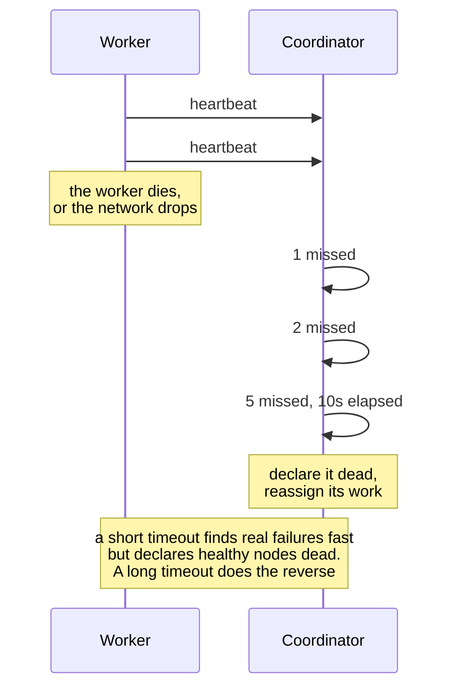
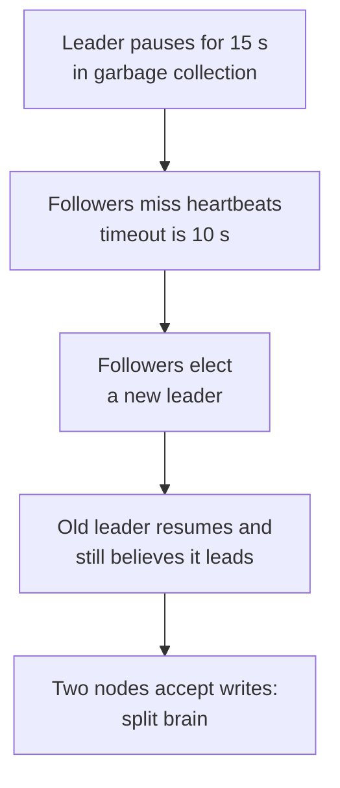

# Heartbeats and failure detection

> Nodes periodically say "I'm alive" so the system can tell a dead server from a slow one and react automatically.

## What it is

In a distributed system you can never directly observe that a remote node is dead; you can only observe that it has stopped talking. A heartbeat is a small periodic message ("still here") sent to a monitor or to peers. Miss enough of them and the node is declared failed, triggering failover, re-replication, or removal from the load balancer pool.

The component that makes this decision is called a failure detector. It watches heartbeats and gives a verdict for each node: alive, or suspected dead. Every failover, re-replication, and leader election in your design depends on that verdict, so its accuracy matters.

## When to use it

- Any pool of servers behind a load balancer (health checks are heartbeats in reverse: the monitor asks, the node answers).
- Cluster membership: who is in the cluster right now, for sharding and rebalancing.
- Detecting a failed leader to trigger a new election.
- Workers that hold a task or a lock, so their work can be reassigned if they disappear.

## How it works

```
[Worker] --heartbeat every 2s--> [Coordinator]
Coordinator rule: no heartbeat for 10s (5 missed) => mark dead, reassign work
```

Two common shapes:

- **Centralized**: every node reports to a coordinator or monitoring service (Kubernetes liveness probes, load balancer health checks, GFS chunkservers reporting to the master).
- **Decentralized (gossip)**: nodes exchange heartbeat state with a few random peers each round, and liveness information spreads epidemically. Cassandra and Dynamo-style systems do this to avoid a central monitor.

The cost of each shape is easy to work out. With 1,000 nodes sending a heartbeat every 2 seconds to one coordinator, the coordinator receives 500 small messages per second, which is trivial. If instead every node pinged every other node, each round would send 1,000 x 999 messages, about one million, or roughly 500,000 per second. That is why large clusters use a coordinator or [gossip](gossip-protocol.md) instead of all-to-all pings.

## Detection time: interval times missed count

A heartbeat policy is two numbers: how often a node sends a heartbeat, and how many heartbeats may be missed. Their product is the detection timeout. With a 2-second interval and 5 missed heartbeats, the timeout is 10 seconds. The coordinator counts from the last heartbeat it received. So a node that fails just after sending one is declared dead about 10 seconds later, and a node that fails just before its next one is declared dead about 8 seconds later.

The default Kubernetes liveness probe follows the same arithmetic. It checks every 10 seconds and restarts a container after 3 failures in a row, so a hung container is restarted between about 20 and 30 seconds after it stops answering, depending on when the next check falls.

## The timeout trade-off

You are never observing death. You are observing silence, and choosing how long to wait before acting on it:



The detection timeout is the central choice:

| Timeout | Consequence |
|---------|-------------|
| Too short | Slow-but-alive nodes are declared dead: false positives, needless failovers, flapping |
| Too long | Real failures go unnoticed: requests keep routing to a dead node |

A live node can go silent for several seconds for ordinary reasons: a long garbage-collection pause, a saturated network link, a busy disk, or a virtual machine paused by its host. The timeout must be longer than the longest normal pause, with a margin.

## Match the timeout to the cost of the action

This is the idea that separates a strong answer. Not every reaction to a missed heartbeat costs the same, so they should not share one timeout.

- **Cheap and reversible:** stop sending new requests to the node. If the verdict was wrong, the node rejoins the pool a few seconds later. A short timeout is fine here.
- **Expensive:** copy all of the node's data to other nodes, or elect a new leader. If a node holds 2 TB and the verdict was wrong, you start copying 2 TB for nothing. Wait longer before you do this.

HDFS is a clear example. DataNodes send a heartbeat every 3 seconds by default, but the NameNode waits about ten and a half minutes by default before it declares one dead and re-replicates its blocks. A short restart should not trigger a full copy of a machine's data.

## The failure mode to name: two leaders

A network partition is indistinguishable from a crash, and so is a long pause. When the node that was declared dead is still alive, it can keep acting:



This is why failover decisions should be paired with [quorum](quorum.md) agreement and fencing (see [leader election](leader-election.md)) rather than taken by a single observer. The standard safety measures:

- **Leases.** The leader holds its authority only for a fixed time and must renew it. When the lease runs out, the leader stops acting on its own, even if nobody tells it. This depends on clocks that drift only a small, bounded amount.
- **Fencing tokens.** Each new leader receives a higher number, and the storage layer rejects writes that carry an older number. The old leader's late writes then fail safely.
- **Quorum.** A majority must agree that a node is dead, so one observer with a bad network link cannot trigger a failover.

## Adaptive detectors

A fixed timeout ignores how the network actually behaves. Adaptive detectors (like the phi accrual detector) adjust the threshold to observed network behavior instead of using a fixed timeout. The phi accrual detector keeps a history of the gaps between heartbeats. From that history it computes how unlikely the current silence is, and it reports that as a suspicion score called phi. Cassandra uses this detector, with a default threshold of 8. A phi of 8 means that, if past arrival times are a guide, a silence this long would occur by chance about once in 100 million times.

## Trade-offs

| Pro | Con |
|-----|-----|
| Simple, cheap, and works almost everywhere | Cannot tell a crash from a partition or a pause |
| Gives a concrete detection time to reason about | Short timeouts cause false failovers; long ones leave traffic on dead nodes |
| The centralized form is easy to operate | The coordinator itself needs a failure detector |

## What to say in an interview

A complete answer names five things, in this order:

1. **Who watches whom.** A coordinator, the load balancer, or peers through gossip.
2. **The policy as numbers.** The interval, the missed count, and the detection time they give.
3. **The action and its cost.** Stop routing quickly; wait longer before re-replicating or electing.
4. **The false positive.** Why a live node can go silent, through a pause or a partition.
5. **The safety net.** Leases, fencing tokens, or quorum, so a wrong verdict cannot corrupt data.

Whenever you say "if the server fails, we fail over," the interviewer's next question is "how do you know it failed?" Answer with points 1 and 2, then move straight to point 5. A candidate who admits the detector will sometimes be wrong, and shows why the system stays safe anyway, gives the stronger answer.

## Related pages

- Spreading heartbeat state without a coordinator: [gossip protocol](gossip-protocol.md).
- What happens after a leader is declared dead: [leader election](leader-election.md).
- Making the dead-node decision by majority: [quorum](quorum.md).
- Fencing tokens in practice: [distributed locking](distributed-locking.md).

## Go deeper

- Related deep dives: [GFS](../deep-dives/gfs-distributed-file-system.md), [Cassandra](../deep-dives/cassandra-wide-column-db.md)
- Every pattern, in depth: [System Design Patterns](https://www.designgurus.io/course/system-design-patterns?utm_source=github&utm_medium=repo&utm_campaign=grokking-system-design&utm_content=patterns-heartbeats)
- Full course: [Grokking the System Design Interview](https://www.designgurus.io/course/grokking-the-system-design-interview?utm_source=github&utm_medium=repo&utm_campaign=grokking-system-design&utm_content=patterns-heartbeats)
