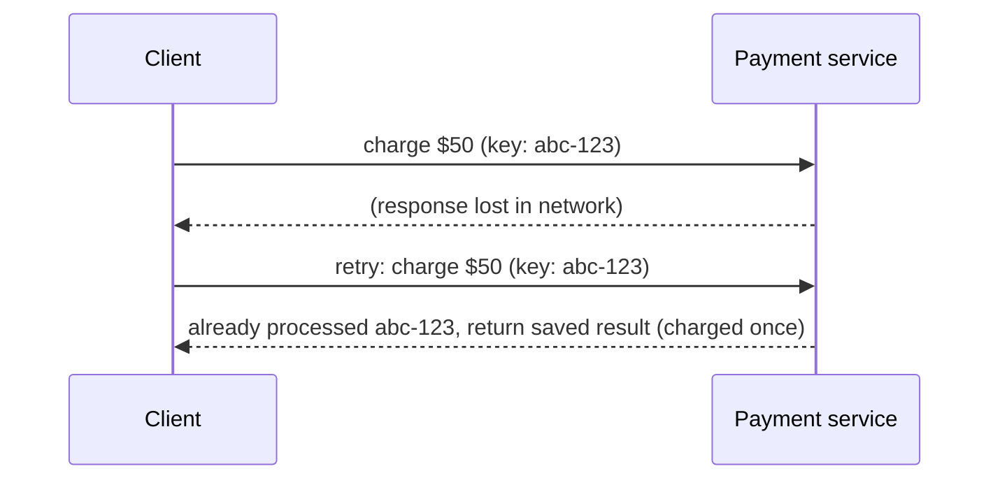
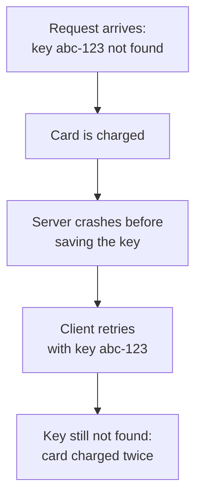

# Idempotency

> Design operations so that doing them twice has the same effect as doing them once, making retries safe.

## What it is

Networks fail in an ambiguous way: when a request times out, the caller cannot know whether the server processed it. The only safe recovery is to retry, and retries are only safe if the operation is idempotent: executing it N times leaves the system in the same state as executing it once. Charging a card, sending an email, and inserting a row are not naturally idempotent; good designs make them so.

A timeout hides three different outcomes. The request may never have arrived. It may have arrived and failed. Or it may have succeeded, with only the response lost on the way back. The caller sees the same silence in all three cases, so the server must make a repeat of the third case harmless.

## When to use it

- Any operation a client may retry after a timeout, which in practice means every write API.
- Consumers of message queues that deliver at least once.
- Operations with external side effects: charging money, sending a message, shipping an order.
- Webhook receivers, because senders retry until they receive a success response.

## How it works

The standard mechanism is an **idempotency key**: the client generates a unique ID per logical operation and sends it with every attempt. The server records the key with the result of the first execution and replays the stored result for any duplicate.

The key check and the operation must be atomic (a unique constraint in the database, or an atomic set-if-absent), otherwise two concurrent retries can both pass the check.

A complete key record holds four things: the key, a hash of the request body, a status (in progress or done), and the saved response. The hash catches a client bug where the same key is sent with a different request; the server should reject that request rather than replay an unrelated result. The status handles a duplicate that arrives while the first attempt is still running. A common choice is to answer 409 Conflict and let the client retry later.

## Exactly once means at least once plus deduplication

This is the idea that separates a strong answer from a weak one. A network cannot guarantee that a message is delivered exactly once. A sender that never retries risks losing the message, which is called at-most-once delivery. A sender that retries risks duplicates, which is called at-least-once delivery. There is no third option at the network level.

What you can build is an exactly-once effect: at-least-once delivery combined with idempotent processing. When a system advertises exactly-once behavior, it means this, within its own boundary. Kafka transactions, for example, give exactly-once results for a read, process, and write cycle that stays inside Kafka. As soon as your consumer writes to an outside database or calls an outside API, deduplication becomes your job again.

## The failure mode to name: the gap between the effect and the record

The key protects you only if the key record and the effect are saved together. If they are saved separately, a crash between them brings the duplicate back:

Three standard fixes, depending on where the effect happens:

- **One transaction.** If the effect is a write to your own database, insert the key row and make the write in the same transaction. Both commit or neither does.
- **Record first.** Insert the key as "in progress" before calling an outside system. On a retry, the server finds the in-progress record and checks the outside system's status instead of repeating the call.
- **Pass the key downstream.** Send the same key to the payment provider, so its own deduplication covers the gap. Each hop is then idempotent on its own.

## How long to keep keys

The deduplication window must be longer than the longest time a client may keep retrying. A retry that arrives after its key has expired is treated as a new request. Stripe documents that its keys may be removed once they are at least 24 hours old.

Work out the storage. At 1,000 payments per second, one day produces 1,000 x 86,400 = 86.4 million key records. Assume about 500 bytes per record, including the saved response. That is about 43 GB per day, which fits in one database table with an expiry on old rows. The client's retry schedule must end well inside that window.

## Where it matters most

- Payments and orders: Stripe's `Idempotency-Key` header is the canonical example.
- [Message queues](message-queues.md): most deliver at-least-once, so every consumer sees duplicates eventually; consumers must deduplicate or be idempotent.
- Any write API called by clients with retry logic.

## Techniques

| Technique | How |
|-----------|-----|
| Idempotency keys | Client-supplied unique ID, server dedupes and replays result |
| Natural idempotency | `SET x = 5` instead of `INCREMENT x`; upsert instead of insert |
| Conditional writes | Compare-and-set with a version number; duplicate applies fail cleanly |
| Database constraints | Unique index on a business key turns duplicates into handled errors |

## Trade-offs

| Pro | Con |
|-----|-----|
| Retries become safe, so clients can retry freely | An extra write and stored record on every request |
| Queues that deliver at least once become usable | The key store is on the critical path and needs high availability |
| Duplicates get a clear, repeatable answer | The client must create the key and keep it across retries |

## The hard parts

- **Who creates the key.** The client creates it once per logical operation, before the first attempt. A key created for each attempt, or created by the server, removes no duplicates.
- **Key scope.** Store keys per account or per user, so two clients cannot collide on the same value.
- **Replaying errors.** Decide whether the result of a failed first attempt is saved and replayed, or whether a retry may run the operation again. Saving the failure is simple and predictable. Allowing a rerun helps when the failure was temporary, but only if the first attempt is known to have had no effect.

## What to say in an interview

A complete answer names five things, in this order:

1. **Where duplicates come from.** Client retries after timeouts, queues that deliver at least once, and webhooks.
2. **The key.** Created by the client per logical operation and sent with every attempt.
3. **The atomic check.** A unique constraint or set-if-absent, committed with the effect, or recorded first as in progress when the effect is outside.
4. **What a duplicate receives.** The saved response, or 409 while the first attempt is still running.
5. **The window.** How long keys live, and why that covers the retry schedule.

Any time your design includes a retry, a queue, or a payment, say the word "idempotent". Then explain the mechanism in one sentence: "the client sends an idempotency key, we store it with the result, duplicates get the stored result." In payment and messaging designs, that one sentence shows a great deal of understanding. Point 3 is the follow-up interviewers ask, so be ready to explain the crash between the effect and the record.

## Related pages

- Writing a database change and an event together: [outbox pattern](outbox-pattern.md).
- Retries and their limits: [circuit breaker](circuit-breaker.md).
- When one operation spans several services: [distributed transactions](distributed-transactions.md).
- Where at-least-once delivery comes from: [message queues](message-queues.md).

## Go deeper

- Full question walkthrough: [Design a payment system](../questions/design-payment-system.md)
- Every pattern, in depth: [System Design Patterns](https://www.designgurus.io/course/system-design-patterns?utm_source=github&utm_medium=repo&utm_campaign=grokking-system-design&utm_content=patterns-idempotency)
- Full course: [Grokking the System Design Interview](https://www.designgurus.io/course/grokking-the-system-design-interview?utm_source=github&utm_medium=repo&utm_campaign=grokking-system-design&utm_content=patterns-idempotency)
