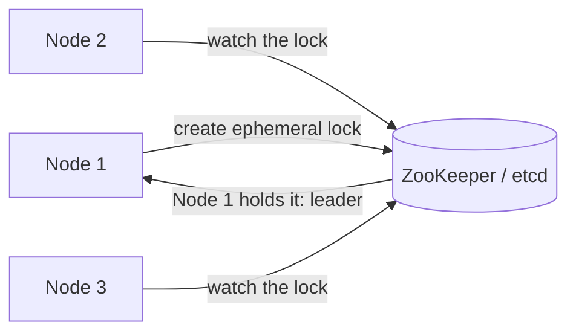
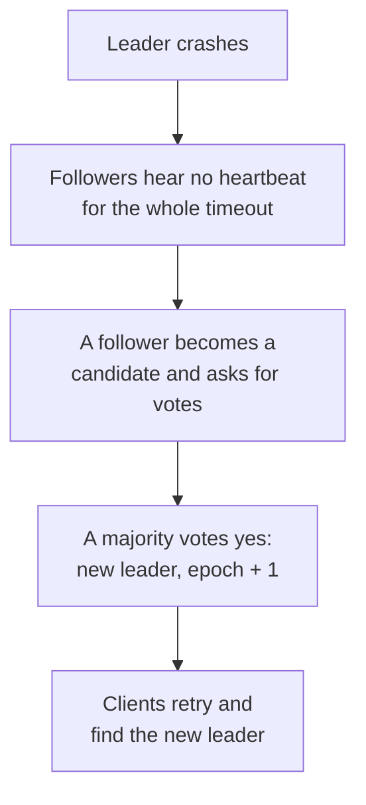
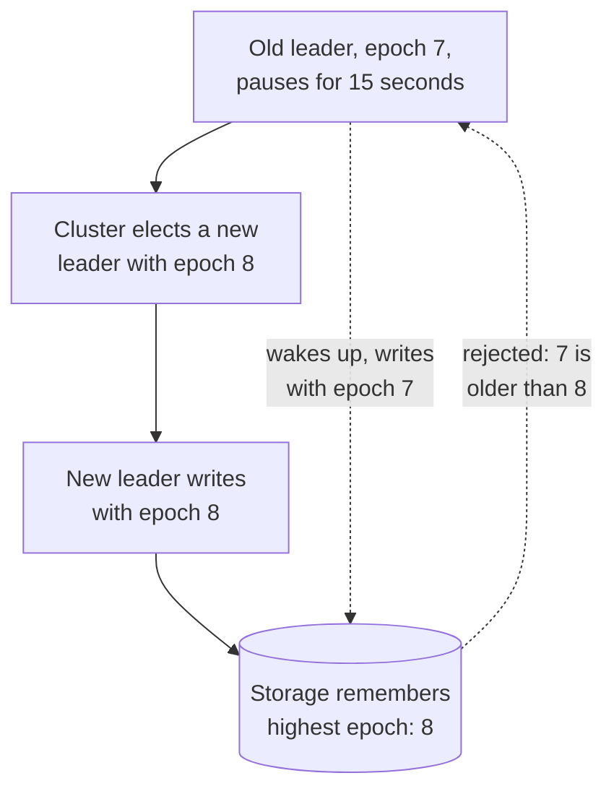

# Leader election (leader and follower)

> Pick one node to be in charge of a task or a data partition, and pick a new one automatically when it fails.

## What it is

Many problems get dramatically simpler when exactly one node makes the decisions: ordering writes to a partition, running a scheduled job exactly once, coordinating a cluster. Leader election is the mechanism by which a group of nodes agrees on who that one node is, and re-agrees when the leader dies. The other nodes are followers: they copy the leader's decisions and wait to take over.

## When to use it

- Single-writer-per-partition databases (Kafka partition leaders, primary replicas).
- "Exactly one node should do this" jobs: cron scheduling, compaction, cluster rebalancing.
- Coordinators in distributed transactions and cluster managers.

Skip it when the work does not need one decision-maker. If any node can safely handle any request, because the work is split by key or every operation is [idempotent](idempotency.md), there is nothing to elect. Each leader you add is one more failover to design, test and explain.

## How it works

Modern systems rarely implement election from scratch. They either use a consensus protocol directly (Raft, Paxos, ZAB) or lean on a coordination service that already runs one:

Each candidate tries to create the same ephemeral key; whoever succeeds is leader. An ephemeral key is one that the service deletes when its owner's session ends. The key is tied to a session kept alive by [heartbeats](heartbeats.md), so if the leader dies, the key vanishes and the watchers race to elect a successor. The coordination service itself accepts a write only when a majority [quorum](quorum.md) of its servers agrees, so two partitions cannot each elect their own leader.

## Failover, worked out loud: the timeout is the outage

A follower cannot see that a leader has died. It can only see that the leader has gone silent. So every election starts with a timeout, and that timeout is most of the outage:

Put numbers on it. The documented etcd defaults are a 100 ms heartbeat and a 1,000 ms election timeout. A crashed leader there means at least one second with no leader, plus the vote and the client retries. If the leader instead holds a coordination service session with a 10-second timeout, the gap is at least 10 seconds. At 5,000 writes per second, a 10-second gap is 50,000 writes that must wait, be retried, or fail.

A shorter timeout is not free. The timeout must be longer than the normal pauses of a healthy leader: garbage collection, a busy disk, a slow network. If a pause exceeds the timeout, the cluster elects a new leader that it did not need. Each such false failover causes its own short outage. Raft also randomizes each node's election timeout (the Raft paper suggests 150 to 300 ms), so followers do not all become candidates at once and split the vote.

This is the first idea that separates a strong candidate: the timeout trades recovery time against false failovers, and you should state which side you chose.

## The failure mode to name: the zombie leader

A leader that is merely slow (a long garbage collection pause, or a brief network failure) may believe it is still leader after a successor has been elected. The fix is a **fencing token**: an epoch number that increases with each election and travels with every write. Downstream systems reject writes carrying an older epoch, so the deposed leader cannot overwrite newer data in any system that checks it.

The second idea that separates a strong candidate is where this check happens. The old leader cannot check its own status, because it does not know it was paused. The storage or downstream service must check the epoch on every write. Detection is a guess, so safety must come from the epoch, not from the timeout.

## Trade-offs

| Pro | Con |
|-----|-----|
| Simple reasoning: one decision-maker per scope | Leader caps throughput for its scope, and its loss stops writes until failover |
| No conflicting concurrent writes | Failover window means brief unavailability |
| Well-supported by off-the-shelf tools (ZooKeeper, etcd) | Split brain if done without quorum and fencing |

## The hard parts to mention in an interview

- **The leader is a bottleneck.** One leader caps write throughput for its scope. Scale by electing one leader per partition, as Kafka does for each partition.
- **Leases depend on clocks.** Some leaders hold a lease, a time-limited right to act, and stop serving when it expires. That is safe only if clocks drift by less than the safety margin you leave.
- **Clients must find the new leader.** Clients either ask the coordination service, or a follower redirects them. Either way they need retries with backoff, or every client retries at the same moment.
- **Writes in flight may be lost.** With asynchronous replication, writes the old leader confirmed but had not yet copied can be lost on failover. Confirm writes only after a majority has them if that loss is not acceptable.

## What to say in an interview

Never say "the nodes just agree." Name the tool (ZooKeeper, etcd) or the protocol (Raft). Then answer the classic follow-ups before they are asked: how do you detect the leader is dead (heartbeats and session timeouts), and what stops a paused old leader from writing (fencing tokens)? A complete answer names five things, in this order:

1. **The scope of leadership.** One leader for the cluster, or one per partition.
2. **How the leader is chosen.** The tool or protocol, and the majority it needs.
3. **How failure is detected.** The heartbeat, the timeout, and the outage that timeout implies.
4. **What stops the zombie leader.** An epoch, checked by the storage on every write.
5. **What clients do during failover.** Retry, buffer, or fail, and for how long.

Point 4 is the one interviewers push on. If nothing downstream checks the epoch, two leaders can write at once, however good the election is.

## Related pages

- How silence is turned into a failure decision: [heartbeats](heartbeats.md).
- The same fencing idea applied to a single lock: [distributed locking](distributed-locking.md).
- An election protocol explained step by step: [Raft](../deep-dives/raft-consensus.md).
- The coordination service most systems use for this: [ZooKeeper](../deep-dives/zookeeper-coordination.md).

## Go deeper

- Related deep dive: [Chubby, Google's distributed lock service](../deep-dives/chubby-distributed-locking.md)
- Every pattern, in depth: [System Design Patterns](https://www.designgurus.io/course/system-design-patterns?utm_source=github&utm_medium=repo&utm_campaign=grokking-system-design&utm_content=patterns-leader-election)
- For harder, distributed-systems depth: [Advanced System Design Interview, Volume II](https://www.designgurus.io/course/grokking-system-design-interview-ii?utm_source=github&utm_medium=repo&utm_campaign=grokking-system-design&utm_content=patterns-leader-election)