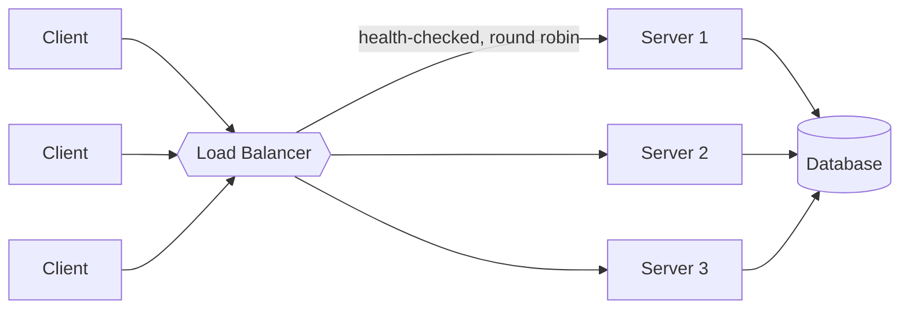
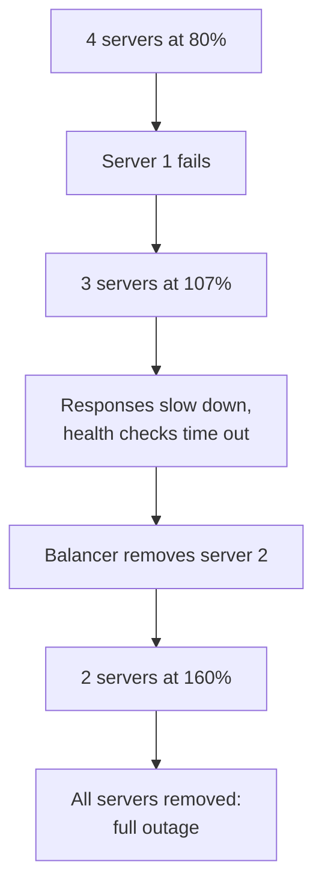

# Load balancing

> Spread incoming traffic across multiple servers so no single one is overwhelmed, and so the system stays available when a server fails.

## What it is

A load balancer sits in front of a pool of servers and distributes requests among them. It improves scalability, because you add more servers behind it, and availability, because it routes around unhealthy servers. It can work at the transport layer (L4), where it sees only IP addresses and ports. It can also work at the application layer (L7), where it reads HTTP attributes like the path or headers.

A load balancer does two jobs at once. It chooses a server for each request, and it decides which servers may receive requests at all. The second job, health checking, is where many real outages begin.

## When to use it

- Any service that runs on more than one instance.
- When you need horizontal scaling and zero-downtime deploys.
- When you want health checks to remove failed instances automatically.

## Balancing algorithms

| Algorithm | How it works | Best for |
|-----------|--------------|----------|
| Round robin | Rotate through servers in order | Uniform servers and requests |
| Weighted round robin | Round robin with capacity weights | Mixed server sizes |
| Least connections | Send to the server with fewest active connections | Long-lived or uneven requests |
| Least response time | Favor the fastest-responding server | Latency-sensitive services |
| Hashing (for example by client IP) | Map a key to a server consistently | Sticky sessions, cache locality |

Round robin assumes every request costs the same, which is rarely true. If one request in fifty is a report that takes two seconds, round robin still sends reports to a server that is already busy with three of them. Least connections reacts to that, because a busy server holds more open requests.

A useful refinement is **the power of two choices**. The balancer picks two servers at random and sends the request to the less loaded one. This is a well-studied result: comparing just two random servers makes the busiest server far less busy than pure random choice. It also avoids a problem with strict least connections across many balancers, where every balancer sends traffic to the same idle server at the same moment.

## L4 vs L7

- L4 (transport): fast, routes by IP and port, no visibility into the request content.
- L7 (application): can route by URL path, header, or cookie, enabling features like path-based routing and TLS termination, at a small latency cost.

## Capacity: plan for the server you will lose

This is the idea that separates a strong answer. A pool is not sized for normal traffic. It is sized for normal traffic **minus one server**.

Work it out loud. Assume 8,000 requests per second, and servers that each handle 2,500 requests per second at full capacity.

| Servers | Load per server, all healthy | Load per server, one failed |
|---------|------------------------------|-----------------------------|
| 4 | 2,000 (80%) | 2,667 (107%) |
| 5 | 1,600 (64%) | 2,000 (80%) |
| 6 | 1,333 (53%) | 1,600 (64%) |

Four servers look comfortable at 80%, but they are not. The first failure pushes the other three past their limit. The rule is simple: with N servers, keep each one below (N-1)/N of its capacity. If you run across three availability zones, also plan for losing a whole zone, which removes a third of the fleet at once.

Health checks have numbers too. Assume the balancer checks every 10 seconds and marks a server unhealthy after 3 failed checks. A server that dies can keep receiving traffic for up to about 30 seconds. With four servers at 8,000 requests per second, that is about 2,000 failing requests per second for 30 seconds. Shorter intervals detect failure faster, but they can also remove a server after one slow response. Passive checks help here: the balancer watches real responses and ejects a server that returns many errors.

## The failure mode to name: the cascading overload

When the pool has no headroom, one failure can become a full outage:

The health checker made it worse. It treated slow servers as dead servers and removed capacity exactly when capacity was short. The standard defenses:

- **Headroom:** size for N-1, as above.
- **Load shedding:** an overloaded server rejects some requests quickly instead of serving all of them slowly. A fast rejection keeps its health check passing.
- **Limit ejection:** never let health checks remove more than a set share of the pool. Some proxies, such as Envoy, have a panic threshold: when too few servers look healthy, they send traffic to all of them.
- **Slow start:** ramp traffic to a recovered server gradually, so it does not fail again while its caches are cold.

## Avoiding a single point of failure

The load balancer itself must not be a single point of failure. Run it in a redundant pair (active-passive or active-active) and use DNS or a floating IP to fail over.

## Trade-offs

| Pro | Con |
|-----|-----|
| Horizontal scaling and high availability | Another component to operate and secure |
| Health checks remove bad instances | Can become a bottleneck if undersized |
| Enables zero-downtime deploys | Sticky sessions complicate scaling |

## The hard parts

- **Sticky sessions.** Pinning a user to one server keeps session data local, but load becomes uneven and a server failure loses those sessions. Prefer stateless servers with session data in a shared store.
- **Long-lived connections.** A balancer spreads new connections, not existing ones. After a deploy, old WebSocket connections stay where they are, so new servers sit idle. See [long polling, WebSockets, and SSE](long-polling-websockets-sse.md).
- **Draining.** Before removing a server, stop sending it new requests and let current ones finish. Without draining, every deploy causes errors.

## What to say in an interview

A complete answer names five things, in this order:

1. **Where the balancer sits and its layer.** L4 or L7, and why.
2. **The algorithm.** Round robin for uniform requests, least connections or two random choices for uneven ones.
3. **Health checks.** The interval, the failure threshold, and how long a dead server keeps receiving traffic.
4. **Headroom.** The pool survives losing one server, or one zone.
5. **The balancer's own redundancy.** A pair, or a managed service across zones.

Point 4 is the one interviewers push on. Mention sticky sessions only if the app needs them, and prefer stateless services so you do not.

## Related pages

- Choosing the layer: [L4 vs L7 load balancing](../cheat-sheets/l4-vs-l7-load-balancing.md).
- Routing by key so a server keeps its cache: [consistent hashing](consistent-hashing.md).
- The general building block behind every balancer: [proxies](proxies.md).
- How failure is detected in the first place: [heartbeats](heartbeats.md).

## Go deeper

- Read more (free): [Complete Load Balancer Guide](https://www.designgurus.io/blog/complete-load-balancing-guide?utm_source=github&utm_medium=repo&utm_campaign=grokking-system-design&utm_content=patterns-load-balancing)
- Every pattern, in depth: [System Design Patterns](https://www.designgurus.io/course/system-design-patterns?utm_source=github&utm_medium=repo&utm_campaign=grokking-system-design&utm_content=patterns-load-balancing)
- Full course: [Grokking the System Design Interview](https://www.designgurus.io/course/grokking-the-system-design-interview?utm_source=github&utm_medium=repo&utm_campaign=grokking-system-design&utm_content=patterns-load-balancing)
