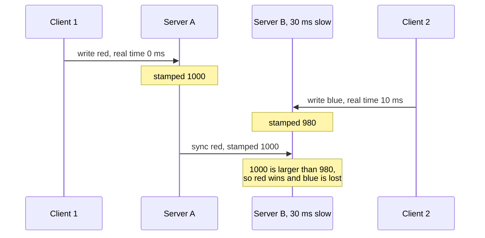
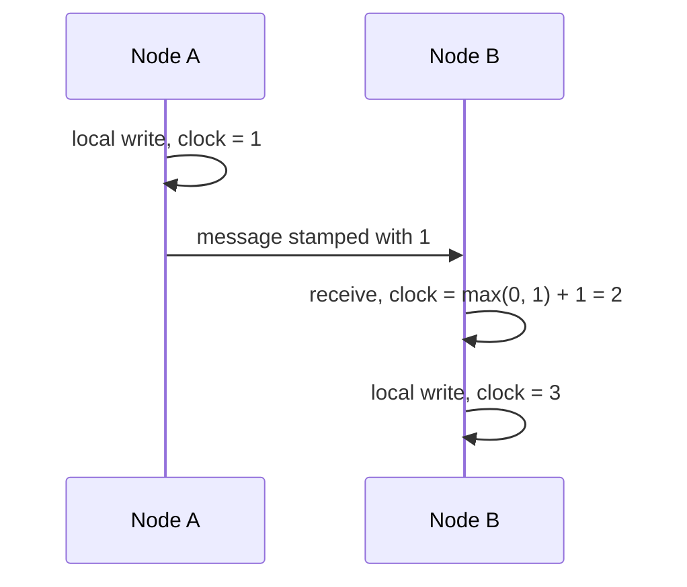

# Logical clocks: Lamport and vector clocks

> Order events across machines with counters, because wall clocks on different servers cannot be trusted to agree.

## What it is

A logical clock is a counter that each machine keeps and attaches to events, so the system can tell which event came before which. It replaces wall time with a counter. It does not know what time it is. It only knows what happened before what.

"Happened before" has a precise meaning here. Event A happened before event B if B could have known about A: they ran in order on one machine, or a message carried news of A to the machine where B ran. If neither event could have known about the other, they are concurrent.

## When to use it

- Two or more places accept writes to the same data: multi-leader or leaderless [replication](replication.md).
- You must merge conflicting updates instead of dropping one, as in a shopping cart or a shared document.
- You need one agreed order for log entries or messages that come from many nodes.
- Not when each key has a single leader. That leader already orders every write to the key.

## The problem with wall clocks

Every machine's clock drifts. NTP (Network Time Protocol, the standard clock sync service) keeps servers roughly in agreement, but their clocks can still differ by milliseconds or more. That difference is called clock skew. So when two servers each accept a write, comparing their timestamps cannot tell you which write happened first. Systems that resolve conflicts with "last writer wins by timestamp" silently drop writes whenever the clocks disagree. The expensive exception is Google Spanner, which buys globally trusted time with atomic clocks and GPS receivers ([deep dive](../deep-dives/spanner-global-sql.md)). Everyone else needs a different tool: a logical clock.

## The failure mode to name: a later write loses

Work one example out loud. Server B's clock runs 30 ms behind server A's. Client 1 writes "red" to A. Ten milliseconds later in real time, client 2 writes "blue" to B. Blue is the newer write. But A stamps red at 1,000 ms and B stamps blue at 980 ms, so last-writer-wins keeps red:

Nothing reports an error. Client 2 was told its write succeeded, and it is gone. The general rule is simple: if clocks can disagree by up to S milliseconds, any two writes to one key less than S apart can be ordered wrongly. A key updated many times per second will meet this regularly, even with small skew.

## Lamport clocks

Each node keeps one integer counter:

- Increment it on every local event.
- Stamp every outgoing message with the current value.
- On receiving a message, set the counter to max(local, received) + 1.

The guarantee runs one way only: if event A happened before event B, then clock(A) < clock(B). The reverse does not hold. A smaller clock value does not prove the event happened first. Break ties by node id and you get a consistent total order (every node sorts events the same way), which is useful for ordering log entries. What a Lamport clock cannot do is detect that two events were concurrent, meaning neither one could have known about the other.

## Vector clocks

A vector clock keeps one counter per node, so each node carries a vector like {A: 2, B: 5, C: 1}. Comparing two vectors answers the question Lamport clocks cannot:

- If one vector is less than or equal to the other in every slot, and the two are not identical, that event happened before.
- If each vector is ahead of the other somewhere, the events were concurrent.

Work through three writes to one key:

| Write | Vector | Compared with Y |
|-------|--------|-----------------|
| X | {A: 2, B: 1} | Behind or equal in every slot: X happened before Y |
| Y | {A: 2, B: 3} | |
| Z | {A: 3, B: 1} | Ahead on A, behind on B: Z and Y are concurrent |

Y can safely replace X. Z and Y cannot replace each other, so the store keeps both as siblings until something merges them.

Detecting concurrency is the point. Instead of guessing which of two conflicting writes to keep, the system knows they were a true conflict and can keep both versions, then merge them.

This is the idea that separates a strong answer. Decide what you need: one agreed order (a Lamport clock is enough), or the ability to tell a real conflict from a normal update (only a vector clock does that).

## Where you meet them

The original Dynamo store ([deep dive](../deep-dives/dynamo-key-value-store.md)) versions each object with a vector clock, so a [shopping cart](../questions/design-amazon-shopping-cart.md) written on both sides of a network partition merges instead of losing items. Multi-leader [replication](replication.md) uses the same idea to detect conflicting writes, and what you do with a detected conflict is really a choice among [consistency models](consistency-models.md).

Hybrid logical clocks combine wall time with a logical counter. Their timestamps stay close to real time and still respect "happened before". CockroachDB uses them.

## Trade-offs

| Lamport clock | Vector clock |
|---------------|--------------|
| One integer, tiny to store and send | One counter per writer, so size grows with the number of writers |
| Gives a total order with a node id tiebreak | Detects concurrency, so true conflicts are found instead of guessed |
| Cannot detect concurrent events | Needs pruning, or the vectors bloat over time |

Many production systems choose last-writer-wins instead, for simplicity, and accept the occasional lost update. Cassandra does this, and so do DynamoDB global tables for concurrent writes made in different regions.

## The hard parts to mention in an interview

- **Detection is only half the work.** The system still needs a merge rule. A cart can take the union of both versions, but then a deleted item can come back, as the Dynamo paper notes.
- **Vectors grow.** Use one entry per server, not per client. The Dynamo paper drops the oldest entry once a vector passes a size limit, which can turn a known order into a false conflict.
- **A Lamport order is not a real-time order.** Two unrelated events get some order, but not necessarily the order in which they really happened.

## What to say in an interview

The moment your design has two places that accept writes, expect the question "how do you know which version is newer?" Answering "compare timestamps" is the weak answer. The strong answer is either vector clocks (detect the conflict, then merge or surface it) or restructuring so each key has a single writer. Naming that choice out loud is the signal interviewers listen for. A complete answer names five things, in this order:

1. **Where concurrent writes can happen.** Which keys, and which nodes accept them.
2. **Why timestamps fail.** Clock skew, with the lost-write example.
3. **Order or detection.** A Lamport clock for one agreed order, a vector clock to find conflicts.
4. **The merge rule.** Union, a per-field rule, or showing both versions to the user.
5. **The alternative.** One writer per key, which removes the problem.

## Related pages

- Where concurrent writers come from: [replication](replication.md).
- The question that depends on merging conflicting writes: [design an Amazon shopping cart](../questions/design-amazon-shopping-cart.md).
- A store that keeps last-writer-wins and accepts the cost: [Cassandra](../deep-dives/cassandra-wide-column-db.md).
- What a merged conflict means for readers: [consistency models](consistency-models.md).

## Go deeper

- Related deep dives: [Dynamo](../deep-dives/dynamo-key-value-store.md), [Spanner](../deep-dives/spanner-global-sql.md)
- Every pattern, in depth: [System Design Patterns](https://www.designgurus.io/course/system-design-patterns?utm_source=github&utm_medium=repo&utm_campaign=grokking-system-design&utm_content=patterns-logical-clocks)
- Full course: [Grokking the System Design Interview](https://www.designgurus.io/course/grokking-the-system-design-interview?utm_source=github&utm_medium=repo&utm_campaign=grokking-system-design&utm_content=patterns-logical-clocks)
