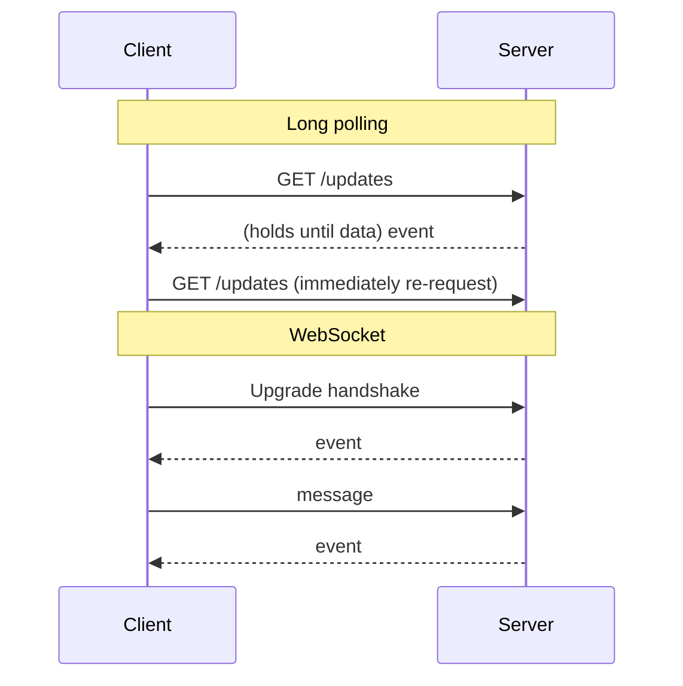
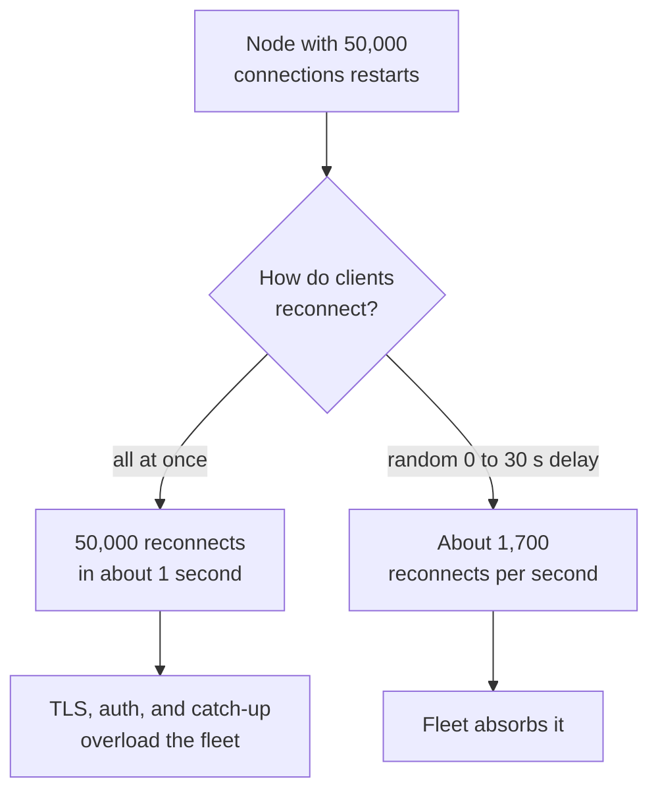

# Long polling vs WebSockets vs Server-Sent Events

> Three ways to push real-time updates from server to client, from "good enough" to fully bidirectional.

## What it is

Plain HTTP is request-response: the server cannot start a conversation. Chat apps, live feeds, notifications, and collaborative editors all need the server to deliver updates the moment they happen. These three techniques close that gap. Each one keeps something open between client and server, either a waiting request or a long-lived connection, so the server has a way to reach the client.

## The options

| Technique | How it works | Direction | Best for |
|-----------|--------------|-----------|----------|
| Short polling | Client asks "anything new?" every N seconds | Client pull | Rarely; simple but wasteful |
| Long polling | Client asks; server holds the request open until there is data, then the client immediately re-asks | Server push (simulated) | Modest update rates, maximum compatibility |
| Server-Sent Events (SSE) | One long-lived HTTP connection; server streams events down it | Server to client only | Feeds, notifications, live scores, LLM token streaming |
| WebSockets | HTTP connection upgraded to a persistent, full-duplex TCP channel | Both directions | Chat, multiplayer games, collaborative editing, trading |

## When to use it

- Updates flow one way (server to client)? SSE is simpler than WebSockets: plain HTTP, automatic reconnection built in.
- Client also sends frequent messages (chat, games, cursors)? WebSockets.
- Infrequent updates, or strict corporate proxies in the way? Long polling still works everywhere.

Two details make SSE stronger than it looks. The browser's `EventSource` reconnects by itself, and it sends the `Last-Event-ID` header so the server can resume from the last event the client saw. With WebSockets, reconnection and resume are code you write. One limit applies to SSE over HTTP/1.1: browsers allow only about six connections per domain, so many open tabs can run out. HTTP/2 carries many streams on one connection, usually 100 or more, so the limit stops mattering in practice.

## Think in open connections, not requests per second

This is the idea that separates a strong answer. A normal API server is sized by requests per second. A real-time server is sized by how many connections are open at the same time, because each one holds memory and a socket even when it is silent.

Work it out loud. Assume 1 million users online at once, each holding one connection. Assume each gateway node comfortably holds 50,000 connections. The real figure depends on memory and on how much state you keep per connection.

| Quantity | Calculation | Result |
|----------|-------------|--------|
| Gateway nodes needed | 1,000,000 / 50,000 | 20, plus headroom for one failure |
| Memory per node, at about 20 KB per connection | 50,000 x 20 KB | about 1 GB |
| Heartbeats, one every 30 seconds per connection | 1,000,000 / 30 | about 33,000 messages per second |

The last row surprises people. Heartbeats alone are tens of thousands of messages per second, before any real event is sent. They are still needed. A heartbeat is a small periodic message that proves the connection is alive (see [heartbeats](heartbeats.md)). Load balancers and network devices drop connections that stay idle too long, often after about a minute. The heartbeat interval must be shorter than the shortest idle timeout on the path.

## Scaling concerns

You need connection-aware load balancing (sticky sessions or a connection gateway tier), heartbeats to detect dead connections, and a plan for reconnect storms after a deploy or outage. A [message queue](message-queues.md) or pub/sub layer usually fans events out to whichever gateway node holds each user's connection.

That last point is the routing problem. User A's message for user B arrives at whichever node holds A's connection. The system needs to know which node holds B. A common answer is a registry that maps each user to a node, plus a pub/sub channel per node.

## The failure mode to name: the reconnect storm

When a gateway node restarts, every client it held tries to reconnect at the same moment:

Each reconnect is expensive. It needs a TLS handshake, an auth check, a new subscription, and a query for missed messages. Fifty thousand of those in one second can overload the surviving nodes, which then drop their own clients, and the storm grows. The fixes:

- **Jittered backoff:** each client waits a random delay before reconnecting, and waits longer after each failure.
- **Drain slowly on deploy:** close connections on a node a few at a time, not all at once.
- **Make catch-up cheap:** resume from a last-seen event ID instead of reloading full state.

## Trade-offs

| Technique | Pro | Con |
|-----------|-----|-----|
| Long polling | Works through almost any proxy | A new request per update, higher latency between updates |
| SSE | Plain HTTP, built-in reconnect and resume | Server to client only, text only |
| WebSockets | Full duplex, low overhead per message | Reconnect, resume, and routing are your code |

## What to say in an interview

A complete answer names five things, in this order:

1. **The direction and rate of updates.** One way or both ways, and how often.
2. **The technique.** SSE for one-way streams, WebSockets for two-way traffic, long polling when compatibility matters most.
3. **The connection count.** Concurrent users, connections per node, and the number of nodes.
4. **Routing.** How an event reaches the node that holds the user's connection.
5. **Reconnection.** Heartbeats, jittered backoff, and how a client catches up on what it missed.

State the requirement first ("clients need updates within a second, and they also send messages, so WebSockets"), then mention the operational cost of persistent connections. Choosing SSE when the flow is one-directional is a strong senior signal; defaulting to WebSockets for everything is a common junior mistake.

## Related pages

- The decision in one table: [WebSockets vs SSE vs long polling](../cheat-sheets/websockets-vs-sse-vs-long-polling.md).
- Delivering events to the right gateway node: [message queues](message-queues.md).
- A real-time system built on these connections: [design WhatsApp](../questions/design-whatsapp.md).
- Fan-out to many viewers at once: [design live comment streaming](../questions/design-live-comment-streaming.md).

## Go deeper

- The decision sheet: [WebSockets vs SSE vs long polling](../cheat-sheets/websockets-vs-sse-vs-long-polling.md)
- Every pattern, in depth: [System Design Patterns](https://www.designgurus.io/course/system-design-patterns?utm_source=github&utm_medium=repo&utm_campaign=grokking-system-design&utm_content=patterns-long-polling-websockets-sse)
- Full course: [Grokking the System Design Interview](https://www.designgurus.io/course/grokking-the-system-design-interview?utm_source=github&utm_medium=repo&utm_campaign=grokking-system-design&utm_content=patterns-long-polling-websockets-sse)
- Practice live: [Mock interviews](https://www.designgurus.io/mock-interviews?utm_source=github&utm_medium=repo&utm_campaign=grokking-system-design&utm_content=patterns-long-polling-websockets-sse)
