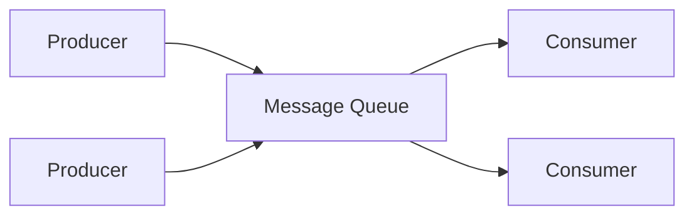
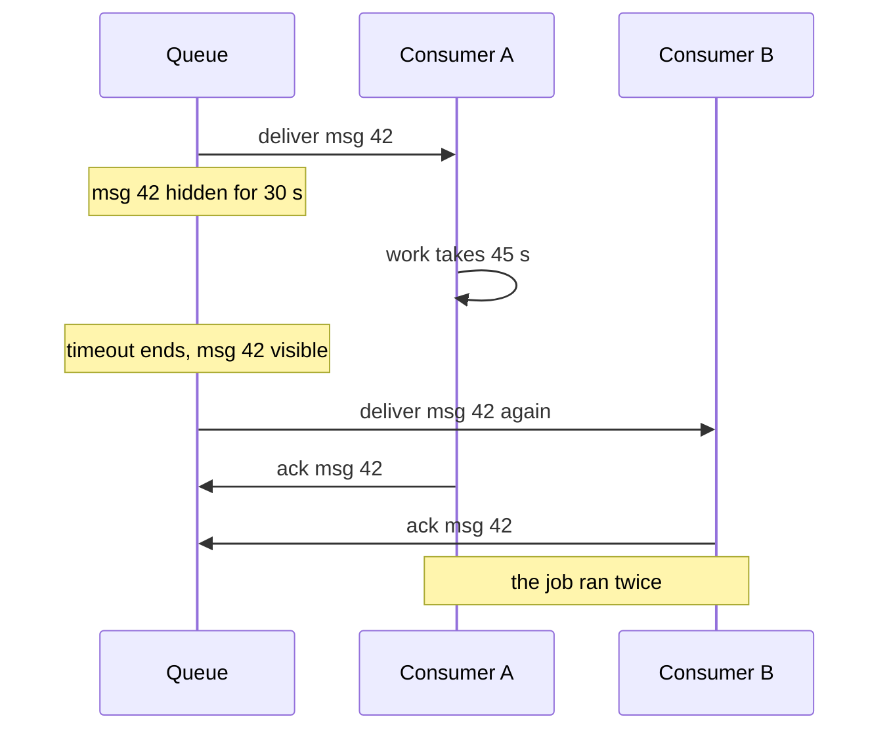
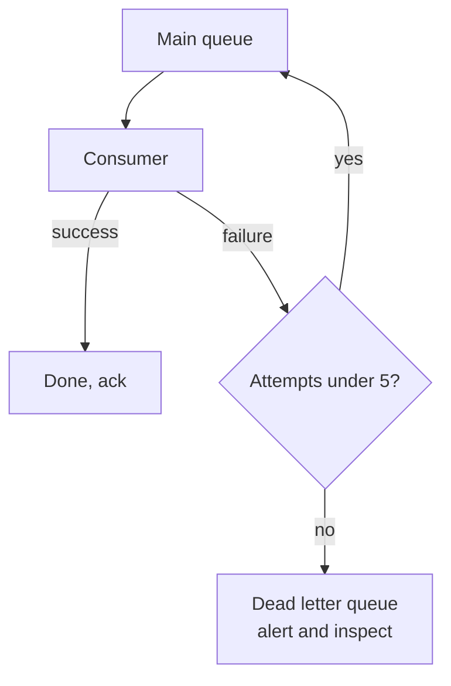

# Message queues

> Put a buffer between producers and consumers so work can be processed asynchronously and the two sides scale independently.

## What it is

A message queue (or broker) accepts messages from producers and delivers them to consumers later. It decouples the two sides: producers do not wait for consumers, and a burst of work is absorbed by the queue instead of overwhelming downstream services.

The producer's request finishes as soon as the broker has stored the message. The slow part (sending the email, encoding the video) happens afterward, on the consumer's schedule. That is the whole value: the user waits for a durable write, not for the work itself.

## When to use it

- Slow or spiky work that should not block the request path (sending email, encoding video, generating thumbnails).
- Smoothing traffic bursts (the queue absorbs the spike, consumers drain it at a steady rate).
- Fan-out, where one event triggers many independent actions.
- Decoupling services so they can fail and scale independently.

Do not use it when the caller needs the result to continue. If checkout must know whether the card was charged before it shows the next page, a queue only adds a hop and a polling loop.

## Queue vs publish-subscribe

- Queue (work distribution): each message is processed by one consumer. Good for task processing.
- Publish-subscribe (fan-out): each message goes to all subscribers. Good for broadcasting events.

A second distinction matters just as much. A classic queue (RabbitMQ, SQS) deletes a message once a consumer acknowledges it. A log (Kafka) keeps every message for a retention period, and each consumer group tracks its own position, called an offset. A log lets a new consumer replay history, while a queue cannot, because the messages are already gone. See [Kafka vs RabbitMQ vs SQS](../cheat-sheets/kafka-vs-rabbitmq-vs-sqs.md) for the full comparison.

## The mechanism: acknowledge after the work

A consumer receives a message, does the work, and then sends an acknowledgment (an "ack") to tell the broker it may forget the message. If no ack arrives in time, the broker assumes the consumer died and delivers the message again.

In SQS this window is the visibility timeout, and its default is 30 seconds. While the timeout runs, other consumers cannot see the message. When it ends without a delete, the message becomes visible again. Kafka works differently, because the consumer commits its offset instead, but the effect is the same: work done after the last commit is done again after a crash.

This is why "at least once" is the normal guarantee for almost every broker in production.

## Delivery guarantees

| Guarantee | Meaning |
|-----------|---------|
| At most once | May lose messages, never duplicates |
| At least once | Never loses, may duplicate (consumers must be idempotent) |
| Exactly once | No loss, no duplicates; hardest and most expensive |

At least once plus idempotent consumers is the common, practical default. An idempotent consumer is one where processing the same message twice has the same effect as processing it once. The usual method is to store each message id in the same transaction as the work, and skip ids already seen. See [idempotency](idempotency.md).

## Sizing: a queue turns overload into delay

This is the idea that separates strong answers. A queue does not add capacity. It stores the excess, and the excess becomes waiting time. So the useful numbers are the arrival rate, the drain rate, and the backlog between them.

Work an example. Consumers can process 3,000 messages per second in total. A sale pushes arrivals to 5,000 per second for 10 minutes.

| Step | Arithmetic | Result |
|------|------------|--------|
| Backlog growth | 5,000 minus 3,000 | 2,000 per second |
| Backlog after the spike | 2,000 times 600 seconds | 1.2 million messages |
| Wait for the newest message | 1.2 million divided by 3,000 | about 400 seconds |
| Time to clear, with arrivals back at 1,000 per second | 1.2 million divided by 2,000 | about 600 seconds |

Three conclusions follow. First, the queue protected the downstream service, but users waited almost seven minutes for their emails. Ask whether that delay is acceptable for this kind of work. Second, the retention period must be longer than the worst backlog, or messages expire unread. Third, if the average arrival rate stays above the drain rate, the backlog never clears. No queue size fixes that, so you must add consumers or slow the producers, which is [backpressure](backpressure.md).

Queue depth and the age of the oldest message are therefore the two metrics to alert on. Depth tells you how much work is waiting, and age tells you how late that work already is.

## The failure mode to name: the slow consumer that duplicates work

The visibility timeout causes a quiet failure. A consumer that is slow, not dead, loses its claim on the message, and a second consumer starts the same job:

The customer gets two emails, or is charged twice. The fixes are to set the timeout well above the slowest normal job, to extend it while long work is running, and above all to make the consumer idempotent so a second run changes nothing.

The related failure is the **poison message**: a message that crashes the consumer every time. It is redelivered without end and delays other work. The fix is a retry limit and a dead letter queue (DLQ), which is a separate queue that holds messages that failed too often:

A DLQ is only useful if someone watches it. Say who gets alerted and how messages are replayed after the bug is fixed.

## Trade-offs

| Pro | Con |
|-----|-----|
| Producers stay fast during downstream slowness | Results arrive later, so the caller cannot use them |
| Bursts are absorbed instead of dropped | Duplicates are normal and consumers must handle them |
| Services fail and scale independently | One more system to run, monitor, and size |
| Easy fan-out to new consumers | Ordering is limited and debugging spans services |

## The hard parts to mention in an interview

- **Ordering.** Kafka keeps order only within a partition, SQS FIFO queues only within a message group, and SQS standard queues do not promise order at all. Partition by the key whose order matters, such as the order id.
- **Idempotency.** Every consumer must survive a redelivery without a double effect, such as a second charge.
- **Backlog.** What happens when the queue grows faster than consumers drain it.
- **Dead letter queues.** Where messages go after repeated failures, and who reads them.

## What to say in an interview

A complete answer names five things, in this order:

1. **Why the work is asynchronous.** The caller does not need the result to continue.
2. **The broker type.** A work queue, a pub-sub topic, or a replayable log, and why.
3. **The delivery guarantee.** At least once, with the dedupe key the consumer uses.
4. **The ordering key.** What is partitioned by what, and what order that guarantees.
5. **The backlog story.** Drain rate, retention, the alert on message age, and the DLQ.

Point 5 is where interviewers push. "The queue absorbs the spike" is only true if you can say how long the absorbed work will wait.

## Related pages

- Making redelivery safe: [idempotency](idempotency.md).
- Slowing producers when consumers fall behind: [backpressure](backpressure.md).
- Publishing to the queue without losing events: [outbox pattern](outbox-pattern.md).
- Building the broker itself: [design a distributed message queue](../questions/design-distributed-message-queue.md).
- The log-based broker, in depth: [Kafka](../deep-dives/kafka-distributed-messaging.md).

## Go deeper

- Practice live: [Mock interviews](https://www.designgurus.io/mock-interviews?utm_source=github&utm_medium=repo&utm_campaign=grokking-system-design&utm_content=patterns-message-queues)
- Every pattern, in depth: [System Design Patterns](https://www.designgurus.io/course/system-design-patterns?utm_source=github&utm_medium=repo&utm_campaign=grokking-system-design&utm_content=patterns-message-queues)
- Full course: [Grokking the System Design Interview](https://www.designgurus.io/course/grokking-the-system-design-interview?utm_source=github&utm_medium=repo&utm_campaign=grokking-system-design&utm_content=patterns-message-queues)
