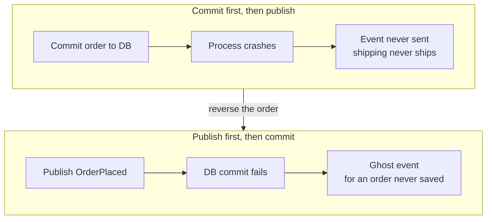
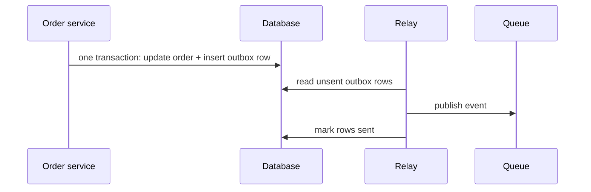

# Outbox pattern

> Publish events reliably by writing them to your own database first, then letting a relay push them out.

## What it is

A service often has to do two things for one action: update its database and publish an event to a [message queue](message-queues.md). No transaction covers both systems. Crash between the two writes and you get one of two bad outcomes: the state changed but no event went out (downstream services never learn about it), or the event went out for a change that rolled back. This is called the dual-write problem. The outbox pattern removes the second write entirely: the event is stored in your own database, inside the same transaction as the state change.

The idea to take away is general. You cannot make two systems agree by writing to both of them. You make one write, to one system, and derive the second write from it.

## When to use it

- Any design that says "save the change, then emit an event", such as order placed, payment captured, or user deleted.
- [Sagas](distributed-transactions.md), where each step must reliably trigger the next one.
- Feeding read models, search indexes, or caches from a service's own writes.
- Any place where a lost event leaves another service permanently wrong.

Skip it when a lost event is harmless, such as a "page viewed" metric. Plain publishing after commit is simpler there.

## The failure mode to name: the dual write

Both orders of the two writes fail, just in different ways:

Retrying does not fix it, because the process that would retry is the one that crashed. Writing to the queue inside a database transaction does not fix it either, because the queue is not part of that transaction.

## How it works

In the same local database transaction that changes state, insert the event as a row in an outbox table (a plain table holding events waiting to be published). A separate relay process reads unsent rows, publishes them to the queue, and marks them sent. The transaction guarantees the state change and the event are recorded together or not at all. The relay guarantees the event eventually goes out.

Delivery is at-least-once: the relay can crash after publishing but before marking a row sent, and it will publish that row again on restart. So consumers must be [idempotent](idempotency.md), meaning they handle the same event twice without a double effect. The consumer-side twin is an inbox table: store each processed event id and skip any id you have already seen.

A typical outbox row holds an event id, the aggregate id (the entity the event is about, such as the order id), the event type, a payload, and a created timestamp. The event id is what consumers dedupe on. The aggregate id is what the relay uses as the partition key, so all events for one order stay in order.

## Sizing the relay, with numbers

Assume 2,000 orders per second, one event each, and a relay that polls every 500 milliseconds.

| Question | Arithmetic | Result |
|----------|------------|--------|
| Rows found per poll | 2,000 times 0.5 | about 1,000 |
| Average extra delay | half the poll interval | about 250 ms |
| Worst extra delay | one full interval, plus publish time | a little over 500 ms |
| Rows added per day | 2,000 times 86,400 | 172.8 million |

The first three rows say the lag is small and predictable. The last row is the one candidates forget. If sent rows are never removed, the outbox grows as fast as the orders table, and it holds rows that nobody reads again. Indexes, backups, and vacuum work all grow with it. Delete sent rows in small batches, or partition the table by day and drop old partitions.

## Common variations

- **Polling publisher**: the relay runs a query for unsent rows every second or so. Simple to build, adds a little lag, and the polling itself puts some load on the database.
- **Change data capture (CDC)**: the relay tails the database's own [write-ahead log](write-ahead-log.md) and turns committed outbox inserts into events. No polling, lower lag, and it is the production-grade choice. Debezium is the common open-source tool for it.

## Trade-offs

| Pro | Con |
|-----|-----|
| State and event are consistent, guaranteed by one local transaction | An extra table and a relay process to build and operate |
| No distributed transaction across the database and the queue | Events publish with a small lag, not instantly |
| Works with any database that supports transactions | At-least-once delivery means duplicates; consumers must dedupe |

## The hard parts to mention in an interview

- **Duplicates are guaranteed, not rare.** Every relay crash between publish and mark-sent produces one. Name the consumer's dedupe key.
- **Skipped events with a polling relay.** Polling "rows with id greater than the last one I saw" can skip events. Two transactions take ids 101 and 102. Transaction 102 commits first, the relay reads it and moves past it, and then 101 commits behind the relay's position. Poll by a sent flag instead of by position, so a row that commits late is still found on the next poll, or use CDC, which reads in commit order.
- **One relay or many.** A single relay keeps order simply but is a single point of delay. Several relays need a way to split rows, such as by aggregate id, so two relays never publish the same order's events out of order.
- **Table growth.** Plan the cleanup when you create the table, as the numbers above show.

## What to say in an interview

A complete answer names five things, in this order:

1. **The dual-write problem.** Say plainly that a crash between commit and publish loses the event.
2. **The outbox row.** It is written in the same transaction as the state change.
3. **The relay.** Polling or CDC, and the lag that choice gives.
4. **At-least-once delivery.** The event id and the consumer's inbox table or dedupe check.
5. **Order and cleanup.** The partition key for per-entity order, and how sent rows are removed.

Point 1 is the one that matters most. Whenever your design says "update the database and emit an event", expect the follow-up: "what happens if it crashes between those two?" Naming the problem before the interviewer does shows you have seen it in production. Order events in a [food delivery system](../questions/design-food-delivery.md) are a natural place to bring it up.

## Related pages

- The pattern that depends on it most: [distributed transactions and sagas](distributed-transactions.md).
- Making duplicate events harmless: [idempotency](idempotency.md).
- The log that CDC reads from: [write-ahead log](write-ahead-log.md).
- Where the relay publishes to: [message queues](message-queues.md).

## Go deeper

- Related pattern: [Event sourcing and CQRS](event-sourcing-cqrs.md)
- Every pattern, in depth: [System Design Patterns](https://www.designgurus.io/course/system-design-patterns?utm_source=github&utm_medium=repo&utm_campaign=grokking-system-design&utm_content=patterns-outbox-pattern)
- Full course: [Grokking the System Design Interview](https://www.designgurus.io/course/grokking-the-system-design-interview?utm_source=github&utm_medium=repo&utm_campaign=grokking-system-design&utm_content=patterns-outbox-pattern)
