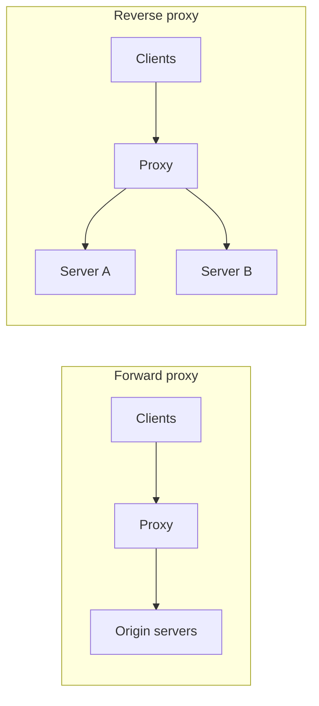
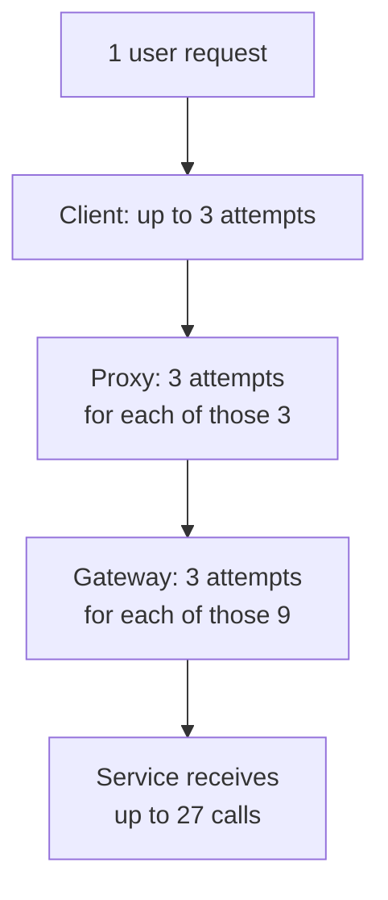

# Proxies

> An intermediary server that sits between clients and servers, used for routing, security, caching, and hiding topology.

## What it is

A proxy accepts requests on behalf of someone else. A **forward proxy** sits in front of clients and represents them to the outside world (the server sees the proxy, not the client). A **reverse proxy** sits in front of servers and represents them to clients (the client sees the proxy, not the individual servers). Almost every large system puts a reverse proxy at the point where outside traffic enters.

## When to use it

- Forward proxy: enforcing egress policy, anonymizing clients, caching outbound requests (corporate networks, crawlers).
- Reverse proxy: TLS termination, compression, caching, request routing, hiding the server fleet, and a single place to apply security rules.

## Forward vs reverse at a glance

| | Forward proxy | Reverse proxy |
|---|---------------|---------------|
| Acts on behalf of | The client | The server |
| Who is hidden | The client's identity | The server topology |
| Typical uses | Egress filtering, anonymity, client-side caching | TLS termination, load balancing, caching, WAF |
| Examples | Squid, corporate proxies | Nginx, HAProxy, Envoy, Cloudflare |

## Relationship to other building blocks

A load balancer is a reverse proxy specialized for distributing traffic (see [load balancing](load-balancing.md)). An [API gateway](api-gateway.md) is a reverse proxy specialized for API concerns like auth and rate limiting. A [CDN](cdn.md) edge server is a caching reverse proxy deployed globally. A service mesh places a small proxy, called a sidecar, next to every service instance.

## What a proxy actually does to a request

Drawing a proxy box is easy. The strong answer says what the box owns. A proxy that terminates a connection ends the client's TCP and TLS session and opens a separate one to the server. Three consequences follow.

**The server loses the client's address.** The server sees the proxy's IP, not the user's. An L7 proxy adds the original address in a header such as `X-Forwarded-For`. An L4 proxy can use the PROXY protocol, which prepends the address to the connection. Rate limiting by IP breaks if you forget this, because every request appears to come from the proxy. Trust that header only when your own proxy set it, because a client can send a forged one.

**The proxy can pool connections.** Thousands of client connections can share a small pool of long-lived connections to the servers. Work the cost out loud. A new TLS connection needs at least two round trips before the first request. Inside a data center a round trip is about 500 microseconds, so a pooled connection saves at least a millisecond per request. It also saves the CPU cost of the TLS handshake on every server.

**The proxy has its own timeouts and retries.** This is the part that causes outages, and the next section shows why.

The cost of the hop itself is small. Inside one data center, the extra round trip plus processing is usually under a millisecond. Compared with a cross-continent round trip of about 150 milliseconds, that is rarely the problem. The problem is behavior, not latency.

## The failure mode to name: retry amplification

Suppose each layer retries a failed call up to 3 times in total. Requests pass through the client, a reverse proxy, and a gateway before they reach the service:

When the service is slow because it is overloaded, every layer retries at once. One user request becomes up to 27 calls to a service that was already failing. The retries do not help it recover. They make recovery much harder.

The standard fixes:

- **Retry at one layer only,** usually the one closest to the failing service.
- **Use a retry budget.** Allow retries only while they stay below a small share of total traffic, for example 10%. Beyond that, fail fast.
- **Retry only safe requests.** A GET can be retried. A payment cannot, unless it carries an [idempotency](idempotency.md) key.
- **Add backoff with jitter,** so retries spread out instead of arriving together.

## Timeouts must shrink inward

The second rule is about timeout order. Each layer's timeout should be longer than the total time of the layer below it, including its retries. Assume the client waits 2 seconds but the proxy waits 5 seconds for the server. After 2 seconds the client gives up and perhaps retries. The proxy keeps waiting, and the server keeps working, on a request nobody will read. Under load, that wasted work fills the servers. The outermost timeout should be the longest, and each inner layer should be shorter.

## The hard parts

- **Slow clients.** A reverse proxy can buffer a full request before passing it on, and buffer the response while a slow mobile client downloads it. The application server is then busy only for the time it takes to do the work, not for the time the network takes.
- **Long-lived connections.** A WebSocket holds a proxy connection open for hours, so a proxy restart drops every one of them. Plan for draining and reconnection.
- **Configuration as risk.** Every request passes through the proxy, so one bad routing rule affects every request. Roll out proxy configuration gradually, like code.

## Trade-offs

| Pro | Con |
|-----|-----|
| Central place for cross-cutting concerns (TLS, caching, security) | Extra network hop adds latency |
| Hides and decouples internal topology | Single point of failure if not replicated |
| Servers can change without clients noticing | One more component to operate and monitor |

## What to say in an interview

A complete answer names five things, in this order:

1. **Which kind of proxy.** Forward or reverse, and whom it represents.
2. **What it terminates.** TLS, TCP, or nothing, and how the server still learns the client's address.
3. **What it does.** Routing, caching, TLS, security rules, or load balancing.
4. **Its timeouts and retries.** Which layer retries, and how timeouts shrink inward.
5. **Its own redundancy.** More than one instance, so the proxy is not a single point of failure.

Most candidates draw a reverse proxy without naming it. Naming it, and knowing that load balancers, API gateways, and CDN edges are all specialized reverse proxies, shows that you understand the layer rather than just the boxes. Expect the follow-up: "what is the difference between a forward and a reverse proxy?"

## Related pages

- The proxy specialized for spreading load: [load balancing](load-balancing.md).
- The proxy specialized for API policy: [API gateway](api-gateway.md).
- Stopping calls to a failing service instead of retrying: [circuit breaker](circuit-breaker.md).
- Choosing where routing decisions happen: [L4 vs L7 load balancing](../cheat-sheets/l4-vs-l7-load-balancing.md).

## Go deeper

- Every pattern, in depth: [System Design Patterns](https://www.designgurus.io/course/system-design-patterns?utm_source=github&utm_medium=repo&utm_campaign=grokking-system-design&utm_content=patterns-proxies)
- Full course: [Grokking the System Design Interview](https://www.designgurus.io/course/grokking-the-system-design-interview?utm_source=github&utm_medium=repo&utm_campaign=grokking-system-design&utm_content=patterns-proxies)
