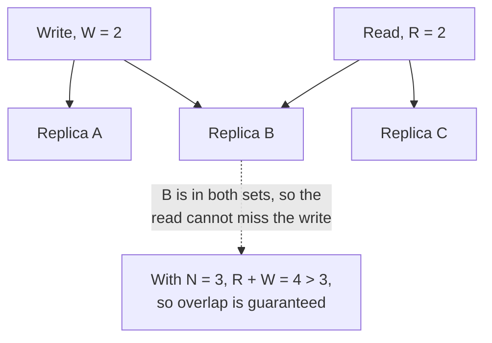
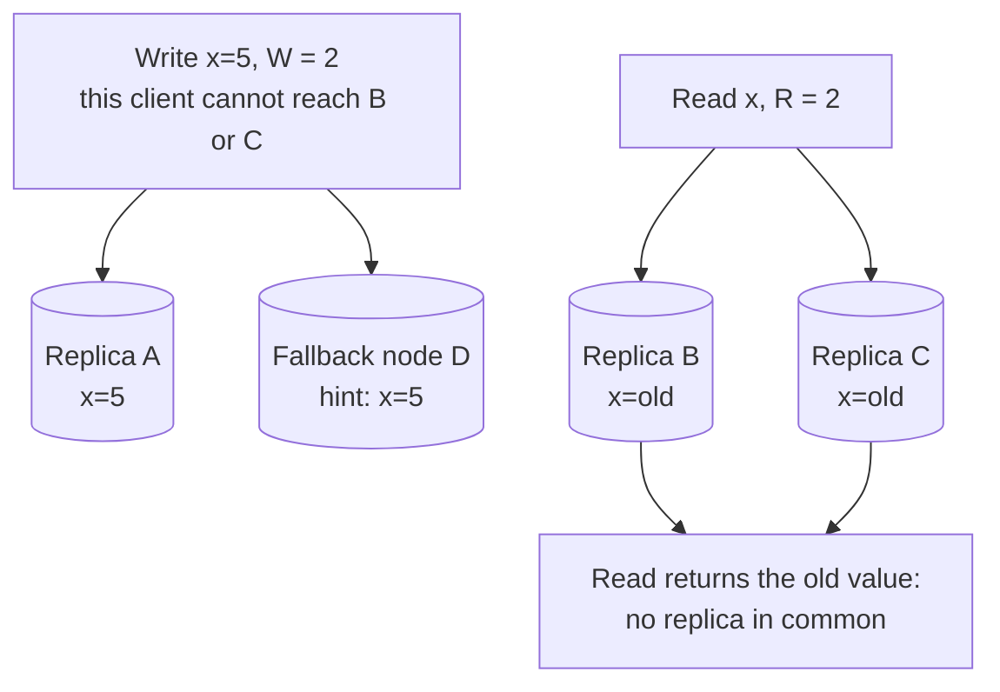

# Quorum

> Require a minimum number of replicas to agree before a read or write counts, so the system stays correct when some nodes are down.

## What it is

With N replicas of a piece of data, a quorum system requires W replicas to acknowledge a write and R replicas to answer a read. If **R + W > N**, every read set overlaps every write set by at least one node, so a read always reaches at least one replica that has the latest acknowledged write. This is how leaderless stores like Dynamo and Cassandra offer tunable consistency.

A quorum is the minimum group whose answer counts. The most common one is a majority, more than half of the nodes.

## When to use it

- Leaderless or multi-leader replication where you still want read-your-writes behavior.
- Any coordination task where two halves of a partitioned cluster must not both proceed (see [leader election](leader-election.md)).
- Data that must survive the loss of a replica without waiting for a failover.
- Systems where some operations need fresh reads and others need fast ones, from the same store.

## How it works

Typical setup, N = 3, W = 2, R = 2:

```
Write "x=5" --> [Replica A: ack] [Replica B: ack] [Replica C: slow, ignored]
Read "x"    --> [Replica B: x=5] [Replica C: x=old]  --> newest version wins
```

The read touches at least one replica (B) that saw the write, and version numbers or timestamps pick the newest value. For a write, the coordinator usually sends it to all N replicas and waits for the first W acknowledgments. For a read, it waits for R answers.

## Tuning R and W

The rule is not arbitrary. R plus W greater than N is exactly the condition that forces the two sets to share a replica:



| Configuration | Effect |
|---------------|--------|
| W = N, R = 1 | Fast reads, slow and fragile writes |
| W = 1, R = N | Fast writes, slow reads |
| W = 2, R = 2 (N = 3) | Balanced; the common default |
| R + W <= N | No overlap guarantee: eventual consistency, but lower latency |

## Read the numbers: failures tolerated and latency

The two numbers that separate a strong answer are how many failures the quorum survives and how slow it is.

**Failures.** A write succeeds while at least W replicas are up, so writes tolerate N - W failures. Reads tolerate N - R. A majority quorum of N = 2f + 1 nodes tolerates f failures:

| N | Majority | Failures tolerated |
|---|----------|--------------------|
| 3 | 2 | 1 |
| 4 | 3 | 1 |
| 5 | 3 | 2 |
| 7 | 4 | 3 |

Four nodes tolerate no more failures than three, but there are more machines to fail and to pay for. That is why quorum clusters use odd sizes.

**Latency.** The coordinator waits for W answers, so a write is as fast as the W-th fastest replica. Work it out: three replicas answer in 2 ms, 3 ms and 40 ms, because the third is in a garbage collection pause. With W = 2, the write takes 3 ms. With W = 3, it takes 40 ms. A quorum hides one slow replica, and W = N makes every write as slow as the slowest one.

Placement changes this. If the three replicas sit in three regions, any two of them include a remote one. Every quorum write then pays at least one cross-region round trip, tens of milliseconds or more (see [latency numbers](../cheat-sheets/latency-numbers.md)).

## The failure mode to name: overlap is not linearizability

R + W > N promises that a read reaches a replica that has the write. It does not promise that the system behaves like a single copy. Name the cases where it breaks.

The best known is the sloppy quorum. When home replicas are unreachable, some Dynamo-style stores accept the write on other nodes instead. Those nodes keep it as a hint and hand it back later (hinted handoff). The write counts W acknowledgments, but not from the home replicas:



The other cases are worth a sentence each:

- **A failed write can still appear.** If a write reaches one replica and then fails, the client sees an error, but the value stays there. Later reads may return it.
- **Concurrent writes need a winner.** Two writes to the same key both reach a quorum. Last-writer-wins by timestamp drops one of them.
- **Reads can go backward.** During a write in progress, one read may see the new value and the next read the old one, unless the store repairs replicas before it answers.

## Trade-offs

| Pro | Con |
|-----|-----|
| Tunable consistency vs latency per operation | Latency set by the slowest node in the quorum |
| Tolerates node failures without losing correctness | R + W > N still is not full linearizability under sloppy quorums or concurrent writes |
| No single leader bottleneck | Requires versioning and conflict resolution (vector clocks, last-writer-wins) |

## The hard parts to mention in an interview

- **Split brain.** Majority quorums (more than N/2) also prevent split brain: two partitions cannot both hold a majority, which is why consensus protocols (Raft, Paxos, and ZAB in ZooKeeper) elect leaders and commit entries with majority votes.
- **Replicas drift apart.** Replicas outside the quorum miss writes. Read repair fixes stale replicas found during reads, and background anti-entropy compares replicas to fix the rest.
- **Versions are required.** The read must decide which answer is newest, so every value needs a version. See [logical clocks](logical-clocks.md).

## What to say in an interview

Give the formula (R + W > N) and one concrete configuration. Then show judgment: "for this feature, stale reads are acceptable, so I would drop R to 1 for latency." Connecting quorums to majority-based leader election and split-brain prevention is a strong senior signal. A complete answer names five things, in this order:

1. **N and where the replicas live.** One region or several.
2. **W and R, and the overlap check.** Say whether R + W > N holds, and for which operations.
3. **Failures tolerated.** For reads and for writes, separately.
4. **The latency.** The W-th fastest replica, and any cross-region hop.
5. **What it does not guarantee.** Sloppy quorums, concurrent writes, and how conflicts are resolved.

## Related pages

- Where the N copies come from: [replication](replication.md).
- What "a read sees the latest write" means precisely: [consistency models](consistency-models.md).
- Majority quorums used to agree on a log: [Raft](../deep-dives/raft-consensus.md).
- Choosing whether a partition should stop writes at all: [CAP theorem](cap-theorem.md).

## Go deeper

- Related deep dives: [Dynamo](../deep-dives/dynamo-key-value-store.md), [Cassandra](../deep-dives/cassandra-wide-column-db.md)
- Every pattern, in depth: [System Design Patterns](https://www.designgurus.io/course/system-design-patterns?utm_source=github&utm_medium=repo&utm_campaign=grokking-system-design&utm_content=patterns-quorum)
- For harder, distributed-systems depth: [Advanced System Design Interview, Volume II](https://www.designgurus.io/course/grokking-system-design-interview-ii?utm_source=github&utm_medium=repo&utm_campaign=grokking-system-design&utm_content=patterns-quorum)