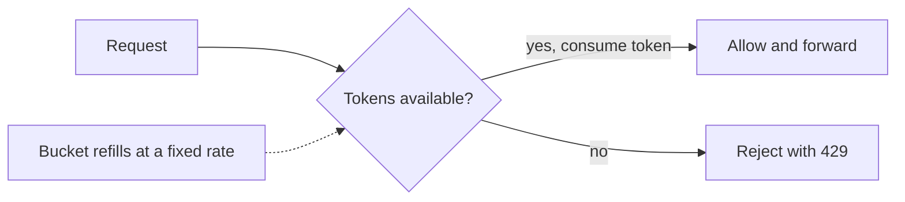
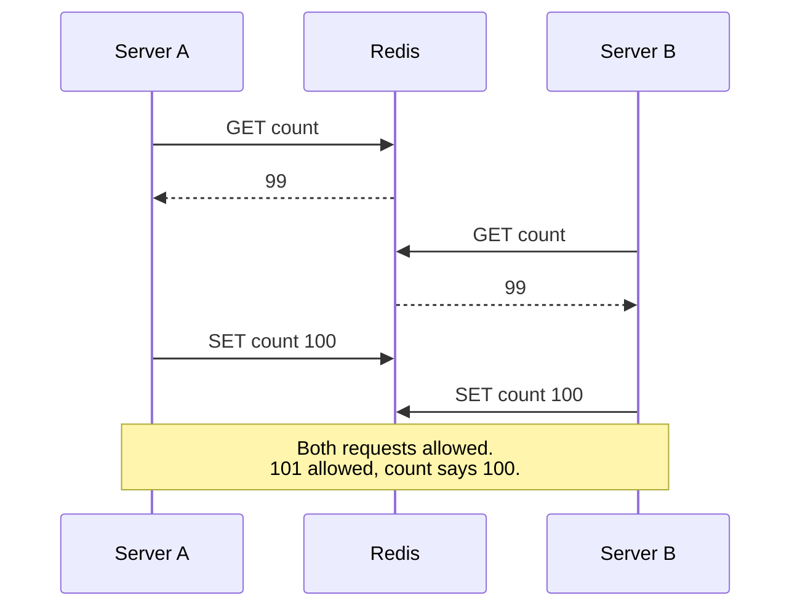

# Rate limiting

> Cap how many requests a client can make in a time window, to protect a service from overload and abuse.

## What it is

A rate limiter counts the requests each client makes and refuses the ones above an agreed limit. The client can be a user, an API key, or an IP address. Rate limiting defends against traffic spikes, abusive clients, and runaway costs. It keeps a service available for everyone by refusing or slowing excess traffic, usually returning HTTP 429 (Too Many Requests). A good response also sets the `Retry-After` header, so well-behaved clients know when to try again.

Token bucket, the common default:

## When to use it

- Public APIs, where one client must not use capacity meant for all clients.
- Expensive endpoints, such as search, login, or model inference, where each call costs real money or CPU.
- Abuse targets, such as login and password reset, where a limit slows guessing attacks.
- In front of a dependency with a known capacity, such as a partner API with its own quota.

## Algorithms

| Algorithm | How it works | Notes |
|-----------|--------------|-------|
| Token bucket | Tokens refill at a fixed rate; each request spends one | Allows short bursts; common default |
| Leaky bucket | Requests drain from a queue at a fixed rate | Smooths output, no bursts |
| Fixed window | Count requests per fixed time window | Simple, but allows bursts at window edges |
| Sliding window log | Track timestamps of recent requests | Accurate, more memory |
| Sliding window counter | Weighted blend of current and previous window | Good accuracy-to-cost balance |

## A limit is two numbers: rate and burst

This is the idea that separates a strong answer. "100 requests per minute" is incomplete. The real question is how many requests may arrive **at once**.

A token bucket makes both numbers explicit. Assume a capacity of 20 tokens and a refill rate of 10 tokens per second. An idle client can send 20 requests immediately, then 10 per second after that. In any period of T seconds, it can send at most 20 + 10 x T requests. Over one minute that is 620, against an average of 600. The burst allowance is small, but it is exactly what a real client needs, such as a page that loads 15 resources at once.

Fixed windows get this wrong. With a limit of 100 per minute, a client can send 100 requests in the last second of one window and 100 more in the first second of the next. That is 200 requests in two seconds, twice the limit you meant.

The sliding window counter fixes that cheaply. It keeps only two counts: the previous window and the current one. Assume a limit of 100 per minute, 80 requests in the previous minute, 30 so far in the current minute, and that we are 15 seconds into it. The previous window still covers 75% of the last 60 seconds, so the estimate is 80 x 0.75 + 30 = 90. The request is allowed. The estimate assumes the previous minute's requests were spread evenly, which is close enough for most limits.

## Distributed rate limiting

A single server's in-memory counter does not work across a fleet. Options: a shared store like Redis holding the counters (watch for the extra round trip and race conditions, use atomic operations), or approximate local limits per node that sum to the global budget.

## The failure mode to name: the lost update

A lost update happens when two servers read the same counter, both add one, and one write erases the other. With a read-then-write counter, two servers can each allow the 100th request:

Under heavy load from one client, this happens often, and the limit stops holding. The fix is to make the check and the update one atomic step. For a fixed window, Redis `INCR` increments and returns the new value in one command. For a token bucket, which reads and writes several fields, run the logic as a Lua script, which Redis executes atomically.

The shared store has costs of its own. Each request pays a round trip, about 500 microseconds inside a data center. At 50,000 requests per second, that is 50,000 store operations per second on every request's path. Two common ways to reduce it:

- **Local batches.** Each server takes tokens from the shared store in batches, for example 10 at a time, and spends them locally. Fewer round trips, slightly less accurate.
- **Local limits.** With 10 servers, each allows one tenth of the limit. No round trips, but it breaks when the load balancer spreads one client unevenly.

Then decide what happens when the store is unreachable. Most systems fail open, allowing traffic without limits for a short time, because rejecting everything is a full outage. Login limits are an exception worth naming. They often fail closed, since they protect against guessing attacks.

## Where to apply it

At the API gateway or load balancer, so excess traffic is refused before it reaches any service, and per service for finer control. Limit by user, API key, or IP depending on the threat. Limiting by IP alone is weak: many users can share one address behind a corporate network, and an attacker can use many addresses.

## Trade-offs

| Pro | Con |
|-----|-----|
| Protects services from overload and abuse | Legitimate clients get refused during spikes |
| Makes capacity and cost predictable | A shared counter adds a round trip and a dependency |
| Enforces fair use across clients | Exact global limits are expensive, so most are approximate |

## What to say in an interview

A complete answer names five things, in this order:

1. **What you limit by.** User, API key, or IP, and why.
2. **The algorithm and its two numbers.** Usually a token bucket, with a rate and a burst size.
3. **Where it runs.** At the gateway, per service, or both.
4. **Where the counter lives.** A shared store with atomic updates, or local approximations.
5. **What happens when the counter store fails.** Fail open or fail closed, per endpoint.

Point 4 is the one interviewers push on. Token bucket is a reasonable default because it allows bursts, but the distributed counter is where the design is tested.

## Related pages

- Each algorithm side by side: [rate limiting algorithms](../cheat-sheets/rate-limiting-algorithms.md).
- The full question, end to end: [design a rate limiter](../questions/design-rate-limiter.md).
- Where the limiter usually runs: [API gateway](api-gateway.md).
- Slowing producers instead of refusing them: [backpressure](backpressure.md).
- Why Redis commands are atomic: [Redis internals](../deep-dives/redis-internals.md).

## Go deeper

- Practice live: [Mock interviews](https://www.designgurus.io/mock-interviews?utm_source=github&utm_medium=repo&utm_campaign=grokking-system-design&utm_content=patterns-rate-limiting)
- Every pattern, in depth: [System Design Patterns](https://www.designgurus.io/course/system-design-patterns?utm_source=github&utm_medium=repo&utm_campaign=grokking-system-design&utm_content=patterns-rate-limiting)
- Full course: [Grokking the System Design Interview](https://www.designgurus.io/course/grokking-the-system-design-interview?utm_source=github&utm_medium=repo&utm_campaign=grokking-system-design&utm_content=patterns-rate-limiting)
