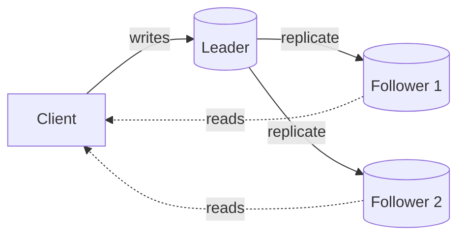
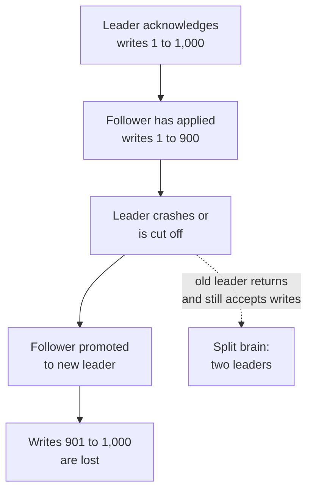

# Replication

> Keep copies of data on multiple nodes so the system stays available when one fails, and so reads can scale.

## What it is

Replication maintains copies (replicas) of the same data on more than one node. It improves availability (if one node dies, others serve the data), durability (the data survives a single failure), and read throughput (reads spread across replicas).

Single-leader replication: writes go to the leader, reads can be served by followers.

The leader records each change in its log, usually the same [write-ahead log](write-ahead-log.md) it uses for crash recovery, and streams that log to the followers. Each follower applies the changes in the same order, so it ends up with the same data a little later.

## When to use it

- Almost always. Any data you cannot afford to lose should live on more than one machine.
- Read-heavy workloads, where followers can serve reads the leader does not need to handle.
- Systems that need to keep running when a node, a rack, or a whole zone fails.
- Serving users in several regions, where a nearby replica cuts read latency.

Replication does not scale writes, because every follower must apply every write and so does as much write work as the leader. To scale writes, you need [sharding](sharding-partitioning.md).

## Models

| Model | How it works | Trade-off |
|-------|--------------|-----------|
| Single leader (primary-replica) | Writes go to the leader, replicate to followers | Simple, but the leader is a write bottleneck |
| Multi leader | Several nodes accept writes | Higher write availability, but conflicts to resolve |
| Leaderless (quorum) | Reads and writes hit a quorum of nodes | Tunable consistency, more client complexity |

Single leader is the default, and it is the model to name unless you have a reason. Multi leader fits writes from several regions that must each stay fast, but two leaders can change the same row at the same time. You then need a rule to resolve the conflict, such as last write wins, which silently drops one of the writes. Leaderless systems such as Cassandra send each write to several nodes and use a [quorum](quorum.md) to decide what counts as committed.

## Synchronous vs asynchronous

- Synchronous: the write waits until a replica confirms. Safer (no data loss on failover), slower.
- Asynchronous: the write returns immediately and replicates in the background. Faster, but a leader crash can lose the last few writes.
- Semi-synchronous (wait for at least one replica) is a common middle ground.

The cost of synchronous replication is the round trip to the replica. Inside one data center, the network round trip is about half a millisecond. Across continents it adds tens to over a hundred milliseconds to every write, because the replica is physically far away. See [latency numbers](../cheat-sheets/latency-numbers.md). This is why cross-region replication is usually asynchronous.

## Replication lag: the loss window

This is the idea that separates a strong answer. **Replication lag** is how far a follower is behind the leader, measured in time or in writes. With asynchronous replication, the lag is also roughly the amount of data you lose if the leader dies and that follower is promoted.

Work it out loud. Assume the leader takes 2,000 writes per second. The writes at risk are the write rate times the lag:

| Lag | Writes acknowledged but not yet on the follower |
|-----|-------------------------------------------------|
| 50 ms | 100 |
| 500 ms | 1,000 |
| 5 seconds | 10,000 |

Lag is not a fixed number. It grows during load spikes and while a follower is busy, which is exactly when failures are more likely.

If the leader crashes and that follower is promoted, those writes are gone, even though the clients were told "saved". So "async replication" is not a complete answer. The complete answer states how much loss is acceptable for this data: "a lost like on a post is fine, a lost payment is not".

## The failure mode to name: failover with async replication

Two things go wrong here: the first is the lost tail of writes, and the second is worse. If the old leader was only cut off from the network and not really dead, it may keep accepting writes while the new leader does the same. That is **split brain**: two nodes that both believe they are the leader, with data that diverges.

The standard defenses:

- **Synchronous or semi-synchronous replication** to at least one follower, and failover promotes a follower that confirmed every acknowledged write.
- **Consensus for leadership,** such as [Raft](../deep-dives/raft-consensus.md), so only a majority can elect a leader. See [leader election](leader-election.md).
- **Fencing:** each new leader gets a higher term number, and storage rejects writes that carry an old one.

## Reading from followers

Replication lag also causes stale reads: a user updates their profile, the next page load reads from a follower, and the old value appears. Three standard fixes, each with a cost:

- **Read your own writes from the leader:** for a short time after a user writes, send that user's reads to the leader. This is simple, but it adds load on the leader.
- **Version tracking:** the client remembers the log position of its last write. A follower serves the read only once it has caught up to that position.
- **Monotonic reads:** pin each user to one follower, so they never see data move backward in time.

## Trade-offs

| Pro | Con |
|-----|-----|
| High availability and read scaling | Replication lag causes stale reads |
| Durability across node failures | Failover and conflict handling add complexity |
| Nearby replicas cut read latency | Synchronous replication slows every write |

## The hard parts

- **Failure detection:** a leader that is slow looks the same as a leader that is dead. A short timeout causes needless failovers, and a long one extends the outage. See [heartbeats](heartbeats.md).
- **Adding a new replica:** copy a snapshot first, then replay the log from the snapshot's position.
- **Conflicts in multi-leader systems:** last write wins is simple and loses data. Merging or app-level rules keep the data and cost complexity.

## What to say in an interview

A complete answer names five things, in this order:

1. **The model.** Usually single leader; say so and move on.
2. **Sync or async, per kind of data.** And the loss window that choice allows.
3. **Where reads go.** Which reads may be stale, and how you give users their own writes.
4. **Failover.** How a new leader is chosen and how you prevent two leaders.
5. **The replica count and placement.** For example, three replicas across three zones.

Point 2 is the one interviewers push on. "Async" without a number for the loss window, and without saying which data can tolerate it, leaves the question half answered.

## Related pages

- What readers can see during lag: [strong vs eventual consistency](../cheat-sheets/strong-vs-eventual-consistency.md).
- Committing writes without a single leader: [quorum](quorum.md).
- Choosing a new leader safely: [leader election](leader-election.md).
- Replicating the log itself, at scale: [Kafka](../deep-dives/kafka-distributed-messaging.md).

## Go deeper

- Read more (free): [Data Replication Strategies](https://www.designgurus.io/blog/data-replication-strategies-system-design?utm_source=github&utm_medium=repo&utm_campaign=grokking-system-design&utm_content=patterns-replication)
- Every pattern, in depth: [System Design Patterns](https://www.designgurus.io/course/system-design-patterns?utm_source=github&utm_medium=repo&utm_campaign=grokking-system-design&utm_content=patterns-replication)
- Full course: [Grokking the System Design Interview](https://www.designgurus.io/course/grokking-the-system-design-interview?utm_source=github&utm_medium=repo&utm_campaign=grokking-system-design&utm_content=patterns-replication)
