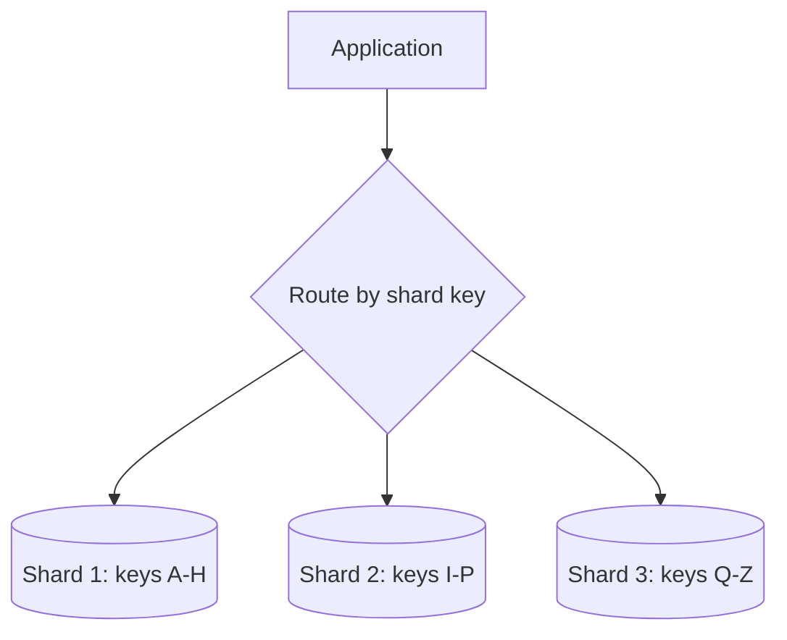
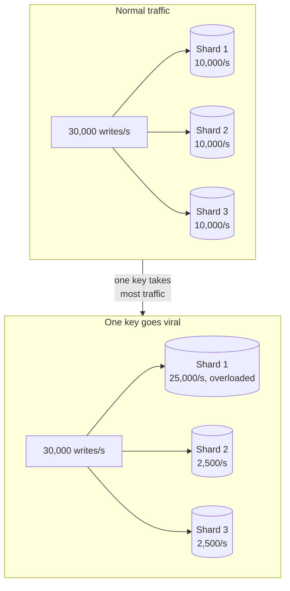

# Sharding and partitioning

> Split a dataset across multiple machines so it can grow beyond what a single database can hold or serve.

## What it is

Partitioning divides a large dataset into smaller pieces. Sharding is horizontal partitioning across separate database servers (shards), where each shard holds a subset of the rows. It is how you scale writes and storage past the limit of one machine.

Every row has a **shard key**, the field the system uses to decide which shard owns the row. A router, a client library, or the database itself turns the key into a shard:

Sharding is different from [replication](replication.md). Replication copies the same data to more machines, which helps reads and availability. Sharding gives each machine different data, which is the only way to scale writes and total storage. Real systems usually do both: each shard is a small replicated group.

## When to use it

- The data no longer fits on one machine, or will not fit soon.
- Write throughput exceeds what one primary can absorb, even after tuning.
- Read replicas and caching have already been tried, and the bottleneck is still the primary.
- You want failures to stay local, so one bad shard affects only its own slice of users.

Do not shard early. A single well-tuned relational database with replicas carries a large amount of traffic, and sharding makes every later change harder. Say why one machine is not enough before you split.

## How many shards: work it out loud

Size the shard count from both storage and writes, then take the larger answer. Assume the system must hold 20 TB, growing to 40 TB, and must absorb 50,000 writes per second at peak. Assume one shard is comfortable with 2 TB and 5,000 writes per second.

| Constraint | Calculation | Shards needed |
|------------|-------------|---------------|
| Storage today | 20 TB / 2 TB | 10 |
| Storage after growth | 40 TB / 2 TB | 20 |
| Peak writes | 50,000 / 5,000 | 10 |

Storage growth decides the count here, so plan for 20 shards. A common technique is to create many more **logical partitions** than machines, for example 1,024 logical partitions placed on 20 machines. Redis Cluster uses a version of this idea with 16,384 fixed hash slots. When you add machines later, you move whole partitions and never rehash individual keys.

## Partitioning strategies

| Strategy | How it works | Watch out for |
|----------|--------------|---------------|
| Range based | Partition by a key range (for example A to M, N to Z) | Hot ranges and uneven load |
| Hash based | Hash the key to choose a shard | Hard to do range queries; resharding is costly |
| Consistent hashing | Hash onto a ring to limit data movement | More complex (see [consistent hashing](consistent-hashing.md)) |
| Directory based | A lookup service maps keys to shards | The directory becomes a critical dependency |

Range partitioning keeps neighboring keys together, so a query for "all orders from last week" reads one or two shards. The cost is that new writes often land in the same range. A key that grows with time, such as a timestamp or an auto-increment ID, sends every new write to the last shard. Hash partitioning spreads writes evenly but sends every range query to all shards.

## Choosing a shard key: single-shard or scatter-gather

This is the idea that separates a strong answer. Every query in a sharded system is one of two kinds:

- **Single-shard:** the query includes the shard key, so the router sends it to exactly one shard.
- **Scatter-gather:** the query does not include the shard key, so the router sends it to every shard and merges the results.

A scatter-gather query costs more than it looks. It uses work on every shard, and its latency is set by the slowest shard. Suppose each shard has a 1% chance of a slow response. A query that touches 20 shards waits on at least one slow shard with probability 1 - 0.99^20, which is about 18%. A rare slow response on one machine becomes a common one across twenty.

So choose the shard key from the most frequent query, not from the data model. For a chat system the main query is "load messages in this conversation", so shard by conversation ID. For an order system the main query is "show this customer's orders", so shard by customer ID. Then name the queries that become scatter-gather, and say how you serve them. A common answer is a separate index or a search system built from a change stream.

## The failure mode to name: the hot shard

A good key spreads load evenly on average. A **hot key** is a single key that receives far more traffic than the others, and it breaks that average. A famous account, a viral post, or a flash sale item all create hot keys:

Adding shards does not help, because one key always lives on one shard. The standard fixes:

- **Key salting:** append a small suffix, such as 0 to 9, to the hot key so its writes spread over ten keys, which hash to as many as ten shards. Reads must then gather all ten keys and combine the results.
- **Separate handling:** detect the few hot keys and route them to a dedicated path, such as a counter in memory that flushes to the database periodically.
- **Caching:** for keys that are hot for reads, put a [cache](caching.md) in front so most reads never reach the shard.

## Resharding

Shards fill up, and you will need to move data. With `hash(key) % N`, changing N from 10 to 11 moves about 10 of every 11 keys, which is roughly 91% of the data. That is why systems use consistent hashing or fixed logical partitions instead. Either way, a migration copies data while it is still being written. Plan for a double-write or change-capture phase, then a final switch of the routing table.

## Trade-offs

| Pro | Con |
|-----|-----|
| Scales writes and storage horizontally | Cross-shard queries and joins are hard |
| A failure affects only one shard's data | Rebalancing and resharding are operationally painful |
| Each shard is smaller and faster | Transactions across shards are complex |

## The hard parts

- **Cross-shard transactions:** a write that touches two shards needs a [distributed transaction](distributed-transactions.md) or a design that avoids it.
- **Secondary indexes:** an index local to each shard makes lookups by other fields scatter-gather. A global index avoids that, but every write then updates two places.
- **Unique IDs:** auto-increment does not work across shards, so you need an [ID scheme](../questions/design-unique-id-generator.md) that is unique everywhere.

## What to say in an interview

A complete answer names five things, in this order:

1. **Why one machine is not enough.** Storage or write numbers, worked out.
2. **The shard key and the query it serves.** Name the main query that stays single-shard.
3. **The strategy.** Hash or range, and the logical partition count.
4. **The queries that become scatter-gather.** How you serve them instead.
5. **Hot keys and resharding.** What happens when one key goes viral, and when a shard fills up.

Point 4 is where interviewers push. A key that serves the main read but turns a common secondary query into a 20-shard fan-out is not finished yet.

## Related pages

- The strategies side by side: [sharding strategies](../cheat-sheets/sharding-strategies.md).
- Moving less data when the shard count changes: [consistent hashing](consistent-hashing.md).
- Keeping each shard available: [replication](replication.md).
- A production system built on hash partitioning: [Dynamo](../deep-dives/dynamo-key-value-store.md).

## Go deeper

- Every pattern, in depth: [System Design Patterns](https://www.designgurus.io/course/system-design-patterns?utm_source=github&utm_medium=repo&utm_campaign=grokking-system-design&utm_content=patterns-sharding-partitioning)
- Full course: [Grokking the System Design Interview](https://www.designgurus.io/course/grokking-the-system-design-interview?utm_source=github&utm_medium=repo&utm_campaign=grokking-system-design&utm_content=patterns-sharding-partitioning)
- Read more (free): [Database Sharding Guide](https://www.designgurus.io/blog/database-sharding-guide-2026?utm_source=github&utm_medium=repo&utm_campaign=grokking-system-design&utm_content=patterns-sharding-partitioning)
