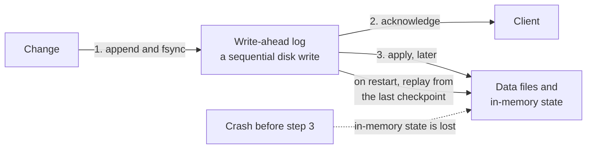
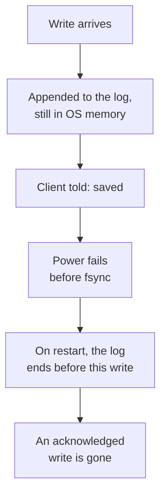

# Write-ahead log (WAL)

> Record every change to an append-only log before applying it, so a crash never loses acknowledged data.

## What it is

Updating data structures in place is fragile: crash mid-update and the structure is corrupt. A write-ahead log reverses the order. First append a description of the change to a sequential log and flush it to disk. Only then apply the change to the real data structures, which can even sit in memory. After a crash, replay the log and you are back to the last change that reached the log on disk.

The client is acknowledged after step 1, not step 3. That is what makes a crash survivable and why the write is fast:

**fsync** is the system call that forces data from the operating system's memory buffers onto the physical disk. Until fsync returns, a write the program has "written" may exist only in memory.

## When to use it

- Any store that acknowledges writes and must keep them after a crash or power loss.
- Systems that hold their main state in memory but must survive a restart.
- Replication, where followers need an ordered stream of every change.
- Designs where the history of changes is itself useful, for audit or replay.

In an interview, you rarely build a WAL yourself. You name it when the interviewer asks "what happens if the server crashes here?"

## Why it is fast

Sequential appends are the fastest thing a disk can do, which is why WALs make systems both safer and faster. The client is acknowledged after one sequential write instead of many random ones. A single change to a table might touch the row's page and three index pages, in four different places on disk. The WAL turns that into one append at the end of one file. The random page writes happen later, in the background, and many changes to the same page are combined into one write.

## The acknowledgment point is the fsync

This is the idea that separates a strong answer. A WAL is only as durable as its fsync policy. The question is not "do you have a log?" It is "when you tell the client the write is saved, has the log reached the disk?"

The cost of fsync depends on the device. It ranges from tens of microseconds on drives with power-loss protection to several milliseconds on others. Work it out with an assumption of 1 millisecond per fsync:

| Policy | What can be lost on power loss | Commit ceiling at 1 ms per fsync |
|--------|-------------------------------|----------------------------------|
| fsync on every commit, one at a time | Nothing acknowledged | About 1,000 commits per second |
| Group commit, 50 commits per fsync | Nothing acknowledged | About 50,000 commits per second |
| fsync once per second | Up to about 1 second of writes | Not limited by fsync |

**Group commit** is the standard answer to the cost. Commits that arrive at nearly the same moment share one fsync, and each client is acknowledged only after that shared fsync returns. Durability stays the same, and throughput scales with the batch size, at the cost of a little added latency per commit.

The third row is a real, documented setting. Redis's append-only file defaults to `appendfsync everysec`, which can lose about one second of writes. PostgreSQL's `synchronous_commit = off` also gives up the last few commits in exchange for speed, without corrupting the database. Both are reasonable choices for some data. The strong answer names the choice and the data it suits.

## The failure mode to name: acknowledging before fsync

Nothing in the logs shows an error. The client was told "saved", and after the restart the write does not exist. This is why every durability claim must say when fsync happens relative to the acknowledgment.

A related failure is the **torn write**: power fails in the middle of appending a log record, so the last record is only partly on disk. WAL records carry a [checksum](checksums.md), so recovery detects the broken final record and stops there. If the system fsyncs before every acknowledgment, that record was never acknowledged, so dropping it is correct.

## Checkpoints and recovery time

Periodic **checkpoints** persist the current state so recovery only replays the log tail, and older log segments can be truncated. The checkpoint interval sets the recovery time.

Assume the system writes 50 MB of log per second and checkpoints every 5 minutes. Five minutes is PostgreSQL's default `checkpoint_timeout`, although PostgreSQL also checkpoints sooner when the log grows past its `max_wal_size` limit. A crash just before a checkpoint leaves about 50 MB x 300 seconds = 15 GB of log to replay. More frequent checkpoints shorten recovery, but each checkpoint writes many data pages, which competes with live traffic.

## Where it is used

- Most databases: PostgreSQL's WAL, MySQL's redo log, the memtable-plus-WAL design in LSM stores (Cassandra, RocksDB, [BigTable](../deep-dives/bigtable-wide-column-store.md)).
- [Replication](replication.md): the log of changes is exactly what you ship to replicas (Postgres streaming replication, MySQL binlog).
- [Kafka](../deep-dives/kafka-distributed-messaging.md) generalizes the idea: the log itself is the product, and consumers are just replayers.
- [Event sourcing](event-sourcing-cqrs.md): application state defined as the replay of an event log.

## Trade-offs

| Pro | Con |
|-----|-----|
| Durability: acknowledged writes survive crashes | Every write hits disk twice (log now, data later) |
| Sequential I/O makes writes fast | Log grows without bound unless checkpointed and truncated |
| The log doubles as a replication and audit stream | fsync frequency is a real latency vs durability knob |

## The hard parts

- **A local log protects against a crash, not a lost disk.** If the machine is destroyed, its log is gone too. Surviving that needs the log replicated to other machines before the acknowledgment.
- **Log retention:** a follower that falls far behind can force the leader to keep old log segments. If it never catches up, the leader's disk fills.
- **Recovery time:** large logs and rare checkpoints make restarts slow, which counts against availability.

## What to say in an interview

A complete answer names five things, in this order:

1. **The order.** Log first, apply later.
2. **The acknowledgment point.** The client hears "saved" only after fsync.
3. **The fsync policy and its cost.** Per commit with group commit, or periodic with a stated loss window.
4. **Checkpoints.** How long recovery takes and how the log is truncated.
5. **Beyond one machine.** Ship the same log to replicas, so a lost disk loses nothing.

Point 2 is the one interviewers push on. "We write to a log" is not a durability answer until it says when fsync happens.

## Related pages

- Shipping the log to other machines: [replication](replication.md).
- Detecting a torn or corrupt log record: [checksums](checksums.md).
- State built entirely from a log: [event sourcing and CQRS](event-sourcing-cqrs.md).
- A store designed around the log and memtable: [BigTable](../deep-dives/bigtable-wide-column-store.md).

## Go deeper

- Related deep dives: [Kafka](../deep-dives/kafka-distributed-messaging.md), [BigTable](../deep-dives/bigtable-wide-column-store.md)
- Every pattern, in depth: [System Design Patterns](https://www.designgurus.io/course/system-design-patterns?utm_source=github&utm_medium=repo&utm_campaign=grokking-system-design&utm_content=patterns-write-ahead-log)
- Full course: [Grokking the System Design Interview](https://www.designgurus.io/course/grokking-the-system-design-interview?utm_source=github&utm_medium=repo&utm_campaign=grokking-system-design&utm_content=patterns-write-ahead-log)
