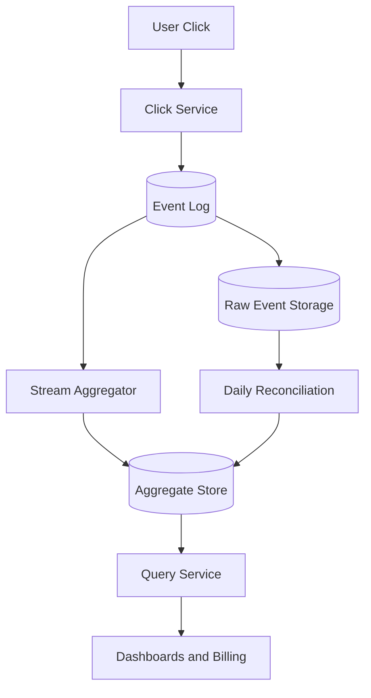
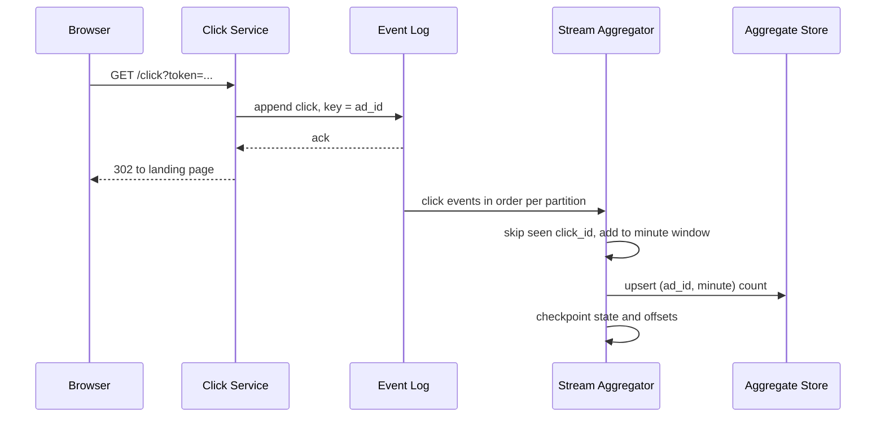

# Design an ad click aggregator

> Ingest a massive stream of ad click events and produce accurate, near real-time aggregated counts.

This question is graded on correctness under failure, not on raw scale. Counting clicks is easy until events arrive twice, arrive late, or a processing node crashes halfway through a window. The interviewer wants to hear how every click is counted exactly once, how late clicks are handled, and how billing totals stay trustworthy.

## 1. Requirements

**Functional**
- Record every ad click and redirect the user to the advertiser's page.
- Return click counts per ad for the last N minutes, for dashboards.
- Return the top 100 most-clicked ads in the last N minutes.
- Produce exact daily totals per campaign for billing.
- Optional: filter by country, device, or other attributes.

**Non-functional**
- Dashboard counts within about a minute of the click.
- Billing totals exact: no click counted twice, no valid click dropped.
- Durable: a crash must never lose clicks that were acknowledged.
- The redirect is fast, because the user is waiting for it.

Agree out loud that there are two kinds of answers with different rules. Dashboards may be briefly approximate. Billing must be exact and can wait for late data. That split decides whether you need one pipeline or two.

## 2. Estimation

Assumptions (all labeled as such):
- 1 billion clicks per day, with peak traffic at 5 times average.
- Each click event is about 300 bytes.
- 10 million ads are active on a given day.
- Raw events are kept for 30 days for reprocessing and audits.

Computed numbers:
- Average rate: 1 billion / 86,400 seconds is about 11,600 clicks per second. Peak is 5 x 11,600, or about 58,000 per second.
- Peak ingest: 58,000 x 300 bytes is about 17 MB per second.
- Raw storage: 1 billion x 300 bytes is 300 GB per day, so 30 days is 9 TB.
- Hourly aggregates: 10 million ads x 24 hours is 240 million rows per day at most. At 50 bytes per row, that is 12 GB per day.

See the [estimation cheat sheet](../cheat-sheets/estimation.md) for the reference numbers.

These numbers show the bandwidth is modest: 17 MB per second fits on a small log cluster. The difficulty is not throughput but accuracy, and the 5 times peak rules out writing each click straight to a database. A durable log in front absorbs spikes, and pre-aggregated rows keep dashboard queries small.

## 3. API

- `GET /click?token={signedToken}` records the click and returns a 302 redirect to the landing page.
- `GET /ads/{adId}/clicks?from={t1}&to={t2}&granularity=minute` returns `{ buckets: [{ time, clicks }] }`.
- `GET /ads/top?window=5m&limit=100&country={c}` returns `{ ads: [{ adId, clicks }] }`.

## 4. Data model

```
click_event:  click_id | impression_id | ad_id | campaign_id | country | event_time
ad_minute:    (ad_id, minute) PK | clicks
ad_hour:      (ad_id, hour) PK | clicks
top_ads:      (window_end, country) PK | [ (ad_id, clicks) x 100 ]
```

Queries always name an ad and a time range, or ask for a precomputed top list. That is a key plus a range scan, which suits a wide-column store keyed by `ad_id` with time as the sort key. See the [Cassandra deep dive](../deep-dives/cassandra-wide-column-db.md). Raw events go to cheap object storage, read only when an aggregate must be rebuilt.

## 5. Windowed aggregation with exactly-once counts

A stream processor reads clicks from the log and counts them in windows. A tumbling window is a fixed, non-overlapping bucket, like each whole minute. Each click belongs to the window of its event time (when the click happened), not its arrival time.

Late events break naive counting. A watermark is the processor's estimate that no events older than a given time will still arrive. A window closes when the watermark passes its end plus a grace period, for example 2 minutes. Clicks that arrive after that go to a correction path instead of being dropped.

Duplicates come from client retries and from replays after a crash. The click id makes processing idempotent (repeating an operation has the same effect as doing it once). The processor keeps recent click ids in its state and skips repeats. See [idempotency](../patterns/idempotency.md).

The architecture choice is whether billing needs a second pipeline.

| Approach | How | Trade-off |
|----------|-----|-----------|
| Lambda | A stream job serves dashboards, and a nightly batch job recomputes exact totals from raw events | Exact billing even if the stream job has bugs, but the logic exists twice |
| Kappa | One stream job with exactly-once state serves both, and fixes are done by replaying the log | One codebase, but correctness depends fully on the stream job |

A common choice is a stream job for both, plus a daily batch reconciliation that compares totals and flags differences. Stream processors like [Flink](../deep-dives/flink-stream-processing.md) checkpoint their state and log offsets together, so a restart resumes without double counting. See [batch vs stream processing](../patterns/batch-vs-stream-processing.md).

## 6. High-level design



The click service does one thing: write the event to the log and redirect. Everything else reads from the log. The batch job reads raw events and corrects the aggregate store when its totals differ from the stream's.



The redirect waits only for the log's acknowledgement, which takes a few milliseconds. Partitioning by `ad_id` sends all clicks for one ad to one processor, so its counts live in one place. Writes to the store are upserts (insert or replace by key) of the full window count, so repeating one is harmless.

## 7. Bottlenecks and trade-offs

- Spikes: the log stores bursts until processors work through the backlog. See [message queues](../patterns/message-queues.md) and [backpressure](../patterns/backpressure.md).
- Hot ads: one viral ad overloads its partition. Split its key into several sub-keys and sum them later. See [sharding and partitioning](../patterns/sharding-partitioning.md).
- Durability: the log replicates each partition before acknowledging. See [replication](../patterns/replication.md) and [Kafka](../deep-dives/kafka-distributed-messaging.md).
- Seen-id memory: keep ids only for the grace period, or use a [Bloom filter](../patterns/bloom-filters.md) with an exact check on possible matches.

The most common follow-up is the length of the grace period. A long grace period counts more late clicks in the right window but delays dashboard numbers. A short one gives fresh numbers but sends more clicks to the correction path. The usual answer is a short period for dashboards and a much longer one, for example a day, for billing totals.

## The deep dives to expect

**How do you return the top 100 ads quickly?** Do not sort all ads at query time. Each processor keeps a heap (a structure that tracks the largest items cheaply) of its top 100 per window. A final step merges the partial lists into one and stores it.

**What happens if the stream processor crashes?** It restarts from its last checkpoint, which saved both its counts and its log position. It then rereads events after that position. Because state and position were saved together, no click is counted twice.

**How do you stop click fraud from reaching billing?** Mark suspicious clicks in a filter before aggregation, using rules like too many clicks from one device. Slower models run later and adjust totals through the correction path.

**Why not count in the database with an increment per click?** At 58,000 clicks per second, popular ads become hot rows with lock contention. Retries would also double count. Pre-aggregating in the stream turns thousands of writes into one per window.

**How do you reprocess after fixing a bug?** Replay raw events from the log or object storage into a new job version. Write its output to a new table, compare, then switch queries over.

## Related pages

- The platform that produces these clicks: [design Google Ads](design-google-ads.md).
- Another high-volume counting problem: [design a YouTube likes counter](design-youtube-likes-counter.md).
- Time-windowed data at scale: [design a metrics monitoring system](design-metrics-monitoring.md).

## Go deeper

- Quick, focused prep: [System Design Interview Crash Course](https://www.designgurus.io/course/system-design-interview-crash-course?utm_source=github&utm_medium=repo&utm_campaign=grokking-system-design&utm_content=questions-design-ad-click-aggregator)
- Full course: [Grokking the System Design Interview](https://www.designgurus.io/course/grokking-the-system-design-interview?utm_source=github&utm_medium=repo&utm_campaign=grokking-system-design&utm_content=questions-design-ad-click-aggregator)
