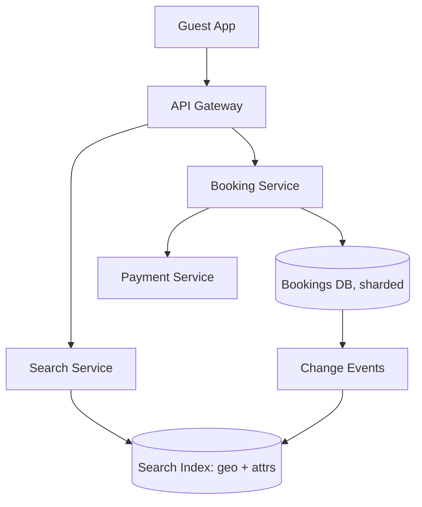
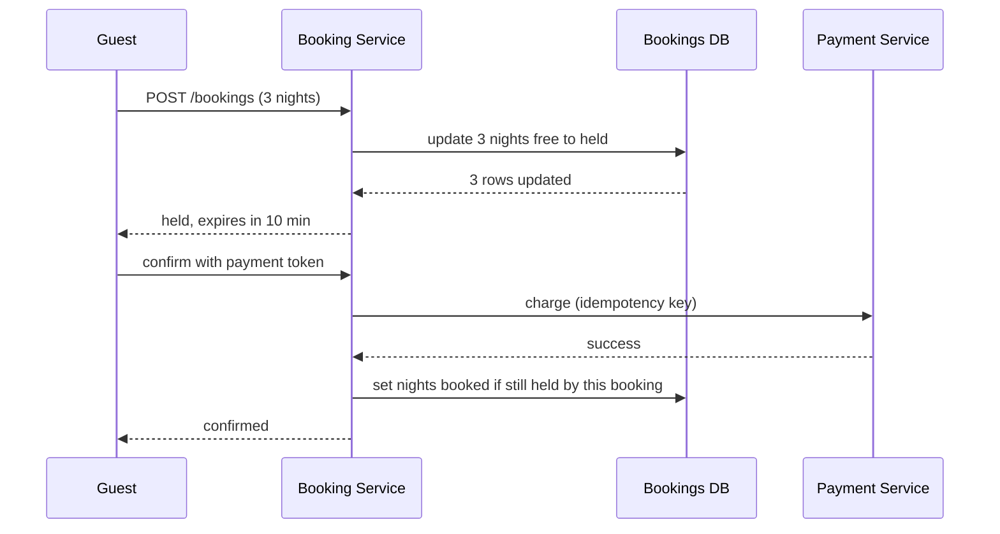

# Design Airbnb

> A marketplace to search listings by location and dates, view availability, and book without double-booking.

This question is really two systems with opposite needs. Search is read-heavy, tolerant of slightly stale data, and built around a geographic index. Booking is low volume but must never sell the same night twice. The interviewer grades whether you split these paths and whether your double-booking answer survives two guests clicking at the same moment.

## 1. Requirements

**Functional**
- Search listings by location, dates, guest count and filters like price.
- Show a listing's calendar with available nights.
- Book a date range, with payment, and never double-book a night.
- Hosts create listings and block or open dates.

**Non-functional**
- Search returns in a few hundred milliseconds.
- Booking is strongly consistent: one night, at most one confirmed guest.
- High availability for search; booking may reject a request rather than risk a conflict.
- Read-heavy: searches outnumber bookings by a wide margin.

Agree out loud that search results may show a listing that was booked a second ago. The booking step rechecks and rejects it. That one concession lets search run on a fast, eventually consistent index while correctness lives only in the booking database.

## 2. Estimation

Assumptions (labeled, not measured):
- 10 million active listings.
- 50 million searches per day, with peak traffic at three times the average.
- 1 million bookings per day.
- The calendar covers 365 nights ahead, at about 20 bytes per listing-night.
- 30 photos per listing at about 500 KB each.

Computed:
- Searches: 50 million / 86,400 = about 580 per second on average, about 1,700 at peak.
- Bookings: 1 million / 86,400 = about 12 per second, about 35 at peak.
- Calendar rows: 10 million x 365 = 3.65 billion listing-nights. At 20 bytes each, 3.65 billion x 20 = 73 GB.
- Photos: 10 million x 30 x 500 KB = 150 TB.

See the [estimation cheat sheet](../cheat-sheets/estimation.md) for the reference numbers.

Twelve bookings per second is tiny, so the booking side can use a relational database with real transactions. The calendar fits on a few machines, so availability does not need an exotic store. Photos are the largest data by far, and they belong in object storage behind a [CDN](../patterns/cdn.md). Search, at about 1,700 queries per second with geographic and date filters, is the only part that needs a specialized index.

## 3. API

- `GET /search?lat=&lng=&radius=&checkIn=&checkOut=&guests=&maxPrice=` returns a ranked page of `{ listingId, title, price, photoUrl }`.
- `GET /listings/{id}/calendar?from=&to=` returns `{ nights: [{ date, status }] }`.
- `POST /bookings` with `{ listingId, checkIn, checkOut, guests, idempotencyKey }` returns `{ bookingId, status: "held", holdExpiresAt }`.
- `POST /bookings/{id}/confirm` with `{ paymentToken }` returns `{ status: "confirmed" }` or an error.

## 4. Data model

```
listings:       listing_id (PK) | host_id | lat | lng | geohash | price | attributes
listing_nights: listing_id | night | status | booking_id | hold_expires_at
                PK (listing_id, night)
bookings:       booking_id (PK) | listing_id | guest_id | check_in | check_out
                | status | idempotency_key (unique)
```

The booking access pattern is "lock these specific nights of one listing", which is a small set of rows under one key. That favors a relational store sharded by `listing_id`, so every booking touches one shard and one transaction. The search access pattern is "listings in this area with these attributes", which a geo-aware search index serves better. See [sharding and partitioning](../patterns/sharding-partitioning.md) and [database indexing](../patterns/database-indexing.md).

## 5. Preventing double-booking

Storing one row per listing-night turns a date-range conflict into a row conflict, which databases handle well. A booking for three nights must claim three rows, all or nothing.

| Approach | How | Trade-off |
|----------|-----|-----------|
| Pessimistic lock | `SELECT ... FOR UPDATE` on the nights, then update | Simple and correct, but holds locks during the transaction |
| Conditional update | `UPDATE ... SET status='held' WHERE status='free'`, check the row count | No long locks, and a lost race fails cleanly |
| Unique constraint | Insert one row per night into a booked table with a unique key | The database rejects duplicates, but holds and releases need care |
| Distributed lock service | Lock the listing in an external store | Adds a separate service, with no gain when one shard owns the listing |

The conditional update is the usual answer. In one transaction, update all requested nights from free to held. If the affected row count is less than the number of nights, roll back and tell the guest the dates are gone. Two guests racing for the same night cannot both succeed, because the second update finds the status already changed.

A hold is a temporary claim that expires, here after about ten minutes. It covers the time the guest spends on the payment page. A background job, or the next read, frees nights whose `hold_expires_at` has passed. See [distributed locking](../patterns/distributed-locking.md) for why a lease with an expiry is safer than a lock that waits for an explicit release.

## 6. High-level design



Search and booking are separate services with separate stores. The booking database is the source of truth. Every change to a listing's calendar emits an event, and a consumer updates the search index within seconds. The [outbox pattern](../patterns/outbox-pattern.md) keeps the event and the database change consistent.



The first database call is where the race is decided. Everything after it works on rows this guest already owns, so payment can take seconds without blocking anyone else from other dates. The confirm update is conditional too: it succeeds only if this booking still holds the nights, so a hold that expired during payment fails and the charge is refunded.

## 7. Bottlenecks and trade-offs

- Search load: serve from a dedicated index like [Elasticsearch](../deep-dives/elasticsearch-lucene.md) and [cache](../patterns/caching.md) popular area queries.
- Booking correctness: shard by listing so each booking is a single-shard transaction, avoiding [distributed transactions](../patterns/distributed-transactions.md).
- Retries and double charges: give every booking and charge an [idempotency key](../patterns/idempotency.md) (a client-chosen id that makes repeats harmless).
- Photos: object storage plus a [CDN](../patterns/cdn.md).

The most common follow-up is how fresh search availability has to be. Strong consistency between the index and the database would make every booking wait on the index, and search would slow down under booking load. Eventual consistency means a guest occasionally clicks a listing that just became unavailable. That costs one error message, so accept it and keep the recheck at booking time. See [strong vs eventual consistency](../cheat-sheets/strong-vs-eventual-consistency.md).

## The deep dives to expect

**How does geographic search work?** Encode each listing's location as a geohash, a short string where nearby points share a prefix. A map area becomes a few prefix ranges, which the index scans quickly. Date and price filters then run on that smaller set. See [design a proximity service](design-proximity-service.md) for the full index comparison.

**What happens if payment fails or the guest leaves?** The hold expires and the nights return to free. If payment succeeds but the confirm call times out, the client retries with the same idempotency key, and the server returns the existing result instead of charging twice.

**How do you filter search by dates without scanning calendars?** Keep a compact availability summary per listing in the index, updated from change events. The filter is approximate by design, and the booking step remains the only authority.

**How do "request to book" listings fit in?** The host must approve, which can take hours. Model it as a longer hold with a new status, pending approval, and release the nights if the host declines or does not answer in time.

**What about a popular listing that many guests try at once?** Contention stays on a few rows in one shard. The conditional update fails fast for the losers, so the database never queues long lock waits. That is the reason to prefer it over pessimistic locking here.

## Related pages

- The same inventory problem with rooms instead of nights: [design a hotel reservation system](design-hotel-reservation.md).
- Geographic indexing in depth: [design a proximity service](design-proximity-service.md).
- Payments with idempotency: [design a payment system](design-payment-system.md).

## Go deeper

- Quick, focused prep: [System Design Interview Crash Course](https://www.designgurus.io/course/system-design-interview-crash-course?utm_source=github&utm_medium=repo&utm_campaign=grokking-system-design&utm_content=questions-design-airbnb)
- Full course: [Grokking the System Design Interview](https://www.designgurus.io/course/grokking-the-system-design-interview?utm_source=github&utm_medium=repo&utm_campaign=grokking-system-design&utm_content=questions-design-airbnb)