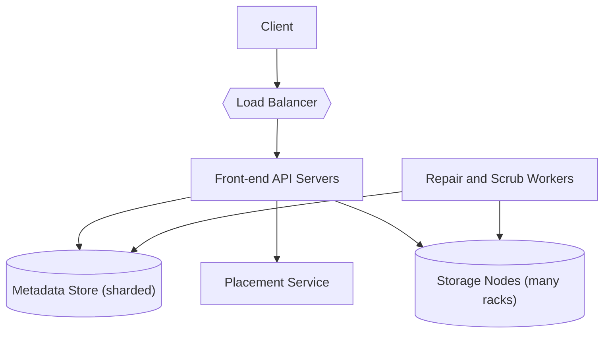
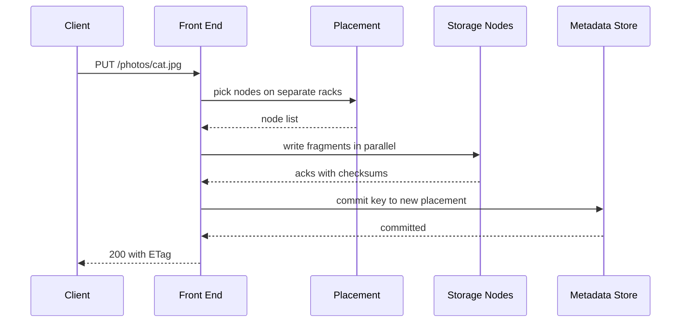

# Design Amazon S3 (object storage)

> A durable, scalable object store: put, get, and delete large blobs by key, with very high durability.

This question is graded on durability, not on the API. The interface is four verbs, so the interviewer will ask how you keep bytes safe when disks fail every week, and how metadata stays fast once it outgrows one machine. A good answer separates the data path from the metadata path early.

## 1. Requirements

**Functional**
- Create buckets (named containers for objects) and put, get, and delete objects by key.
- Support objects from a few bytes to several terabytes, with resumable uploads for large ones.
- List the keys in a bucket by prefix, in sorted order, page by page.
- Optional: versioning, lifecycle rules, and range reads of part of an object.

**Non-functional**
- Very high durability: a stored object should essentially never be lost. Amazon publishes a design target of eleven nines (99.999999999 percent) for S3.
- High availability for reads and writes.
- Strong read-after-write consistency: a read after a successful write returns the new object.
- Scale to exabytes of data and very high request rates.

Agree on two points out loud before designing. Objects are immutable, so an update is a full replacement, not an in-place edit. And durability and availability are different promises: an object can be unreachable for a minute and still be perfectly safe.

## 2. Estimation

Assumptions (stated, not measured):
- 100 billion objects stored, average size 1 MB.
- 200 million new objects per day.
- Reads are 10 times writes.
- 500 bytes of metadata per object, and 20 TB disks.

Computed numbers:
- Logical data: 100 billion times 1 MB is 100 PB.
- Writes: 200 million divided by 86,400 seconds is about 2,300 per second. Reads are about 23,000 per second.
- New data: 200 million times 1 MB is 200 TB per day.
- Metadata: 100 billion times 500 bytes is 50 TB.
- Raw disk with three full copies: 300 PB, which is 15,000 disks. With erasure coding at 1.5 times overhead: 150 PB, which is 7,500 disks.

See the [estimation cheat sheet](../cheat-sheets/estimation.md) for the reference values.

These numbers force three decisions. First, 50 TB of metadata at tens of thousands of requests per second is too much for one database machine, so the metadata store must be sharded. Second, at 7,500 disks and an assumed annual failure rate of 1 percent, you lose about 75 disks a year, so repair must be automatic. Third, the gap between 300 PB and 150 PB is 7,500 disks, which is why storage efficiency is a first-class design goal.

## 3. API

- `PUT /{bucket}/{key}` with the object body returns `{ etag, versionId }`. The ETag is a checksum of the content.
- `GET /{bucket}/{key}` with an optional `Range` header returns the bytes and metadata.
- `DELETE /{bucket}/{key}` returns `204`.
- `GET /{bucket}?prefix=&startAfter=&limit=` returns `{ keys[], nextToken }`.
- Multipart upload: `POST /{bucket}/{key}?uploads` returns `{ uploadId }`. Then `PUT ...?uploadId=&partNumber=` uploads each part, and `POST ...?uploadId=` with the part list completes it.

## 4. Data model

```
buckets:    bucket_name (PK) | owner_id | region | versioning | created_at
objects:    (bucket_name, object_key) (PK) | version_id | size | etag | placement_id | created_at
placements: placement_id (PK) | scheme | fragments[(node_id, disk_id, offset, length)]
```

These tables hold only metadata, which points to the bytes on storage nodes.

The access pattern is a point lookup by `(bucket, key)` plus a listing by prefix in sorted order. The listing requirement rules out pure hash partitioning, because hashing scatters adjacent keys across every shard. So the metadata store is range partitioned on `(bucket, key)`, and a partition that grows too large or too busy is split in two. See [sharding and partitioning](../patterns/sharding-partitioning.md).

## 5. Placing and protecting object data

The core choice is how each object survives disk, machine, and rack failures. There are two common approaches:

| Approach | How | Overhead | Survives | Trade-off |
|----------|-----|----------|----------|-----------|
| Replication | Three full copies on three racks | 3x | 2 lost copies | Simple, fast reads and repair, expensive |
| Erasure coding (6+3) | 6 data fragments plus 3 parity fragments | 1.5x | Any 3 lost fragments | Half the disk, but reads and repair touch more nodes |

Erasure coding is a method that adds computed parity fragments so the object can be rebuilt from any subset of the right size. With 6+3, any 6 of the 9 fragments rebuild the whole object.

A common design uses both. Small and new objects are replicated, because coding gains little on small objects. Large and older objects are converted to erasure coding in the background.

**Placement spreads fragments across failure domains.** A failure domain is a set of hardware that can fail together, like a rack that shares one power supply. A placement service picks nodes so no two fragments of one object share a rack, and ideally spreads them across separate data centers in the region.

**Corruption is detected by checksums.** Every fragment is stored with a [checksum](../patterns/checksums.md), and every read verifies it. A background scrubber also reads every fragment on a schedule, because a disk can corrupt data that nobody reads for months. A bad fragment is rebuilt from the others and written to a new disk.

## 6. High-level design



The stateless front ends handle authentication, routing, and the split into fragments. Bytes never pass through the metadata store, which only handles small records. Storage nodes send [heartbeats](../patterns/heartbeats.md), which are periodic "I am alive" messages, and a missed heartbeat starts repair for every fragment that node held.

The write path is where durability is decided, so walk it:



The order matters. The bytes are durable on disk before the metadata commit, and the metadata commit is the single atomic step that makes the object visible. A crash before the commit leaves orphan fragments that garbage collection removes later, but it never leaves a key that points at missing data.

## 7. Bottlenecks and trade-offs

- Metadata scale: range partition and split hot partitions. See [sharding and partitioning](../patterns/sharding-partitioning.md).
- Metadata availability: replicate each partition with a consensus group so one machine loss does not block writes. See [replication](../patterns/replication.md) and [quorum](../patterns/quorum.md).
- Silent corruption: checksums on every read plus scheduled scrubbing. See [checksums](../patterns/checksums.md).
- Large uploads: multipart upload makes them parallel and resumable.

The most common follow-up is replication versus erasure coding, and the answer depends on object size and age. Replication reads and repairs from one copy, so it is fast. Erasure coding halves the disk cost, but rebuilding one lost fragment reads six others across the network. Use replication where repair speed matters most, and erasure coding where cost per byte matters most.

## The deep dives to expect

**How do you provide strong read-after-write consistency?** Make the metadata commit the only step that changes what a read sees. If each metadata partition is a consensus group (a set of replicas that agree on the order of writes), a read served by the leader always sees the latest commit. Amazon has published that S3 provides strong read-after-write consistency for all requests.

**How do you list a bucket with billions of keys?** Because the metadata is sorted by key, a listing is a range scan that starts at the prefix. Return one page of results plus a continuation token that encodes the last key, so the next call resumes there. Never count or load the full bucket.

**What happens when one prefix gets very hot?** All its keys sit in one range partition, so that partition becomes the bottleneck. The fix is automatic splitting: the store watches request rates and divides a busy range into two partitions on different machines.

**How are deletes and overwrites cleaned up?** A delete or overwrite only changes metadata. A background garbage collector later reclaims the unreferenced fragments, which keeps the request path fast and makes deletes safe to retry.

## Related pages

- Syncing files on top of a store like this: [design Dropbox](design-dropbox.md).
- The file system design this builds on: [GFS deep dive](../deep-dives/gfs-distributed-file-system.md).
- Partitioning a key space across many nodes: [Dynamo deep dive](../deep-dives/dynamo-key-value-store.md).

## Go deeper

- Quick, focused prep: [System Design Interview Crash Course](https://www.designgurus.io/course/system-design-interview-crash-course?utm_source=github&utm_medium=repo&utm_campaign=grokking-system-design&utm_content=questions-design-amazon-s3)
- Full course: [Grokking the System Design Interview](https://www.designgurus.io/course/grokking-the-system-design-interview?utm_source=github&utm_medium=repo&utm_campaign=grokking-system-design&utm_content=questions-design-amazon-s3)
