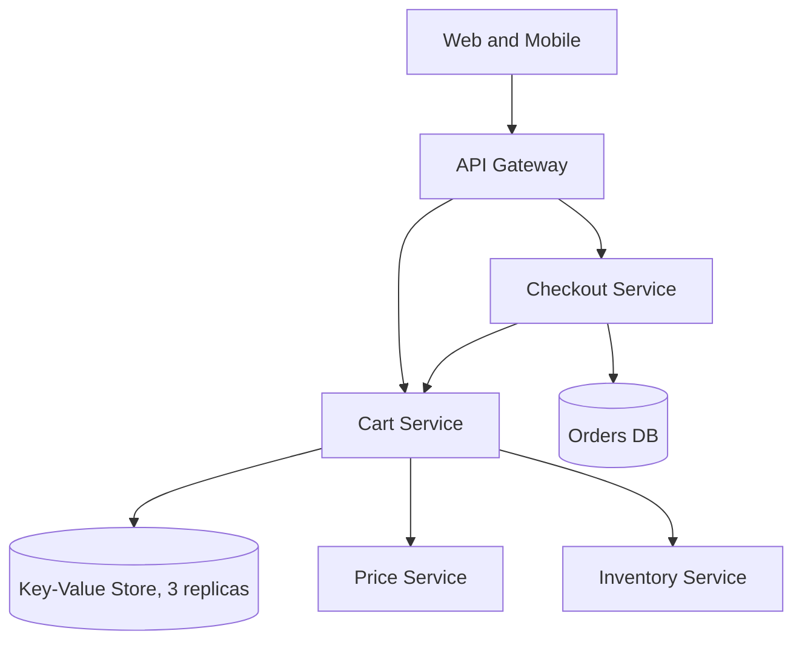
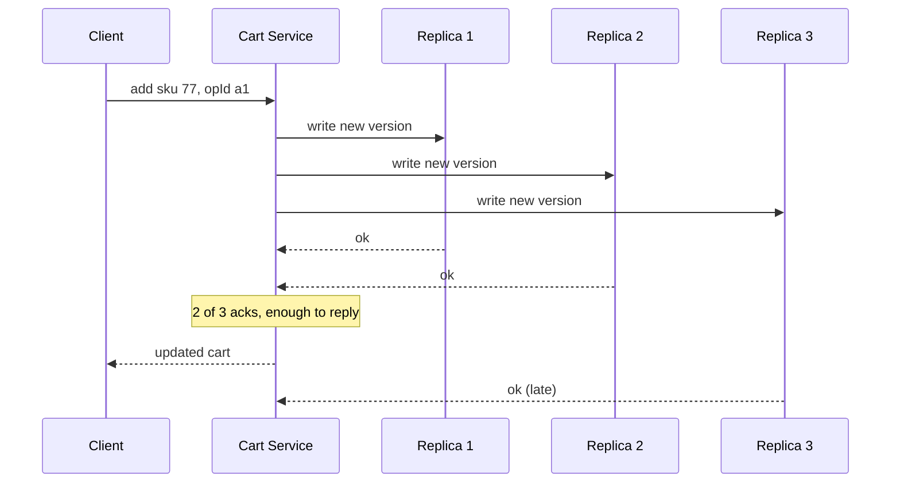

# Design Amazon shopping cart

> A cart that holds items per user, persists across devices and sessions, and feeds into checkout.

This question looks like simple storage, and the grading is about one decision: what the cart does when replicas disagree. A cart that refuses a write loses a sale, so most strong answers choose availability and then explain how conflicting versions get merged. The interviewer also checks that you keep price and stock decisions out of the cart and in checkout.

## 1. Requirements

**Functional**
- Add, update and remove items, with a quantity per item.
- See the same cart on phone, laptop and app.
- Keep a guest cart and merge it into the account cart on login.
- Hand the cart to checkout, which confirms price and stock.

**Non-functional**
- "Add to cart" always succeeds, even during a partial outage.
- Reads and writes return in tens of milliseconds.
- The cart survives for weeks without activity.
- Large peaks during sale events, many times normal traffic.

Agree out loud that the cart is not the order. A cart can show a slightly old price or an item that just sold out, because checkout rechecks both. That agreement is what allows the cart to be eventually consistent, and it is the decision the rest of the design depends on.

## 2. Estimation

Assumptions (labeled, not measured):
- 300 million users with a cart, 50 million of them changing it on a given day.
- 10 cart writes per active user per day, and two reads for every write.
- Peak traffic at ten times the average.
- 20 items per cart at about 100 bytes each.
- 10 million checkouts per day.

Computed:
- Writes: 50 million x 10 = 500 million per day, and 500 million / 86,400 = about 5,800 per second. Peak: about 58,000 per second.
- Reads: 1 billion per day, about 11,600 per second. Peak: about 116,000 per second.
- Storage: 300 million x 20 x 100 bytes = 600 GB.
- Checkouts: 10 million / 86,400 = about 116 per second.

See the [estimation cheat sheet](../cheat-sheets/estimation.md) for the reference numbers.

600 GB is small and fits in the memory of a modest cluster, so size is not the problem. The peak write rate is real but spreads evenly across millions of independent carts. Each cart sees about ten writes a day, so contention on a single key is rare. The hard part is availability during failures, not throughput.

## 3. API

- `GET /cart` returns `{ items: [{ sku, qty, currentPrice, inStock }], version }`.
- `POST /cart/items` with `{ sku, qty, opId }` returns the updated cart.
- `PATCH /cart/items/{sku}` with `{ qty, opId }` returns the updated cart.
- `DELETE /cart/items/{sku}?opId=` returns the updated cart.
- `POST /cart/merge` with `{ guestCartId }` returns the merged account cart.
- `POST /checkout` with `{ cartVersion }` returns `{ orderId }` or a list of changed prices and missing stock.

## 4. Data model

```
carts:  cart_id (PK, user_id or guest_id) | version_vector | updated_at | expires_at
        items: [ { sku, qty, added_at, op_id, removed } ]
```

The access pattern is "read or write the whole cart by its id", with no joins and no queries across carts. That is a key-value lookup, so a partitioned key-value store fits. The cart stores product references and quantities only. Prices and stock come from their own services at read time and again at checkout. See [SQL vs NoSQL](../cheat-sheets/sql-vs-nosql.md).

## 5. Keeping the cart writable and merging conflicts

Each cart is copied to several replicas. When a network split separates them, the system must choose between refusing writes and accepting writes that may conflict. This is the [CAP theorem](../patterns/cap-theorem.md) choice in its plainest form.

| Approach | How | Trade-off |
|----------|-----|-----------|
| Single leader, strong consistency | All writes go to one replica, which orders them | No conflicts, but writes fail while the leader is unreachable |
| Leaderless, last write wins | Any replica accepts writes, newest timestamp survives | Always writable, but a concurrent add can silently disappear |
| Leaderless, merge versions | Any replica accepts writes, divergent versions are merged | Always writable and nothing added is lost, but removals need care |

Amazon's Dynamo paper describes the shopping cart as its motivating example and takes the third path. Each version carries a version vector, a small list of counters per replica that shows whether one version came after another or whether they diverged. See [logical clocks](../patterns/logical-clocks.md). The application merges divergent versions, commonly by taking the union of items and the larger quantity.

The known weakness of a plain union is that a removed item can return. If one device removes a book while another device adds a pen, the union still contains the book. The fix is a tombstone, a marker that records the removal so the merge can respect it. A data type built for this is the observed-remove set, which keeps each add with a unique id and lets a remove cancel only the adds it has seen.

## 6. High-level design



The cart service owns the cart record and calls price and inventory services only to add current prices and stock flags to the response. Checkout reads the cart, reprices every line, reserves stock and writes the order in a strongly consistent store. Carts are spread across nodes with [consistent hashing](../patterns/consistent-hashing.md), so adding nodes moves only a small share of carts.



The service replies once two of three replicas acknowledge, so one slow or failed replica does not block the add. With three replicas, writing to two and reading from two normally makes a read overlap the latest write. During failures, a stand-in node can take a write, so that overlap is not guaranteed and merging still matters. See [quorum](../patterns/quorum.md).

## 7. Bottlenecks and trade-offs

- Replica failure: accept writes on a stand-in node and hand them back later, as described for [Dynamo](../deep-dives/dynamo-key-value-store.md).
- Retried requests: an `opId` per change makes repeats [idempotent](../patterns/idempotency.md), so a retry never adds the item twice.
- Read latency at peak: [cache](../patterns/caching.md) prices and stock flags for short periods.
- Data spread: partition by cart id with [replication](../patterns/replication.md) across zones.

The most common follow-up is whether to use strong consistency instead. A strongly consistent store gives simpler code and no merge logic. The cost is that a cart becomes unwritable whenever its leader is unreachable, which happens during exactly the traffic peaks that matter most. Merging an occasional conflict costs a little code, while a failed "add to cart" costs a sale. Say which cost you prefer and why. See [consistency models](../patterns/consistency-models.md).

## The deep dives to expect

**How do you merge a guest cart on login?** Read both carts, combine items by SKU, and keep the larger quantity for duplicates. Write the result to the account cart and mark the guest cart merged, so a retry does not merge twice.

**What if the price changed since the item was added?** The cart never stores a price as a promise. It shows the current price on every read, and checkout reprices again. If the price rose, checkout tells the user before charging.

**When do you reserve inventory?** At checkout, not at add to cart. Reserving on add would lock stock in millions of abandoned carts. A short reservation during payment is enough.

**How long do carts live?** Give each cart an expiry, refreshed on every write. Expired guest carts are deleted, and account carts can live for months because storage is cheap at 600 GB.

**How do you handle a sale event peak?** Carts are independent keys, so the load spreads across partitions. Scale the cart service and cache price lookups, because the price and inventory calls usually reach their limits before the cart store does.

## Related pages

- The checkout side, where stock is reserved: [design a flash sale system](design-flash-sale-system.md).
- Charging the order safely: [design a payment system](design-payment-system.md).
- The storage system behind this design: [Dynamo](../deep-dives/dynamo-key-value-store.md).

## Go deeper

- Quick, focused prep: [System Design Interview Crash Course](https://www.designgurus.io/course/system-design-interview-crash-course?utm_source=github&utm_medium=repo&utm_campaign=grokking-system-design&utm_content=questions-design-amazon-shopping-cart)
- Full course: [Grokking the System Design Interview](https://www.designgurus.io/course/grokking-the-system-design-interview?utm_source=github&utm_medium=repo&utm_campaign=grokking-system-design&utm_content=questions-design-amazon-shopping-cart)