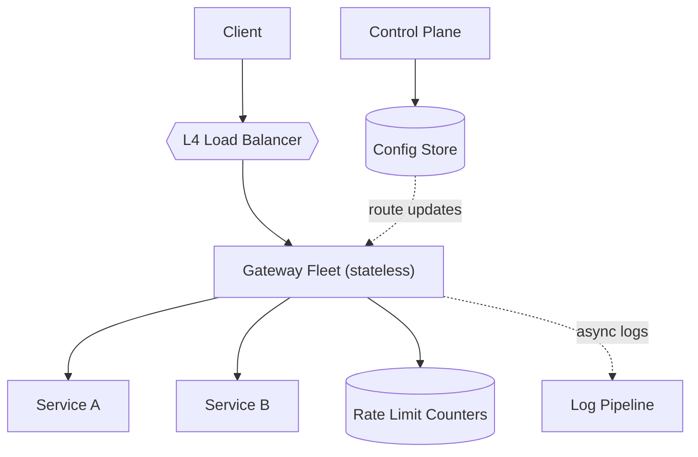
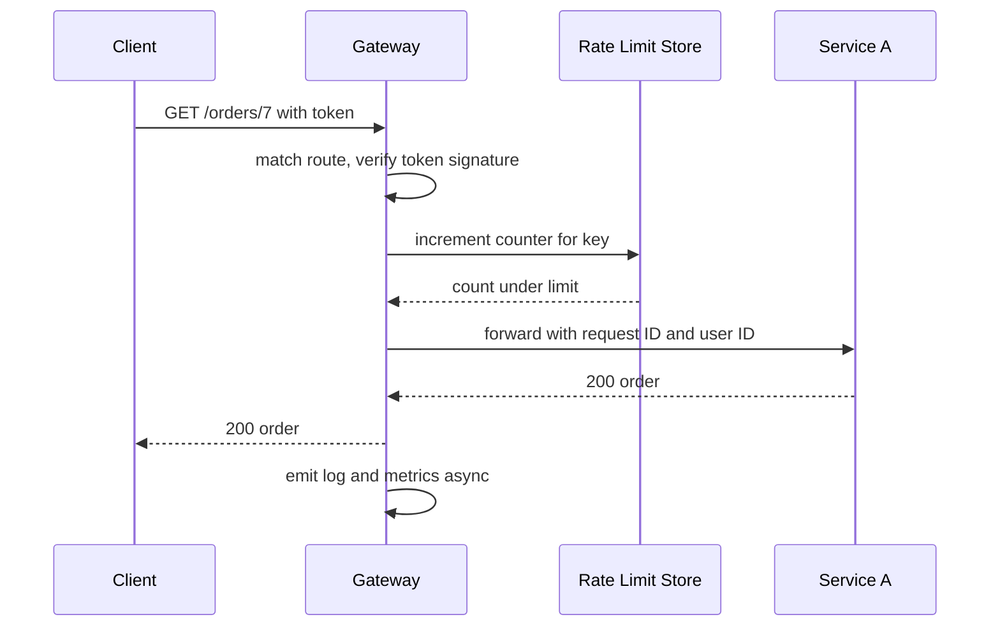

# Design an API gateway

> A single entry point in front of many backend services that handles routing, auth, and cross-cutting concerns.

This question is graded on whether the gateway stays thin, fast, and highly available. Every request in the company passes through it, so each millisecond it adds and each failure it causes affects all services. Expect the interviewer to push on how authentication avoids a network call, how rate limits work across many instances, and how one slow backend is kept from hurting the rest.

## 1. Requirements

**Functional**
- Route each request to a backend service by host, path, and method.
- Authenticate callers and check that they may call the route.
- Enforce rate limits per API key or per user.
- Terminate TLS, add request IDs, and log every request.
- Optional: request and response transformation, response caching, and canary routing.

**Non-functional**
- Very high availability, higher than any single backend.
- Low added latency: a few milliseconds at p99 (the latency that 99 percent of requests stay under).
- Scale horizontally to hundreds of thousands of requests per second.
- Route changes apply within seconds, without a restart.

Agree on the boundary out loud before designing. The gateway handles cross-cutting concerns, which are checks every service would otherwise repeat. It does not hold business logic. Also agree that it is split into a data plane (the fleet that handles live traffic) and a control plane (the service where teams change routes and policies).

## 2. Estimation

Assumptions (stated, not measured):
- 500,000 requests per second at peak, across 200 backend services.
- One gateway instance handles 10,000 requests per second, including TLS.
- Average response size 10 KB.
- 10 million active API keys.

Computed numbers:
- Instances: 500,000 divided by 10,000 is 50. With 50 percent headroom to survive losing a zone, run about 75.
- Bandwidth: 500,000 times 10 KB is 5 GB per second in total. Across 50 instances, that is 100 MB per second each, or about 800 Mbps.
- Rate-limit counter updates: one per request, so 500,000 per second against the counter store.

See the [estimation cheat sheet](../cheat-sheets/estimation.md) for the reference values.

The numbers rule out any blocking network call that is not strictly needed. Calling an auth service on each request would add 500,000 internal calls per second and a second point of failure. So tokens are validated locally, and routes live in each instance's memory. Rate limiting is the one place that needs shared state, and 500,000 updates per second is why that state lives in an in-memory store.

## 3. API

Data plane:
- `ANY /{path}` from clients, forwarded to the matched service. The gateway adds headers like `X-Request-Id` and the authenticated user ID.

Control plane:
- `PUT /admin/routes/{routeId}` with `{ host, pathPrefix, methods, upstream, authPolicy, rateLimit, timeoutMs, retries }` returns `{ version }`.
- `GET /admin/routes?since={version}` returns the changed routes, used by gateway instances to pull updates.
- `PUT /admin/consumers/{apiKey}` with `{ tenantId, plan, status }` returns `200`.

## 4. Data model

```
routes:     route_id (PK) | host | path_prefix | methods | upstream | auth_policy
            | rate_limit_rule | timeout_ms | retry_policy | version
upstreams:  upstream (PK) | discovery_name | lb_policy | health_check
consumers:  api_key (PK) | tenant_id | plan | status
counters:   "{api_key}:{window_start}" -> count   (in-memory store, TTL = window)
```

Two access patterns drive two stores. Routes are read on every request but change a few times a day. So they live in a small config database, and each instance holds a compiled copy in memory, often as a prefix tree for fast path matching. Counters are written on every request and matter only for one time window, so they live in an in-memory store like Redis with a TTL (time to live).

## 5. Processing a request through the filter chain

Each request passes through an ordered chain of filters, where each filter can pass, change, or reject the request. The cheapest checks come first, so bad requests are rejected before they cost anything:

1. TLS termination and request ID.
2. Route match by host, path, and method.
3. Authentication: verify the token signature with a cached public key, with no network call.
4. Authorization: check the token's scopes against the route policy.
5. Rate limit check.
6. Proxy to a healthy instance with a timeout, limited retries, and a circuit breaker.
7. Log and emit metrics without blocking the response.

Rate limiting is the step with a real design choice, because the counter must be shared across 75 instances. See [rate limiting](../patterns/rate-limiting.md).

| Approach | How | Trade-off |
|----------|-----|-----------|
| Local counters | Each instance limits to its share of the quota | No network call, but uneven load balancing makes limits inaccurate |
| Central counters | Every request increments a counter in Redis | Accurate, but adds a network hop and depends on Redis |
| Hybrid | Count locally, sync to Redis every few hundred milliseconds | Close to accurate with little added latency |

A common design uses central counters for paid API keys where accuracy matters, and the hybrid for coarse abuse protection. If the counter store is down, the gateway fails open (allows the request) for most routes, because rejecting all traffic is worse than briefly exceeding a limit.

## 6. High-level design



A layer 4 [load balancer](../patterns/load-balancing.md) spreads TCP connections across the gateway fleet, which is stateless, so any instance can serve any request. The control plane writes routes to the config store, and every instance receives updates within seconds. If the control plane fails, instances keep serving with their last known good config, so live traffic is never affected.

The hot path for one request:



Only two network calls happen in line: the counter check and the forward. Everything else is in memory, which keeps the added latency to a few milliseconds.

## 7. Bottlenecks and trade-offs

- Gateway availability: a stateless fleet across zones behind a [load balancer](../patterns/load-balancing.md).
- Slow or failing backends: timeouts and a [circuit breaker](../patterns/circuit-breaker.md) per upstream.
- Retries: only on idempotent requests, with a retry budget. See [idempotency](../patterns/idempotency.md).
- Repeated reads: optional response [caching](../patterns/caching.md) for public, cacheable routes.
- Background on the pattern itself: [API gateway](../patterns/api-gateway.md) and [proxies](../patterns/proxies.md).

The most common follow-up is how much logic belongs in the gateway. Adding response aggregation or business rules is tempting, because the gateway already sees every request. But each feature added there must be deployed with the gateway, so one team's change can break every service. Keep the shared gateway limited to cross-cutting checks, and put aggregation in a separate backend-for-frontend service owned by the client team.

## The deep dives to expect

**How do you stop one slow service from taking down the gateway?** Give each upstream its own connection pool and concurrency limit, which is called a bulkhead. Add a short timeout and a circuit breaker that rejects calls fast once errors pass a threshold. Then a hung service uses up only its own share of capacity.

**How do you change routes safely?** Validate every change in the control plane, version it, and roll it to a small share of instances first. Keep the previous version, so a bad change can be reverted in seconds.

**How do you revoke a token if validation is local?** Use short-lived access tokens, a few minutes long, so revocation takes effect when the token expires. For urgent cases, push a small denylist of revoked token IDs to every instance.

**Why not retry every failed request?** Retries multiply load on a service that is already struggling. Retry only idempotent requests, and cap retries at a small share of total traffic, like 10 percent.

**How do you deploy the gateway itself?** Roll out instance by instance. Each instance stops taking new connections, finishes its open requests, then restarts, which is called connection draining.

## Related pages

- The limiting logic in depth: [design a rate limiter](design-rate-limiter.md).
- A gateway specialized for model traffic: [design an LLM gateway](design-llm-gateway.md).
- Choosing the load balancer layer: [L4 vs L7 load balancing](../cheat-sheets/l4-vs-l7-load-balancing.md).

## Go deeper

- Read more (free): [Load Balancer vs Reverse Proxy vs API Gateway](https://www.designgurus.io/blog/load-balancer-reverse-proxy-api-gateway?utm_source=github&utm_medium=repo&utm_campaign=grokking-system-design&utm_content=questions-design-api-gateway)
- Quick, focused prep: [System Design Interview Crash Course](https://www.designgurus.io/course/system-design-interview-crash-course?utm_source=github&utm_medium=repo&utm_campaign=grokking-system-design&utm_content=questions-design-api-gateway)
- Full course: [Grokking the System Design Interview](https://www.designgurus.io/course/grokking-the-system-design-interview?utm_source=github&utm_medium=repo&utm_campaign=grokking-system-design&utm_content=questions-design-api-gateway)
