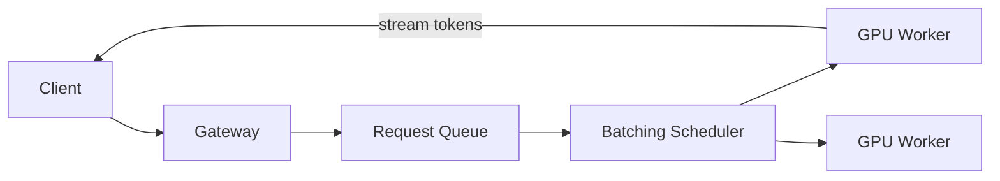

# Design ChatGPT (LLM serving)

> A service that serves a large language model to many users, streaming responses with low latency.

## Requirements

- Accept a prompt and stream back a generated response.
- Serve a large model to many concurrent users.
- Keep latency acceptable and cost under control.
- Maintain conversation context.

## Key ideas

- Inference serving: requests hit a fleet of GPU workers running the model; a scheduler batches concurrent requests together to use the hardware efficiently.
- Streaming: tokens are generated one at a time and streamed to the client over a persistent connection, so the user sees output as it is produced.
- Context: conversation history is sent with each request (within a context limit); long histories may be summarized or truncated.
- Scaling and cost: GPUs are expensive, so batching, queuing, and autoscaling the worker pool are central. Cache common results where possible.

## High-level design

## Go deeper

This walkthrough is written for a general system design round. For the AI-round version, which leads with data, evaluation, and cost, see [Grokking AI System Design](https://github.com/design-gurus/grokking-ai-system-design).

- Full worked solution for the AI round: the lesson [Design a ChatGPT-Style Assistant](https://www.designgurus.io/course-play/grokking-the-ai-system-design-interview/doc/design-a-chatgptstyle-assistant?utm_source=github&utm_medium=repo&utm_campaign=grokking-system-design&utm_content=questions-design-chatgpt) in [Grokking the AI System Design Interview](https://www.designgurus.io/course/grokking-the-ai-system-design-interview?utm_source=github&utm_medium=repo&utm_campaign=grokking-system-design&utm_content=questions-design-chatgpt).
- A second, condensed walkthrough: the lesson [Design ChatGPT](https://www.designgurus.io/course-play/system-design-interview-crash-course/doc/design-chatgpt?utm_source=github&utm_medium=repo&utm_campaign=grokking-system-design&utm_content=questions-design-chatgpt) in [System Design Interview Crash Course](https://www.designgurus.io/course/system-design-interview-crash-course?utm_source=github&utm_medium=repo&utm_campaign=grokking-system-design&utm_content=questions-design-chatgpt).
- The frontend design: the lesson [Design an AI Chat Interface](https://www.designgurus.io/course-play/grokking-the-modern-frontend-system-design-interview/doc/design-an-ai-chat-interface?utm_source=github&utm_medium=repo&utm_campaign=grokking-system-design&utm_content=questions-design-chatgpt) in [Grokking the Modern Frontend System Design Interview](https://www.designgurus.io/course/grokking-the-modern-frontend-system-design-interview?utm_source=github&utm_medium=repo&utm_campaign=grokking-system-design&utm_content=questions-design-chatgpt).
- The API contract: the lesson [Streaming LLM APIs](https://www.designgurus.io/course-play/grokking-modern-api-design-interview/doc/streaming-llm-apis?utm_source=github&utm_medium=repo&utm_campaign=grokking-system-design&utm_content=questions-design-chatgpt) in [Grokking Modern API Design Interview](https://www.designgurus.io/course/grokking-modern-api-design-interview?utm_source=github&utm_medium=repo&utm_campaign=grokking-system-design&utm_content=questions-design-chatgpt).
- Full course: [Grokking the System Design Interview](https://www.designgurus.io/course/grokking-the-system-design-interview?utm_source=github&utm_medium=repo&utm_campaign=grokking-system-design&utm_content=questions-design-chatgpt)
