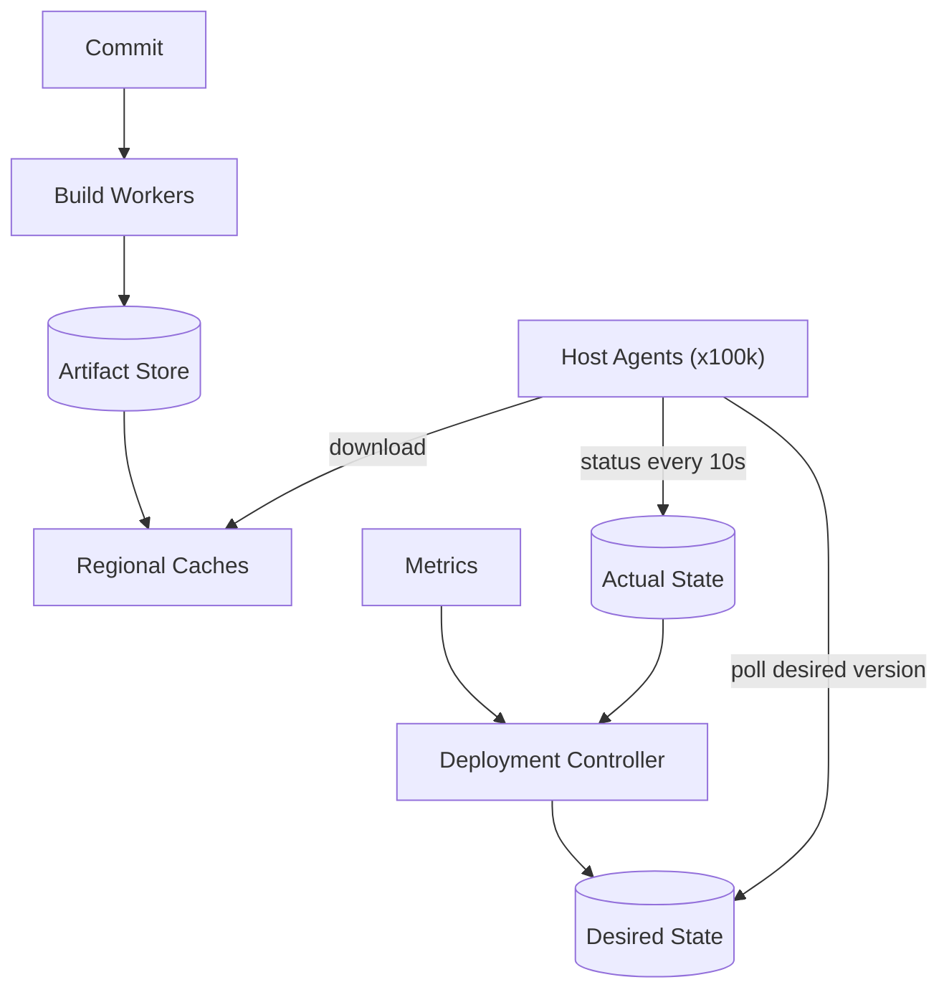
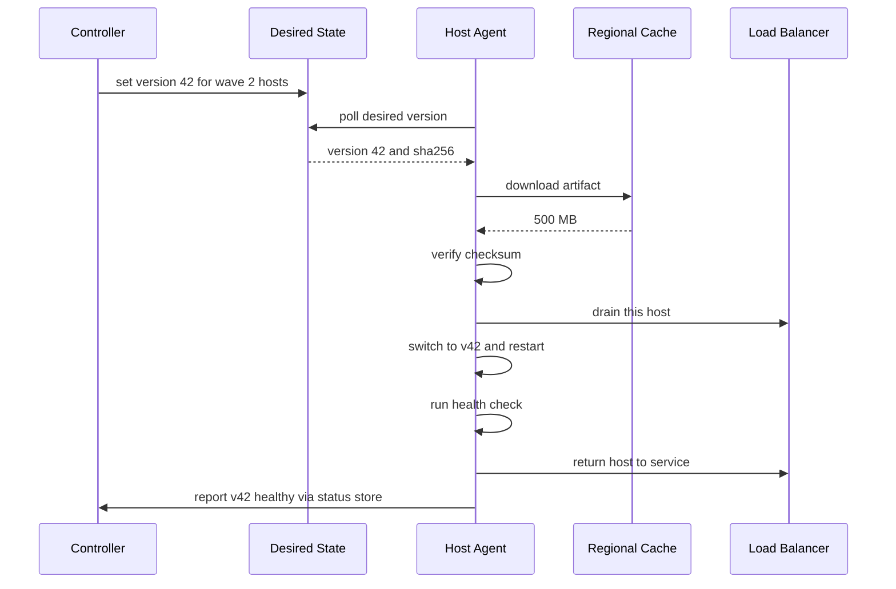

# Design a code deployment system

> Build, distribute, and roll out application binaries to a large fleet of servers safely.

This question is graded on safety, not on speed. Any team can copy a file to a server, so the interviewer will ask how a bad build reaches only a few servers before it is caught, and how fast you can undo it. The second graded point is distribution: moving a large artifact to many thousands of machines without overloading its store.

## 1. Requirements

**Functional**
- Build a commit into an immutable, versioned artifact (a package that never changes once built).
- Deploy a chosen version to a service's fleet in stages.
- Roll back automatically when health checks fail, and manually on request.
- Show which version each host runs and the progress of each deployment.

**Non-functional**
- Safety: a bad version should reach only a small share of hosts.
- Speed: a full fleet deployment finishes within tens of minutes, and a rollback within minutes.
- Availability: the system must work during an incident, which is when rollback is needed most.
- Distribution must not saturate the network or the artifact store.

Agree out loud on two points before designing. Artifacts are immutable and identified by a content hash, so "version 42" means the same bytes everywhere. And the system records desired state (the version each host should run) separately from actual state (the version it does run). Deploying means changing desired state, then waiting until actual state matches.

## 2. Estimation

Assumptions (stated, not measured):
- 100,000 servers across 5 regions.
- Artifact size 500 MB.
- The artifact store serves 10 Gbps, which is 1.25 GB per second.
- Each host downloads at 1 Gbps, which is 125 MB per second.
- Each host agent reports status every 10 seconds.

Computed numbers:
- Total transfer for a fleet-wide deployment: 100,000 times 500 MB is 50 TB.
- From the central store alone: 50,000 GB divided by 1.25 GB per second is 40,000 seconds, about 11 hours.
- One host's own download: 500 MB divided by 125 MB per second is 4 seconds.
- Status reports: 100,000 hosts divided by 10 seconds is 10,000 writes per second.

See the [estimation cheat sheet](../cheat-sheets/estimation.md) for the reference values.

Say the 11 hours against 4 seconds out loud. Each host could finish in seconds, but the central store cannot feed them all, so a single source is ruled out. Distribution must spread across regional caches or peers. The 10,000 status writes per second also rule out writing each heartbeat to the same relational table that holds deployment records.

## 3. API

- `POST /builds` with `{ repo, commitSha }` returns `{ buildId }`.
- `GET /builds/{buildId}` returns `{ status, artifactUrl, sha256 }`.
- `POST /deployments` with `{ service, version, stages: [1, 10, 50, 100], bakeMinutes, healthChecks }` returns `{ deploymentId }`.
- `GET /deployments/{deploymentId}` returns `{ stage, hostsDone, hostsFailed, state }`.
- `POST /deployments/{deploymentId}/rollback` and `/pause` return `202`.
- Agent calls: `GET /agents/{hostId}/desired` returns `{ version, artifactUrl, sha256 }`, and `POST /agents/{hostId}/status` sends `{ version, health }`.

## 4. Data model

```
builds:      build_id (PK) | repo | commit_sha | artifact_url | sha256 | size | status
deployments: deployment_id (PK) | service | from_version | to_version | strategy
             | current_stage | state
desired:     (service, host_id) (PK) | version | deployment_id
actual:      host_id (PK) | service | version | health | last_seen
```

Two access patterns drive the store choice. Builds, deployments, and desired state change rarely and need strict state transitions, so a relational database fits them. Actual state takes 10,000 writes per second and is only read in aggregate, so it lives in a key-value store or an in-memory store that the controller reads. Agent polls add 10,000 reads per second, served from a cache.

## 5. Rolling out in stages and rolling back

The core design choice is the rollout strategy:

| Strategy | How | Trade-off |
|----------|-----|-----------|
| All at once | Every host switches together | Fastest, but a bad build hits everyone |
| Rolling waves | Fixed batches, one after another | Simple, but no early signal before many hosts change |
| Canary then waves | 1 percent first, wait, then 10, 50, 100 percent | Catches most bad builds early, slower |
| Blue-green | Start a full new fleet, then move traffic | Instant rollback, but doubles capacity during the switch |

A canary is a small group of hosts that runs the new version first while the rest stays on the old one. Canary then waves is the common default for large fleets. After each stage, the controller waits for a bake time, which is a fixed period to let problems appear, then compares the new hosts' error rate and p99 latency against hosts still on the old version. The p99 latency is the time that 99 percent of requests stay under. If the new version is clearly worse, the controller sets desired state back to the old version.

**Rollback must be fast.** Each host keeps the previous artifact on disk, so rollback switches a pointer and restarts the process with no download.

**Distribution spreads load across caches and peers.** Each region runs a set of caching servers that pull the artifact once from the central store, much like a [CDN](../patterns/cdn.md). Hosts can also share pieces with each other, peer to peer, so capacity grows with the fleet. Uber has open-sourced Kraken, a peer-to-peer registry built for this purpose. Every host verifies the artifact's [checksum](../patterns/checksums.md) before installing it.

## 6. High-level design



The deployment controller is a reconciliation loop: it changes desired state one stage at a time, then watches actual state and metrics until the stage is healthy. Agents on every host pull their desired version, download it, install it, and report back with [heartbeats](../patterns/heartbeats.md).

The hot path for one host in one stage:



The agent removes the host from the [load balancer](../patterns/load-balancing.md) and lets open requests finish before it restarts, so users see no errors from the switch.

## 7. Bottlenecks and trade-offs

- Artifact fan-out: regional caches and peer-to-peer sharing. See [CDN](../patterns/cdn.md).
- Integrity: verify the hash on every host. See [checksums](../patterns/checksums.md).
- Status volume: heartbeats into a fast store, aggregated for the controller. See [heartbeats](../patterns/heartbeats.md).
- Safe re-runs: agents apply desired state idempotently, so repeating a step is harmless. See [idempotency](../patterns/idempotency.md).

The most common follow-up is push versus pull. In a push model, the controller connects to each host and tells it to deploy, which is fast but needs the controller to track 100,000 connections and retry unreachable hosts. In a pull model, agents poll desired state every few seconds, so a host that was offline catches up on its own when it returns. Pull adds a few seconds of delay and removes a whole class of tracking work, which is why it is the common choice.

## The deep dives to expect

**How do you decide a canary is healthy?** Compare the canary hosts against old-version hosts during the same minutes, not against yesterday, so traffic changes affect both groups equally. Gate on a few clear metrics like error rate, p99 latency, and crash count, with thresholds set per service.

**How do you deploy a database schema change?** Split it into backward-compatible steps, often called expand and contract. First add the new column, then deploy code that writes both, then move reads, and finally drop the old column. At every step, old and new code can run together.

**What if the deployment system is down during an incident?** Keep rollback available with fewer dependencies than a deployment. Hosts keep the previous artifact locally, so a rollback needs only the desired state store and the agents.

**How does this relate to Kubernetes?** A Kubernetes Deployment uses the same model: desired state in a store, and controllers that move actual state toward it in batches. See the [Borg and Kubernetes deep dive](../deep-dives/borg-kubernetes.md).

## Related pages

- Where the health signals come from: [design a metrics and monitoring system](design-metrics-monitoring.md).
- The storage behind the artifact store: [design Amazon S3](design-amazon-s3.md).

## Go deeper

- Quick, focused prep: [System Design Interview Crash Course](https://www.designgurus.io/course/system-design-interview-crash-course?utm_source=github&utm_medium=repo&utm_campaign=grokking-system-design&utm_content=questions-design-code-deployment-system)
- Full course: [Grokking the System Design Interview](https://www.designgurus.io/course/grokking-the-system-design-interview?utm_source=github&utm_medium=repo&utm_campaign=grokking-system-design&utm_content=questions-design-code-deployment-system)
