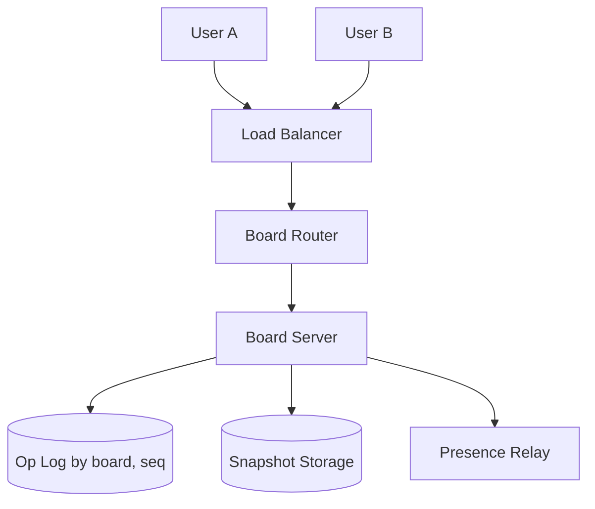
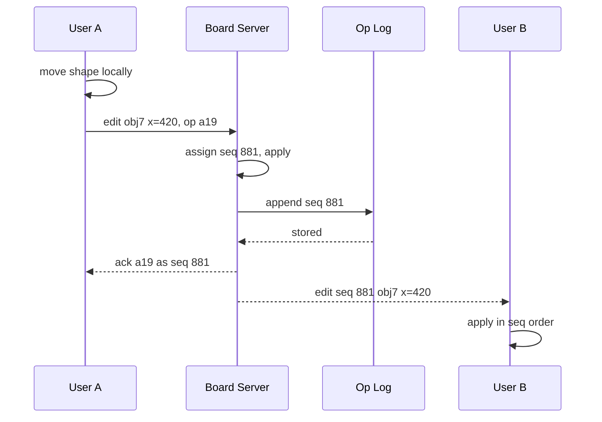

# Design a collaborative whiteboard (Miro)

> A shared canvas where many users draw and edit shapes together in real time.

This question is graded on how you merge edits that happen at the same moment and how you keep everyone's canvas the same. The interviewer wants a clear owner for each board's ordering, a conflict rule you can defend, and a recovery story for a server crash. Cursors and presence are a second, much larger stream, and strong answers treat them differently from edits.

## 1. Requirements

**Functional**
- Create, move, resize, recolor and delete shapes, lines and sticky notes.
- See other users' edits within a fraction of a second.
- See other users' cursors and who is on the board.
- Reopen a board later, and reconnect after a dropped network without losing edits.

**Non-functional**
- Edits appear for others in about 100 milliseconds.
- Every client ends with the same board state.
- Boards are durable: an acknowledged edit is never lost.
- Many boards at once, and up to dozens of active editors on one board.

Agree out loud which data must be durable and which may be lost. Edits must survive any failure. Cursor positions are useless a second later, so they can be dropped, and that split decides where each message travels.

## 2. Estimation

Assumptions (labeled, not measured):
- 2 million users connected at peak, an average of 4 users per active board.
- Each user sends 1 edit per second and 10 cursor updates per second while active.
- 200 bytes per edit, and average traffic at a quarter of peak.
- 50 million stored boards with an average snapshot of 1 MB.
- 50,000 WebSocket connections per server.

Computed:
- Active boards: 2 million / 4 = 500,000.
- Edits in: 2 million per second. Edits out, to 3 other users each: 6 million per second.
- Cursor messages in: 2 million x 10 = 20 million per second. Out: 60 million per second.
- Edit log at peak: 2 million x 200 bytes = 400 MB per second. At average traffic, a quarter of that is 100 MB per second, and 100 MB x 86,400 = about 8.6 TB per day.
- Snapshots: 50 million x 1 MB = 50 TB.
- Connection servers: 2 million / 50,000 = 40.

See the [estimation cheat sheet](../cheat-sheets/estimation.md) for the reference numbers.

Cursor traffic is ten times edit traffic, so it cannot pass through a database or a durable log. The edit log grows by terabytes a day, so it must be compacted into snapshots and old entries discarded. A board of about 1 MB fits easily in one server's memory, which makes it practical to give each live board a single home server.

## 3. API

- `GET /boards/{id}` returns `{ snapshot, snapshotSeq }`.
- `WS /boards/{id}/live?sinceSeq=` opens the live channel and replays any edits after `sinceSeq`.
- Client sends `edit { clientOpId, objectId, prop, value }` and receives `ack { clientOpId, seq }`.
- Server broadcasts `edit { seq, objectId, prop, value, userId }` to other clients.
- Client sends `cursor { x, y }`, and the server relays it without storing it.

## 4. Data model

```
boards:  board_id (PK) | owner_id | title | snapshot_key | snapshot_seq
objects: object_id | type | props { x, y, w, h, color, text } | z_key
         | updated_seq | deleted          (inside the snapshot)
ops:     board_id | seq | object_id | prop | value | user_id | client_op_id
         PK (board_id, seq)
```

The access pattern is "load one whole board, then apply a stream of small edits to that board in order". So the board snapshot lives in object storage, the recent edit log in a store keyed by board and sequence number, and the live state in memory on one server. This snapshot plus log approach is a form of [event sourcing](../patterns/event-sourcing-cqrs.md).

## 5. Merging concurrent edits

A conflict happens when two users change the same thing before either sees the other's change. The board server gives every edit a sequence number, a single counter per board that fixes the order all clients apply edits in.

| Approach | How | Trade-off |
|----------|-----|-----------|
| Last write wins per object | The later edit replaces the whole object | Simple, but a move and a recolor at the same moment lose one change |
| Last write wins per property | The later edit wins only for the property it changed | Concurrent move and recolor both survive, and it is still simple |
| Operational transformation (OT) | Rewrite each edit against the edits it raced with | Precise merging for text, but complex to get correct |
| CRDT | Data types that merge in any order to the same result | Works without a central server, at a cost in memory and complexity |

Per-property last write wins is the usual answer for shapes. Figma has written publicly that its multiplayer system uses a central server and resolves conflicts per property in this way. Text inside a sticky note is the exception, because two people typing in one note would overwrite each other. Use a text merging method, OT or a text CRDT, for that field only. See [Google Docs](design-google-docs.md).

The client applies its own edit at once, so the canvas feels instant. Until the ack arrives, it ignores incoming changes to that property, because the server orders its edit after them. Every client applies edits in sequence order, so all canvases match.

## 6. High-level design



The router sends a board's connections to one board server, using [consistent hashing](../patterns/consistent-hashing.md) on the board id. That server holds the board in memory, assigns sequence numbers and appends each edit to the log. The server also writes a fresh snapshot every few thousand edits and trims the log behind it.



The ack is sent only after the log append, so an acknowledged edit survives a server crash.

## 7. Bottlenecks and trade-offs

- Persistent connections: use [WebSockets](../patterns/long-polling-websockets-sse.md), compared in [WebSockets vs SSE vs long polling](../cheat-sheets/websockets-vs-sse-vs-long-polling.md).
- Edit durability: append to a [write-ahead log](../patterns/write-ahead-log.md) before acknowledging.
- Cursor volume: throttle on the client and drop stale cursor messages under load, a form of [backpressure](../patterns/backpressure.md).
- Presence: each client sends [heartbeats](../patterns/heartbeats.md), and a user who misses several is shown as gone.
- Spreading boards: [load balancing](../patterns/load-balancing.md) for connections and board affinity through the router.

The most common follow-up is whether a central board server is a weakness. A single owner per board makes ordering and conflict rules simple. A server-free CRDT design removes that owner and allows offline editing between peers, but every client must hold extra merge metadata. For a hosted product with servers always available, the central owner is the simpler and more common choice, and a crash costs only a few seconds of reconnection.

## The deep dives to expect

**What happens when a board server crashes?** The router assigns the board to another server. That server loads the latest snapshot and replays log entries after it.

**How does reconnection after a dropped network work?** The client keeps unacknowledged edits in a local queue. On reconnect, it sends `sinceSeq`, applies the edits it missed, then resends its queue. The `clientOpId` lets the server ignore an edit it already stored, which makes the resend [idempotent](../patterns/idempotency.md).

**How do you order shapes front to back without conflicts?** Give each object a fractional index, a sortable key placed between its neighbors' keys. Moving a shape forward changes only that shape's key, so two users reordering different shapes never conflict.

**How does undo work with many editors?** Undo only your own edits. The client records the inverse of each edit and sends it as a new edit, so it receives a new sequence number like any other change.

**What about a board with 1,000 viewers and a few editors?** Editors connect to the board server, while viewers receive the edit stream from a fan-out tier, so the board server sends each edit once per fan-out node instead of once per viewer.

## Related pages

- Text-level merging with OT and CRDTs: [design Google Docs](design-google-docs.md).
- Fan-out of live messages to many clients: [design live comment streaming](design-live-comment-streaming.md).
- Persistent connections and presence at scale: [design Discord](design-discord.md).

## Go deeper

- Quick, focused prep: [System Design Interview Crash Course](https://www.designgurus.io/course/system-design-interview-crash-course?utm_source=github&utm_medium=repo&utm_campaign=grokking-system-design&utm_content=questions-design-collaborative-whiteboard)
- Full course: [Grokking the System Design Interview](https://www.designgurus.io/course/grokking-the-system-design-interview?utm_source=github&utm_medium=repo&utm_campaign=grokking-system-design&utm_content=questions-design-collaborative-whiteboard)