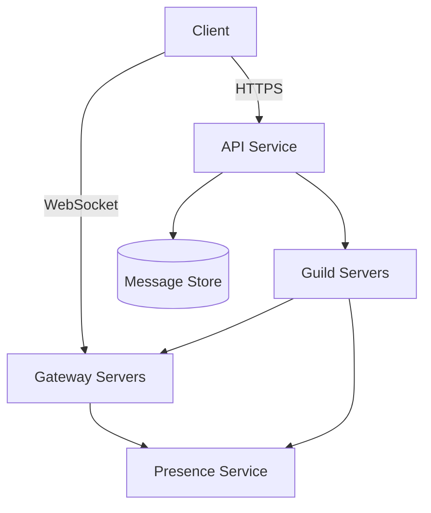
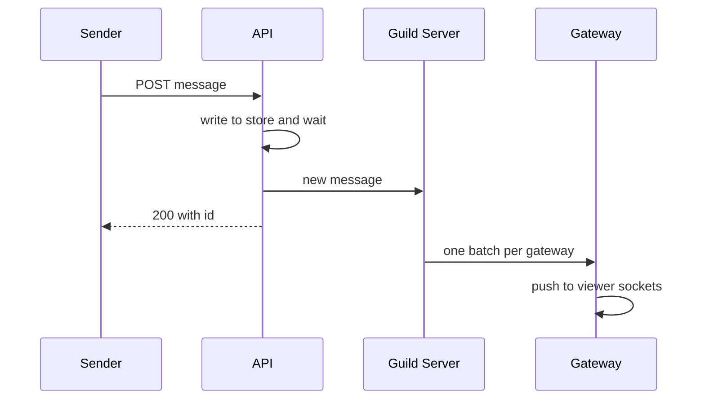

# Design Discord

> A community chat platform with servers, channels, real-time messaging, presence, and voice.

This question looks like WhatsApp with group chats, and it is graded on the difference. A server (Discord calls it a guild) can have hundreds of thousands of members online at once. So the hard parts are fan-out (delivering one message to many recipients), presence updates that grow with membership, and fast reads of recent history.

## 1. Requirements

**Functional**
- Users join guilds, and each guild has many text channels.
- Send and receive messages in a channel in real time, plus direct messages.
- Scroll back through channel history and see unread counts.
- Show presence (online, idle, offline) for members.
- Voice channels (usually scoped out of the text design).

**Non-functional**
- Message delivery to online members within a few hundred milliseconds.
- Messages are never lost once the sender sees them as sent.
- Ordering within a channel is consistent for all readers.
- Guilds range from five friends to hundreds of thousands of online members.

Agree out loud that ordering only matters within a channel, never across channels. That single choice lets each channel be stored and ordered on its own.

## 2. Estimation

Assumptions: 20 million concurrent connected users at peak, 4 billion messages per day, 200 bytes per stored message, an average of 50 online recipients per message, and 50,000 connections per gateway server.

- Writes: 4 billion divided by about 86,400 seconds is roughly 46,000 messages per second, or about 93,000 at a peak of twice the average.
- Deliveries: 46,000 times 50 recipients is about 2.3 million pushes per second on average.
- Storage: 4 billion times 200 bytes is 800 GB per day, or about 290 TB per year before replication.
- Gateway servers: 20 million connections divided by 50,000 is 400 servers at peak.

See the [estimation cheat sheet](../cheat-sheets/estimation.md) for the reference numbers.

Deliveries outnumber writes by fifty to one, so fan-out, not storage, sets the size of the real-time layer. Hundreds of terabytes per year with time-ordered reads points to a wide-column store partitioned by channel. And 400 gateways means a message must be routed only to the gateways that hold interested users, never broadcast to all of them.

## 3. API

- `POST /channels/{channelId}/messages` with `{ content, nonce }` returns `{ messageId, timestamp }`. The `nonce` is a client-generated id used to remove duplicates on retry.
- `GET /channels/{channelId}/messages?before={messageId}&limit=50` returns a page of history.
- `PUT /channels/{channelId}/read` with `{ lastReadMessageId }` updates the unread marker.
- WebSocket gateway: the client opens one long-lived connection and receives events like `MESSAGE_CREATE`, `PRESENCE_UPDATE`, and `TYPING_START`. See [WebSockets vs SSE vs long polling](../cheat-sheets/websockets-vs-sse-vs-long-polling.md).

## 4. Data model

```
messages     partition key: (channel_id, time_bucket)
  channel_id | time_bucket | message_id (clustering, descending) | author_id | content

guild_members   partition key: guild_id
  guild_id | user_id | roles | joined_at

read_states     partition key: user_id
  user_id | channel_id | last_read_message_id | mention_count
```

The main access pattern is "the latest 50 messages in channel C, then the 50 before that". Partitioning by channel and a time bucket (for example ten days) keeps one channel's recent messages together and stops a busy channel from growing one partition forever. The `message_id` is time-sortable, so the clustering order is the display order. Discord has written publicly about storing messages this way in Cassandra and later moving to ScyllaDB. See the [Cassandra deep dive](../deep-dives/cassandra-wide-column-db.md).

## 5. Fanning out channel messages

Each gateway server holds tens of thousands of WebSocket connections. When a message is written, the system must find every gateway that holds an online member who can see that channel.

| Approach | How | Trade-off |
|----------|-----|-----------|
| Per-user lookup | Look up each member's gateway in a session registry, then push | Simple for small guilds, but a 100,000-member guild means 100,000 lookups per message |
| Guild topic | Each gateway subscribes to the topics of guilds its users belong to, and the message is published once | One publish per message, and each gateway filters locally, at the cost of many subscriptions |
| Guild process | One owner process per guild holds the member-to-gateway map and sends one batch per gateway | One routing decision per gateway rather than per member, but the owner can become a hot spot |

A guild owner process is a strong answer. Guilds are assigned to guild servers with [consistent hashing](../patterns/consistent-hashing.md), so each guild has exactly one owner. The owner keeps an in-memory map from gateway to connected members. A new message becomes one message per gateway, which then writes to each local socket.

Large guilds need one more rule: push only to members who are actively looking. A member with a channel open receives the full message. Other online members receive nothing at once, and their unread badge updates the next time the client syncs read states. In the largest guilds, most online members are not viewing any given channel, so this cuts fan-out sharply.

Presence follows the same idea. A status change in a guild of 500,000 would otherwise go to everyone, so the client receives presence only for members it is showing, like the visible part of the member list.

## 6. High-level design



Sends go over HTTPS to the API service, which writes the message and hands it to the guild server that owns the guild. The guild server routes it to the gateways that hold active viewers. Gateways also report connects and disconnects to the presence service, which uses [heartbeats](../patterns/heartbeats.md) (small periodic signals that prove a client is still connected) to detect dropped clients.

The send path in order:



The write is acknowledged only after the store confirms it, which meets the "never lost" requirement. Fan-out happens after the write, so a slow gateway delays delivery but never blocks the sender.

## 7. Bottlenecks and trade-offs

- Huge guilds: fan out per gateway rather than per member, and push only to active viewers. See [sharding and partitioning](../patterns/sharding-partitioning.md).
- Real-time connections: one WebSocket per client through gateways behind a [load balancer](../patterns/load-balancing.md). See [long polling, WebSockets and SSE](../patterns/long-polling-websockets-sse.md).
- Spam and runaway bots: [rate limiting](../patterns/rate-limiting.md) per user and per channel.
- Duplicate sends on retry: the client `nonce` makes the send [idempotent](../patterns/idempotency.md), meaning a repeated request has no extra effect.

The common follow-up is why sends go over HTTPS rather than the WebSocket. Keeping writes on ordinary API servers means they scale, retry, and rate limit like any other request. The gateway then has one job: holding connections and pushing events. A gateway restart drops connections, which clients reopen, but it never loses a message.

## The deep dives to expect

**How do you keep message order within a channel?** Generate a time-sortable `message_id` on write, like a Snowflake id (a 64-bit id built from a timestamp, a machine number, and a sequence). Clients sort by id. Two messages a few milliseconds apart may arrive out of order and are reordered on display.

**What happens when a guild server dies?** Its guilds move to another server through the hash ring. The new owner rebuilds the member-to-gateway map by asking gateways which of their sessions belong to those guilds. Delivery pauses for a few seconds, and stored messages are unaffected.

**How does a reconnecting client catch up?** It sends the last event sequence number it saw. If the gap is small, the gateway replays buffered events. Otherwise the client fetches recent history per channel over HTTPS.

**How do unread counts work at scale?** Store one read state per user per channel with the last read `message_id`. A channel is unread if its latest id is greater, so the badge needs no counting. Mention counts are incremented only for the mentioned users.

**Where does voice fit?** Voice runs on separate media servers that forward audio between participants. The text system only signals who joined, which keeps media traffic off the chat path. See [design Zoom](design-zoom.md).

## Related pages

- One-to-one and small group delivery: [design WhatsApp](design-whatsapp.md).
- Fan-out to millions of viewers with loose delivery rules: [design live comment streaming](design-live-comment-streaming.md).
- Delivering events to offline users: [design a notification system](design-notification-system.md).

## Go deeper

- Quick, focused prep: [System Design Interview Crash Course](https://www.designgurus.io/course/system-design-interview-crash-course?utm_source=github&utm_medium=repo&utm_campaign=grokking-system-design&utm_content=questions-design-discord)
- Full course: [Grokking the System Design Interview](https://www.designgurus.io/course/grokking-the-system-design-interview?utm_source=github&utm_medium=repo&utm_campaign=grokking-system-design&utm_content=questions-design-discord)