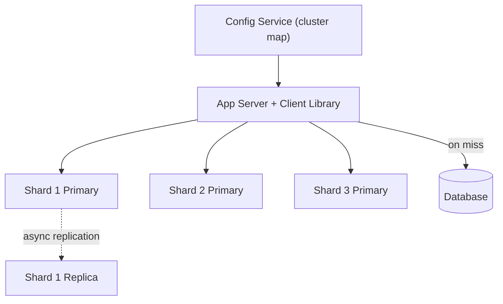
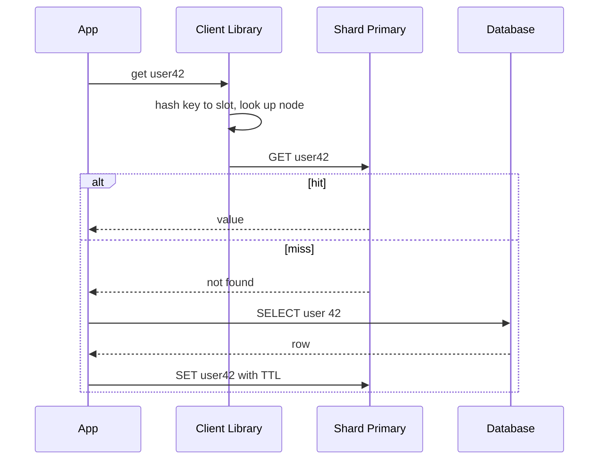

# Design a distributed cache (like Redis)

> An in-memory key-value cache spread across many nodes, for fast reads and reduced load on the data store.

This question is graded on how you spread keys across nodes and what happens when a node dies. A single-machine hash table with a time limit on each entry is easy. The interviewer wants to hear how keys move when the cluster changes, how a hot key is handled, and how much extra load the database takes when the cache misses.

## 1. Requirements

**Functional**
- `get`, `set`, and `delete` by key, with an optional TTL (time to live, after which the entry expires).
- Evict entries when memory is full.
- Optional: atomic counters and compare-and-set (write only if the value has not changed).

**Non-functional**
- Low latency: under a millisecond inside the data center for most requests.
- Scale beyond one machine's memory and throughput.
- High availability: a node failure should not take down the cache or overload the database.
- Best-effort durability: losing some entries is acceptable, because they can be reloaded.

Agree out loud that the cache is not the source of truth. That one fact allows asynchronous replication, simple eviction, and no disk on the hot path. Also agree on the usage pattern. Cache-aside, where the application reads the cache and loads from the database on a miss, is the common default.

## 2. Estimation

Assumptions (stated, not measured):
- 2 billion keys, average entry 1 KB including key and overhead.
- 1 million operations per second at peak, 90 percent reads.
- 64 GB of usable memory per node, and about 100,000 operations per second per node.
- A 95 percent hit ratio.

Computed numbers:
- Memory: 2 billion times 1 KB is 2 TB. At 64 GB per node, that is about 32 nodes, or 64 with one replica each.
- Throughput: 1 million divided by 100,000 is 10 nodes, so memory decides the node count, not request rate.
- Database load: 900,000 reads times a 5 percent miss rate is 45,000 reads per second.
- If the hit ratio falls to 80 percent, misses become 180,000 per second, four times the normal database load.

See the [estimation cheat sheet](../cheat-sheets/estimation.md) and the [latency numbers](../cheat-sheets/latency-numbers.md).

The last line is the one to say out loud. The database is sized for the miss rate, not the total rate, so a drop in hit ratio can overload it. Losing one node of 32 means about 3 percent of keys miss at once, which is survivable. Losing a large share of the cluster is not, and that is why replication and gradual resharding matter.

## 3. API

- `GET /keys/{key}` returns `{ value, version }` or `404` on a miss.
- `PUT /keys/{key}` with `{ value, ttlSeconds? }` returns `{ version }`.
- `DELETE /keys/{key}` returns `204`.
- `POST /keys/{key}/cas` with `{ value, expectedVersion }` returns `200` or `409` on a version mismatch.

Real caches use a compact binary protocol over long-lived TCP connections, because HTTP overhead is large compared to a sub-millisecond lookup.

## 4. Data model

```
Per node (in memory):
  hash table:  key -> entry
  entry:       value | expires_at | version | lru_prev | lru_next

Cluster map (in a coordination service):
  slot (0..16383) -> primary_node | replica_nodes[] | epoch
```

The access pattern is a single-key lookup with no range scans and no joins. A hash table gives constant-time lookups, and a doubly linked list through the entries gives constant-time LRU (least recently used) ordering. The cluster map is small and changes rarely, so every client can cache it and route requests without a central hop.

## 5. Partitioning keys across nodes

The core question is how a key finds its node, and what moves when nodes join or leave.

| Approach | How | When a node is added |
|----------|-----|----------------------|
| Modulo hashing | `hash(key) mod N` | Almost every key moves, so the hit ratio drops sharply |
| Consistent hashing | Nodes and keys on a hash ring, with virtual nodes | About 1/N of keys move |
| Fixed hash slots | Keys map to a fixed number of slots, slots map to nodes | Whole slots move, under explicit control |

[Consistent hashing](../patterns/consistent-hashing.md) places nodes at many points on a ring (virtual nodes), and each key belongs to the next node clockwise. Fixed slots reach the same goal with an explicit table. Redis Cluster documents this approach with 16,384 slots. Slots are easier to reason about, because migrating one slot is a single, visible operation.

**Routing can happen in three places.** A smart client library holds the cluster map and talks to the right node directly, which saves a network hop. A proxy tier hides the map from clients but adds a hop. A server can also redirect a client that asked the wrong node. A common design uses smart clients plus redirects as the fallback when the map is stale.

**Eviction keeps memory bounded.** When memory is full, the node evicts by LRU, and TTL removes expired entries both on read and in a background sweep. Exact LRU costs two pointers per entry, so some systems sample a few keys and evict the oldest of the sample instead. Redis documents this approximated LRU.

## 6. High-level design



Each shard has a primary that serves reads and writes and at least one replica on another rack. A config service holds the cluster map and runs failover. Nodes exchange [heartbeats](../patterns/heartbeats.md), and when a primary stops responding, the config service promotes its replica and publishes a new map with a higher epoch.

The cache-aside read is the hot path:



The client library computes the slot locally, so a hit costs one network round trip. On a miss, the application, not the cache, loads from the database and writes the value back with a TTL.

## 7. Bottlenecks and trade-offs

- Key distribution and resharding: [consistent hashing](../patterns/consistent-hashing.md) or fixed slots.
- Node failure: replicate each shard. See [replication](../patterns/replication.md) and [leader election](../patterns/leader-election.md).
- Hot keys: replicate the key or cache it in the application. See [sharding and partitioning](../patterns/sharding-partitioning.md).
- Stale data after a database write: see [caching](../patterns/caching.md) and [caching strategies](../cheat-sheets/caching-strategies.md).

The common follow-up is synchronous versus asynchronous replication. Synchronous replication waits for the replica on every write, which adds a network round trip to a sub-millisecond operation. Asynchronous replication is fast, but a failover can lose the last few writes. For a cache, losing a few writes only causes a few extra misses, so asynchronous replication is the usual choice.

## The deep dives to expect

**What do you do about a hot key?** One key at hundreds of thousands of reads per second saturates its node. Copy it to several nodes under suffixed keys like `key#1` to `key#4` and read a random copy. Or keep a short-lived copy in each application's local memory.

**What is a cache stampede and how do you stop it?** A stampede (also called a thundering herd) happens when a popular key expires and many requests miss at once and all query the database. Let only one request reload the value, using a short lock or a lease, while others wait or serve the stale copy. Facebook's published memcache paper describes leases for this purpose.

**How do you keep the cache consistent with the database?** Update the database first, then delete the cache entry rather than overwriting it. A delete is safe to repeat, and the next read reloads the fresh value. TTLs bound how long any missed invalidation can last.

**How do you add a node without a spike in misses?** Move slots one at a time. During migration, the old node serves a key it still holds and redirects a key it has already moved, so the hit ratio stays high.

**Why not persist to disk?** You can, with periodic snapshots or an append-only log, which shortens warm-up after a restart. It is optional, because the database remains the source of truth.

## Related pages

- How Redis works inside: [Redis internals](../deep-dives/redis-internals.md).
- A cache tier at very large scale: [memcached at Facebook](../deep-dives/memcached-at-facebook.md).
- Choosing an engine: [Redis vs Memcached](../cheat-sheets/redis-vs-memcached.md).

## Go deeper

- Read more (free): [Ultimate Guide to Redis in System Design](https://www.designgurus.io/blog/redis-guide?utm_source=github&utm_medium=repo&utm_campaign=grokking-system-design&utm_content=questions-design-distributed-cache)
- Quick, focused prep: [System Design Interview Crash Course](https://www.designgurus.io/course/system-design-interview-crash-course?utm_source=github&utm_medium=repo&utm_campaign=grokking-system-design&utm_content=questions-design-distributed-cache)
- Full course: [Grokking the System Design Interview](https://www.designgurus.io/course/grokking-the-system-design-interview?utm_source=github&utm_medium=repo&utm_campaign=grokking-system-design&utm_content=questions-design-distributed-cache)
