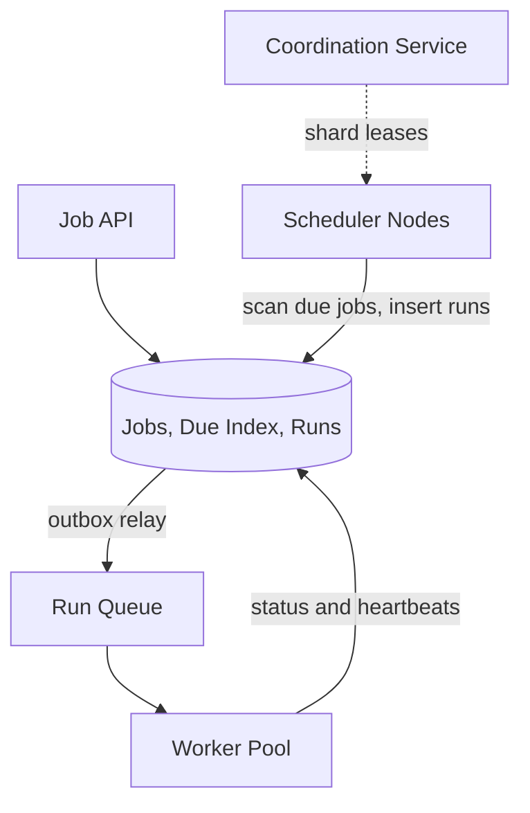
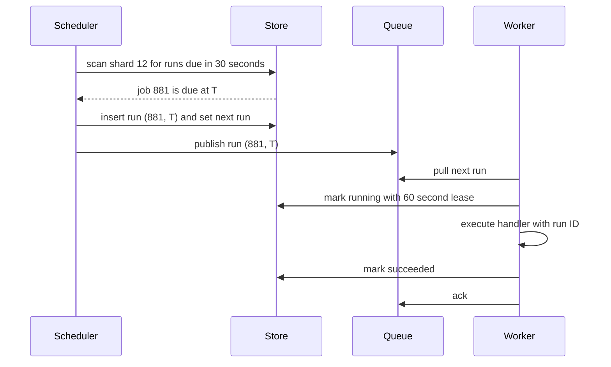

# Design a distributed job scheduler (like Cron)

> Run jobs at scheduled times or intervals across a fleet, reliably and exactly as intended.

This question is graded on two things. How do you find due jobs without scanning every job? And how do you make sure a job runs neither zero times nor twice when machines fail?

## 1. Requirements

**Functional**
- Create one-time jobs (run at a given time) and recurring jobs (a cron expression plus a time zone).
- Run each job on a worker fleet, with a timeout and retries with backoff.
- Pause, resume, and cancel jobs.
- Show the status of each run.

**Non-functional**
- No missed runs: every due run starts, even when a scheduler or worker dies.
- Few duplicates, and duplicates must be safe.
- Start within a few seconds of the scheduled time.
- Scale to hundreds of millions of jobs and survive the loss of any machine.

Agree out loud on the delivery promise before designing. Exactly-once execution is not achievable when a worker can die after doing the work but before reporting success. So the system promises at-least-once execution, and each job must be idempotent, which means running it twice has the same effect as running it once.

## 2. Estimation

Assumptions (stated, not measured):
- 100 million active jobs, averaging 10 runs per day.
- Each run lasts 30 seconds on average.
- Peak load at the top of the hour is 10 times the average, because many cron expressions use minute zero.
- 1 KB per job definition, 200 bytes per run record, run history kept for 30 days.
- One worker host runs 50 jobs at the same time.

Computed numbers:
- Runs: 100 million times 10 is 1 billion per day. Divided by 86,400 seconds, that is about 11,600 per second on average, and about 116,000 per second at peak.
- Concurrent runs: 11,600 per second times 30 seconds is about 348,000 jobs in progress. At 50 per host, that is about 7,000 worker hosts. This is the average. Sizing for the tenfold peak would need about 70,000.
- Job definitions: 100 million times 1 KB is 100 GB.
- Run history: 1 billion times 200 bytes is 200 GB per day, or 6 TB for 30 days.

See the [estimation cheat sheet](../cheat-sheets/estimation.md) for the reference values.

The numbers rule out scanning 100 million rows every second. They force a time-ordered index that finds the jobs due in the next minute with a range scan. The tenfold peak at minute zero forces a queue between scheduler and workers, so a burst waits in line instead of overloading the fleet.

## 3. API

- `POST /jobs` with `{ name, schedule | runAt, timezone, handler, payload, timeoutSec, retryPolicy }` returns `{ jobId, nextRunAt }`.
- `GET /jobs/{jobId}` returns the definition and `nextRunAt`.
- `PATCH /jobs/{jobId}` with `{ status: "paused" | "active" }` returns `200`.
- `DELETE /jobs/{jobId}` returns `204`.
- `GET /jobs/{jobId}/runs?limit=` returns `{ runs[] }` with state, attempt, and timestamps.

## 4. Data model

```
jobs:      job_id (PK) | owner | schedule | timezone | handler | payload
           | timeout_sec | retry_policy | status
due_index: (shard_id, next_run_at, job_id) (PK)
runs:      (job_id, scheduled_at) (PK) | run_id | attempt | state
           | worker_id | lease_expires_at | started_at | finished_at | error
```

The hot access pattern is "all jobs in shard S with `next_run_at` before now plus 30 seconds," which is a sorted range scan. That is why `due_index` is a separate table sorted by time within each shard. The `runs` key `(job_id, scheduled_at)` is unique, so inserting a run row twice fails, and that unique key is what stops duplicate dispatch. See [database indexing](../patterns/database-indexing.md).

## 5. Finding due jobs and dispatching them once

The scheduler must answer "what is due now" cheaply and at high volume.

| Approach | How | Trade-off |
|----------|-----|-----------|
| Poll a time index | Each scheduler range-scans its shards every second | Simple and durable, but one query per shard per second |
| Time-bucketed partitions | Jobs grouped into one-minute buckets, read one bucket at a time | Cheap reads, but rescheduling moves rows between buckets |
| In-memory timing wheel | Load the next few minutes of jobs into memory, fire from a timer | Precise and cheap, but must reload from the store after a crash |

A common design polls the index for the next minute, then fires from memory at the exact second.

**Each shard has exactly one owner.** The job space is split into shards, and each scheduler node holds a lease on a set of shards. A lease is a lock with an expiry that the holder must renew, granted by a coordination service like ZooKeeper. See [leader election](../patterns/leader-election.md).

**Dispatch is one transaction plus a queue.** For each due job, the owner inserts the run row and moves `next_run_at` forward in one transaction. A relay then publishes new run rows to the [message queue](../patterns/message-queues.md). This is the [outbox pattern](../patterns/outbox-pattern.md): the database write and the queue publish cannot get out of sync, because the publish is driven from the committed row.

**Workers hold a lease on each run.** A worker marks the run as running with `lease_expires_at` and renews it with [heartbeats](../patterns/heartbeats.md). If the lease expires, the run is put back on the queue for another worker.

## 6. High-level design



Jobs, the due index, and runs live in one database, so the run insert and the `next_run_at` update share one transaction. Each scheduler node scans only the shards it owns, so adding nodes adds scan capacity. Workers are stateless and pull from the queue.

The hot path for one run:



The run ID `(881, T)`, the job ID plus its scheduled time, goes to the handler as an idempotency key, so a duplicate run can detect that the work is already done.

## 7. Bottlenecks and trade-offs

- Due-job lookup: a time-ordered index split into shards. See [sharding and partitioning](../patterns/sharding-partitioning.md).
- Shard ownership: leases from a coordination service. See [distributed locking](../patterns/distributed-locking.md) and the [ZooKeeper deep dive](../deep-dives/zookeeper-coordination.md).
- Duplicate runs: unique run keys and idempotent handlers. See [idempotency](../patterns/idempotency.md).
- Peak bursts: the queue buffers work, and workers apply [backpressure](../patterns/backpressure.md) by pulling only when they have capacity.

The most common follow-up is exactly-once execution. A lock alone cannot provide it, because a worker can pause, lose its lease, then resume and finish the job. The fix is a fencing token, which is a number that increases each time the lease changes hands. The downstream system rejects writes that carry an older token. Combined with idempotent handlers, this gives the effect of exactly-once without the guarantee.

## The deep dives to expect

**How do you handle the spike at the top of the hour?** Load jobs due in the next minute into memory ahead of time, and let the queue absorb the burst. For jobs that do not need an exact second, add jitter, a small random delay, to spread them across the minute.

**What happens when a scheduler node dies?** Its shard leases expire after a few seconds, and other nodes claim the shards. The new owner scans from the oldest unfinished `next_run_at`, so nothing is skipped, and the unique run key catches any repeat dispatch.

**How do you tell a dead worker from a slow one?** You cannot tell them apart from outside. The lease decides: if it expires, the run is retried elsewhere, and the fencing token stops the old worker's late writes.

**How do you handle time zones and daylight saving time?** Store the cron expression with a named time zone. Compute the next run in that zone, then convert it to UTC for the index. When a local time is skipped or repeated, run the job once.

**What happens to runs missed during an outage?** Make it a per-job catch-up policy: run every missed run, run only the latest, or skip them all. A billing job needs every run, while a cache refresh needs only the latest.

## Related pages

- A close relative that fires notifications at a time: [design a reminder and alert system](design-reminder-alert-system.md).
- The queue between scheduler and workers: [design a distributed message queue](design-distributed-message-queue.md).

## Go deeper

- Quick, focused prep: [System Design Interview Crash Course](https://www.designgurus.io/course/system-design-interview-crash-course?utm_source=github&utm_medium=repo&utm_campaign=grokking-system-design&utm_content=questions-design-distributed-job-scheduler)
- Full course: [Grokking the System Design Interview](https://www.designgurus.io/course/grokking-the-system-design-interview?utm_source=github&utm_medium=repo&utm_campaign=grokking-system-design&utm_content=questions-design-distributed-job-scheduler)
