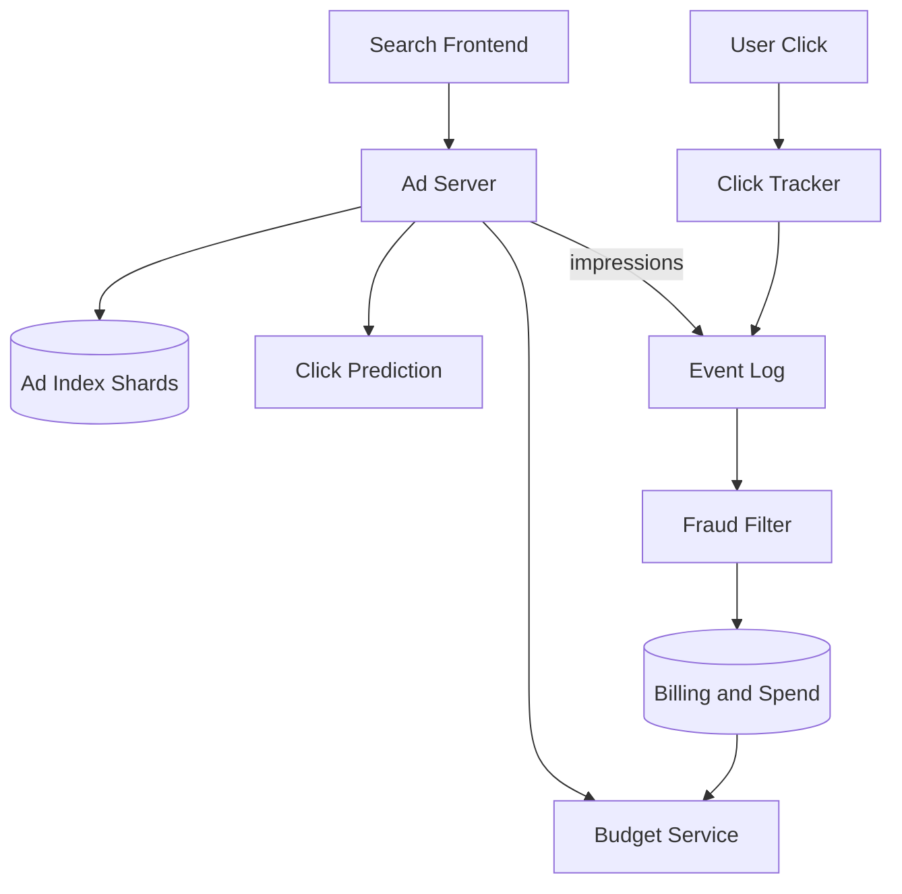
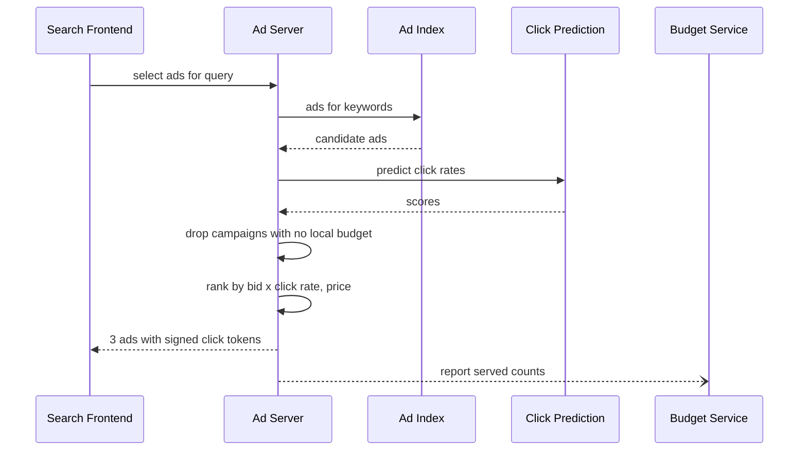

# Design Google Ads

> An ad platform that selects and serves ads, tracks clicks, and bills advertisers accurately.

This question joins two systems with opposite needs. Choosing an ad must finish in tens of milliseconds and can be approximate. Charging for a click must be exact, because it is money. The interviewer grades whether you keep those two paths apart and how you stop a campaign from spending past its budget.

## 1. Requirements

**Functional**
- Advertisers create campaigns with keywords, bids, ads, and a daily budget.
- For each search, select the best ads and show them on the results page.
- Record impressions (an ad being shown) and clicks.
- Charge advertisers per click and stop serving a campaign when its budget runs out.
- Filter invalid clicks, like bots and repeated clicks, before billing.

**Non-functional**
- Ad selection adds only tens of milliseconds to the search page.
- Billing is exact: no click is charged twice and no valid click is lost.
- High availability: if the ad system fails, the search page still loads, just without ads.
- Reporting for advertisers can lag by minutes.

Agree out loud that serving and billing have different correctness rules. Serving can use slightly stale budgets and models. Billing cannot. That split allows a fast path that reads mostly from caches, separate from a slower, exact pipeline.

## 2. Estimation

Assumptions (all labeled as such):
- 10 billion searches per day show ads, with 3 ads per page.
- A click-through rate (the share of impressions that get clicked) of 2 percent.
- 500 million active ads, each about 2 KB with its targeting data.
- Each impression or click event is about 200 bytes.

Computed numbers:
- Ad requests: 10 billion / 86,400 seconds is about 116,000 per second. Assume peak is 2 times average, so about 232,000 per second.
- Impressions: 10 billion x 3 is 30 billion per day, or about 347,000 per second.
- Clicks: 2 percent of 30 billion is 600 million per day, or about 6,900 per second.
- Ad index: 500 million x 2 KB is 1 TB.
- Event storage: 30 billion x 200 bytes is 6 TB per day for impressions. Clicks add 600 million x 200 bytes, or 120 GB per day.

See the [estimation cheat sheet](../cheat-sheets/estimation.md) for the reference numbers.

The numbers rule out a database call per candidate ad at 232,000 requests per second. The ad index must be sharded and held in memory. Clicks are about 50 times fewer than impressions, so the exact billing path handles thousands of events per second, not hundreds of thousands. So billing can afford stronger guarantees.

## 3. API

- `POST /campaigns` with `{ keywords, bids, dailyBudget, ads }` returns `{ campaignId }`.
- Internal: `POST /ads/select` with `{ query, userContext, slots: 3 }` returns `{ ads: [{ adId, creative, clickUrl }] }`.
- `GET /click?token={signedToken}` records the click and returns a 302 redirect to the landing page.
- `GET /reports?campaignId={id}&from={t1}&to={t2}` returns impressions, clicks, and spend.

## 4. Data model

```
campaign:      campaign_id (PK) | advertiser_id | daily_budget | status
ad:            ad_id (PK) | campaign_id | creative | landing_url | max_bid
keyword_index: keyword -> [ ad_id ... ]
spend:         campaign_id | date | spent_micros
click:         click_id (PK) | impression_id | ad_id | cost_micros | ts | is_valid
```

Two access patterns drive two stores. Serving reads "all ads for these keywords," a key lookup that belongs in a sharded in-memory index rebuilt from the campaign database. Billing writes click records and updates spend, which needs a durable store with exact counts. Keep money as integers in micros (millionths of a currency unit) so rounding never changes a bill.

## 5. Running the auction and pacing budgets

Selection runs in three steps. First, retrieve candidates from the keyword index. Second, predict each candidate's click-through rate with a model. Third, rank candidates by expected value per impression, which is bid times predicted click rate. Google has published that ad position depends on both the bid and ad quality, which this formula reflects.

A common pricing rule is second price: the winner pays just enough to beat the next ad's rank. With one slot, this removes the reason to bid below true value. With several slots it only reduces that reason.

The harder part is the budget. Clicks arrive seconds or minutes after the ad is served, so a campaign can be shown many times after its last dollar is committed.

| Approach | How | Trade-off |
|----------|-----|-----------|
| Central counter per click | Every serve checks one strongly consistent counter | Exact, but a large campaign becomes a hot key, one record read on a large share of requests |
| Budget slices per server | A budget service hands each ad server a small slice to spend locally | No remote call per request, but unspent slices sit idle on each server |
| Pacing by rate | Serve a campaign with a probability tuned to spread spend over the day | Smooth delivery, but does not stop a final overspend by itself |

A common design uses pacing plus slices. Pacing spreads spend evenly, and slices cap what any server can commit. Small overspend from late clicks is absorbed as a credit to the advertiser. See [strong vs eventual consistency](../cheat-sheets/strong-vs-eventual-consistency.md).

## 6. High-level design



The ad server never writes to billing. It logs impressions, the click tracker logs clicks, and the fraud filter and billing read that log. Spend flows back to the budget service, which updates the slices it hands out.



The budget check reads a local slice, so no network call blocks the response. If the ad server misses its deadline, the frontend shows the page without ads. Each click URL carries a signed token holding the impression id and price, so the tracker can verify the click without a lookup.

## 7. Bottlenecks and trade-offs

- Index size and read load: shard the ad index by keyword and replicate it. See [sharding and partitioning](../patterns/sharding-partitioning.md) and [replication](../patterns/replication.md).
- Duplicate clicks: the click id makes billing writes idempotent (safe to repeat with one effect). See [idempotency](../patterns/idempotency.md).
- Event volume: buffer impressions and clicks in a log before processing. See [message queues](../patterns/message-queues.md) and [Kafka](../deep-dives/kafka-distributed-messaging.md).
- Repeated model inputs: cache ad features and campaign status in each ad server. See [caching](../patterns/caching.md).

The most common follow-up is exactness against latency for budgets. A strongly consistent check on every request guarantees no overspend but adds a network call and a hot key for each large campaign. Local slices remove both and allow a small, bounded overspend. A common choice is the bounded overspend with a refund, because a slower page costs more than a small credit.

## The deep dives to expect

**How do you detect click fraud?** Run rules in the stream, like many clicks from one IP or device in a short window. Then run slower models in batch that look at patterns across days. Mark clicks invalid before final billing, and refund any already charged.

**How does an advertiser's change reach the ad servers?** Campaign edits go to the campaign database and are published as change events. Ad index shards apply them within seconds to minutes. Pausing a campaign uses the same path with a higher priority.

**What happens if the click tracker is down?** The user should still reach the landing page. The tracker can redirect first and write the event to a local buffer, sending it to the log when it recovers. Lost clicks are lost revenue, so the buffer must be durable.

**How do you produce advertiser reports?** Aggregate events by campaign and hour in a stream processor. This is the [ad click aggregator](design-ad-click-aggregator.md) question. Reports read the aggregates, never raw events.

**How do you handle a very hot keyword?** Its ad list is read on many requests. Replicate that shard more, and cache its candidate list in each ad server for a few seconds.

## Related pages

- Counting clicks and impressions at scale: [design an ad click aggregator](design-ad-click-aggregator.md).
- Exact money movement: [design a payment system](design-payment-system.md).
- The page the ads appear on: [design Google Search](design-google-search.md).

## Go deeper

- Quick, focused prep: [System Design Interview Crash Course](https://www.designgurus.io/course/system-design-interview-crash-course?utm_source=github&utm_medium=repo&utm_campaign=grokking-system-design&utm_content=questions-design-google-ads)
- Full course: [Grokking the System Design Interview](https://www.designgurus.io/course/grokking-the-system-design-interview?utm_source=github&utm_medium=repo&utm_campaign=grokking-system-design&utm_content=questions-design-google-ads)
