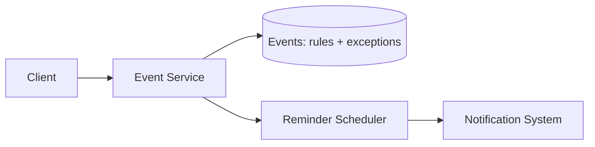

# Design Google Calendar

> A calendar service with events, recurring events, invitations, reminders, and availability.

## 1. Requirements

**Functional**
- Create, update, and delete events.
- Recurring events (daily, weekly, custom rules).
- Invite people and track responses.
- Reminders and notifications.

**Non-functional**
- Strong consistency for a user's own schedule.
- Correct timezone handling.
- Reliable, timely reminders.

## 2. Key challenges

- Recurrence: do not store every occurrence. Store the recurrence rule (for example "every Monday") plus exceptions, and expand occurrences on read for the requested date range.
- Timezones: store times in UTC plus the event's timezone, and convert on display. Daylight saving transitions are the tricky part.
- Reminders: a scheduling component fires reminders at the right time (see the [reminder system](design-reminder-alert-system.md)).

## 3. Deep dive

- Data model: events, recurrence rules, exceptions, and attendee responses.
- Invitations: an event references attendees; each attendee has a status (accepted, declined, tentative).
- Free or busy: compute availability by expanding events in a time range.

## 4. Trade-offs

- Store-rule-and-expand (cheap storage, compute on read) vs materialize-occurrences (cheap read, expensive storage). Expansion on read is the common choice.

## High-level design

## Go deeper

- Full worked solution: the chapter [Design Google Calendar](https://www.designgurus.io/course-play/grokking-system-design-interview-ii/doc/design-google-calendar?utm_source=github&utm_medium=repo&utm_campaign=grokking-system-design&utm_content=questions-design-google-calendar) in [Advanced System Design Interview, Volume II](https://www.designgurus.io/course/grokking-system-design-interview-ii?utm_source=github&utm_medium=repo&utm_campaign=grokking-system-design&utm_content=questions-design-google-calendar), an 8-step walkthrough.
- The API contract: the lesson [Interview Question: Design a Calendar API](https://www.designgurus.io/course-play/grokking-modern-api-design-interview/doc/interview-question-design-a-calendar-api?utm_source=github&utm_medium=repo&utm_campaign=grokking-system-design&utm_content=questions-design-google-calendar) in [Grokking Modern API Design Interview](https://www.designgurus.io/course/grokking-modern-api-design-interview?utm_source=github&utm_medium=repo&utm_campaign=grokking-system-design&utm_content=questions-design-google-calendar).
- The frontend design: the lesson [Design a Calendar App](https://www.designgurus.io/course-play/grokking-the-modern-frontend-system-design-interview/doc/design-a-calendar-app?utm_source=github&utm_medium=repo&utm_campaign=grokking-system-design&utm_content=questions-design-google-calendar) in [Grokking the Modern Frontend System Design Interview](https://www.designgurus.io/course/grokking-the-modern-frontend-system-design-interview?utm_source=github&utm_medium=repo&utm_campaign=grokking-system-design&utm_content=questions-design-google-calendar).
- Full course: [Grokking the System Design Interview](https://www.designgurus.io/course/grokking-the-system-design-interview?utm_source=github&utm_medium=repo&utm_campaign=grokking-system-design&utm_content=questions-design-google-calendar)
